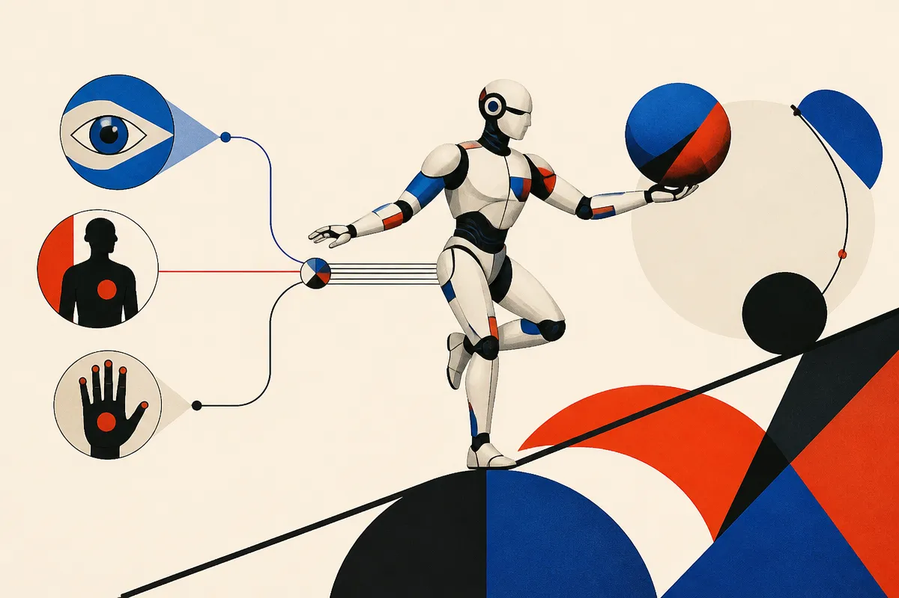

TL;DR: Humanoid robots will not get very far by copying hand paths alone, because useful manipulation depends on sensing, predicting, and controlling contact force through the whole body.

## What problem is FLORE trying to solve?

The primary source here is **"Learning Force-Reactive Humanoid Loco-Manipulation"**, posted on arXiv cs.AI and cs.LG, with project details at https://louis-leee.github.io/FLoRe/.

The paper goes after a simple but nasty robotics problem: many everyday tasks are not just about where the hand goes. They are about how hard the hand pushes, pulls, resists, or yields.

That sounds obvious if you have ever opened a sticky drawer, scrubbed a pan, held a heavy box against your chest, or leaned into a door while turning the handle. Motion is only half the behavior. Contact force is the other half.

On a humanoid, that gets harder. A robot hand pushing into the world is not isolated from the rest of the body. Force at the hand changes balance, foot loading, torso posture, and the available range of motion for the other arm. A policy that only imitates trajectories can look correct until it touches something. Then the world pushes back.

That is the useful frame for FLORE. Not "humanoids are solved." Not "diffusion policies magically do chores." The narrower claim is better: if the task is contact-rich, the learning system needs force as an input and force as an output.

## What did "Learning Force-Reactive Humanoid Loco-Manipulation" add?

The FLORE setup collects robot-free demonstrations with two force-sensing UMI-style handheld grippers. Those grippers capture hand motion and contact wrenches. Wearable trackers capture body motion.

Then a force-reactive diffusion policy consumes vision, proprioception, and measured wrenches. It predicts both robot actions and per-hand force commands.

That last part matters. The policy is not just watching force as extra context. It is asked to command force.

Execution is handled by a hybrid compliance whole-body controller with force tracking. According to the paper, real force/torque sensors measure force error, and an integral of that error helps each hand track force along the commanded direction while staying compliant along the other directions. Translation: push where you mean to push, give where you should not fight, and keep the humanoid upright.

This is the part I find most interesting. FLORE separates the learned policy from the physical controller in a way that feels operator-friendly. The model decides intent and force targets. The controller handles balance, compliance, and force tracking. That is less glamorous than an end-to-end robot brain, but probably more shippable.

## Should we trust the 80% success result?

The FLORE team reports 80% success across three contact-rich robot tasks, compared with 26.7% for a position-only policy trained on the same demonstrations and executed by the same controller.

That is a big gap. It is also the right comparison. Same demos. Same controller. The difference is force-aware policy versus position-only policy.

Still, I would not overread it. From the supplied paper summary, we do not know the task details, rollout count, environment variation, failure modes, or how far this transfers outside the demonstrated setup. Three tasks is useful evidence, not a general humanoid benchmark.

The result is strongest as a design signal. If you are building for physical work, do not treat force as an afterthought. A camera-plus-joints imitation stack may be enough for free-space motions. It is weak for tasks where the object pushes back.

For builders, the takeaway is to instrument contact early. If your robot or simulator can measure force, make it part of the policy interface, not just a debug plot. Try a split architecture: learned policy for perception-conditioned action and force intent, compliance controller for safe execution. The catch most teams miss is demonstration data. Pretty teleop trajectories are not enough. For contact-heavy work, you need to record what the human was feeling and applying, not just where the human hand went.
