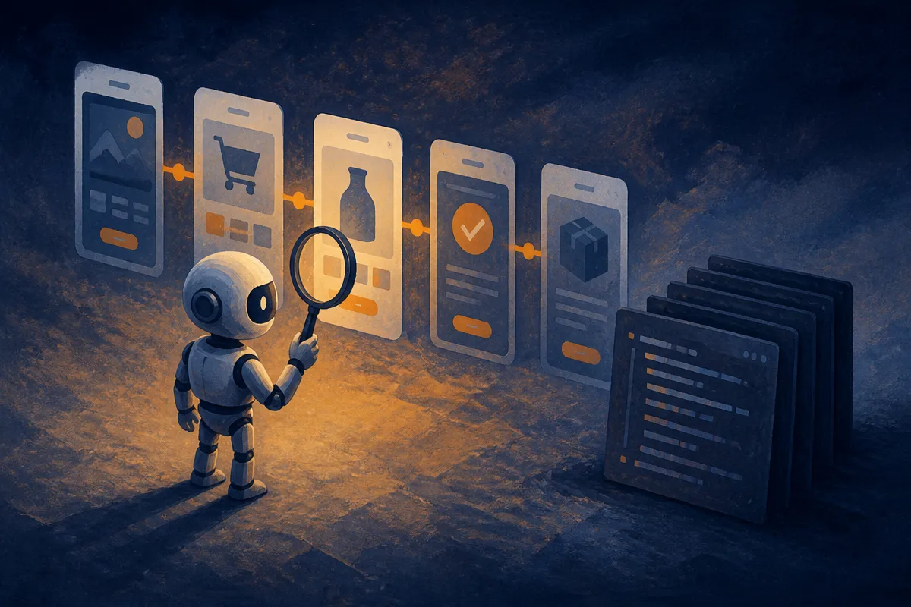

TL;DR: Greptile’s GPT-6 Astra story is useful because it moves AI bug detection from “does this code look wrong?” toward “does this product workflow actually break?”

## What changed from AI code review?

OpenAI’s primary announcement, “Greptile takes bug detection beyond code review with GPT-6 Astra,” says Greptile uses GPT-6 Astra to test user workflows, Daybreak to strengthen security, and Codex to reduce rework.

That is the important bit. Not the model name. Not the implied future shine. The shift is from static-ish review to behavior testing.

Most AI code review tools start where developers already spend time: pull requests, changed files, known patterns, maybe repo context. That is useful. It catches missing null checks, risky refactors, inconsistent API usage, weak tests, and obvious security mistakes. But a lot of real bugs are not cleanly visible in a diff. They live across steps.

A signup flow fails only after email verification. A billing update works for new customers but breaks migrated accounts. A permissions change looks safe in code review but exposes the wrong control in the UI. A support dashboard loads fine until the agent filters by region and exports a CSV.

Those are workflow bugs. They are product bugs, not just code bugs.

That makes Greptile’s positioning more interesting than another “AI reviews your PR” announcement. If GPT-6 Astra is being used to test user workflows, the agent is being aimed at the path a user takes through the system. That is closer to QA, product analytics, and security testing than classic code review.

## Where does Daybreak and Codex fit?

OpenAI says Greptile uses Daybreak to strengthen security and Codex to reduce rework. The provided announcement does not give enough detail to evaluate how those pieces work under the hood, so I would not treat this as a benchmark claim.

Still, the stack shape makes sense.

Security is often workflow-shaped too. Prompt injection, broken access control, data leakage, privilege escalation, and unsafe automation do not always show up as one bad line of code. They show up when an attacker moves through a system in a way the happy-path test never covered.

If Daybreak is helping Greptile harden that layer, the right mental model is not “AI linter with a security mode.” It is closer to an adversarial tester that looks at what the product allows, not only what the code says.

Codex reducing rework is the other half of the loop. Finding bugs is only valuable if the fix lands cleanly. Teams do not need an agent that files 80 vague tickets. They need one that produces a tight reproduction path, points to likely causes, suggests a fix, updates tests, and stays out of the way when confidence is low.

That last part matters. The fastest way to make developers ignore an AI reviewer is to flood them with plausible noise. Agentic QA needs precision, not theater.

## What should builders copy from this?

The practical lesson is to evaluate AI coding tools at the workflow boundary.

Do not ask only, “Can it review my code?” Ask, “Can it run the five flows that make us money or create risk?” New account creation. Checkout. Password reset. Admin invite. Data export. Subscription cancel. Whatever your product depends on.

Then measure boring things. How many real defects did it catch before staging? How many false positives did it create? Did it produce a reproducible failure? Did the suggested fix reduce rework or add more review time? Did it catch security issues that existing scanners missed?

I would also keep humans in the loop on anything that changes code, permissions, payments, or customer-visible behavior. The announcement is promising, but the provided material does not show independent evals, failure rates, or customer-scale numbers. Treat it as a direction, not proof.

My practical read: start by giving an agent three production-like workflows and the tests you already trust, then ask it to break them, explain the break, and propose the smallest fix. The catch most teams miss is setup quality. If the agent cannot access realistic state, permissions, fixtures, and product intent, it will look smart in demos and weak in the messy parts where bugs actually live.
