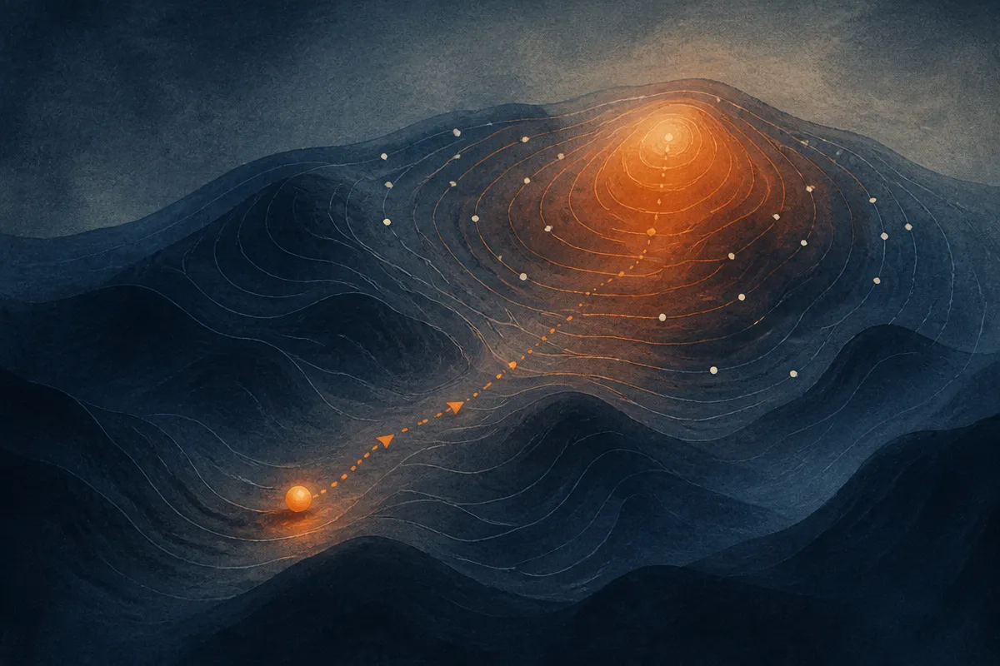

TL;DR: A new paper shows the evolution strategies update is exactly a displacement toward the reward-weighted center of mass of a model's own sampled population, which is a cleaner mental model than "smoothed gradient estimate" and makes the role of mean subtraction obvious.

The paper is "Center-of-Mass Interpretation of Evolution Strategies," posted to arXiv under both cs.AI and cs.CL. It does not claim a new algorithm or a benchmark win. It reinterprets math you may already use. That sounds modest, and in a way it is. But the reframe is the kind of thing that changes how you debug and tune a method, which is worth more than most incremental tricks.

Let me walk through what it actually says, and then why an operator running population-based training should care.

## What does evolution strategies actually do?

Evolution strategies (ES) is a way to improve a model without backpropagation. You take your current model, make a bunch of perturbed copies by adding random noise to the weights, score each copy on whatever reward you care about, and then step in the direction that favored the higher-scoring perturbations. No gradients through the network. Just sample, score, move.

The standard story told about this update is that it approximates a gradient: specifically, the gradient of a Gaussian-smoothed version of your reward function. That framing is correct and it connects ES to the broader gradient-descent world everyone already understands. It is also, as the paper argues, not the most intuitive way to see what is happening.

## What is the center-of-mass reading?

Here is the reframe. Treat every perturbed copy of the model as a physical particle sitting in weight space. Before you score anything, every particle has the same mass, so the whole cloud balances at its centroid, the plain average of all the perturbations. That centroid, under symmetric noise, sits essentially on top of your current model.

Now assign rewards. The paper's move is to read each particle's reward as its mass. Higher reward, heavier particle. Once you do that, the cloud no longer balances at the plain centroid. It balances at the reward-weighted center of mass, pulled toward the region of weight space where the good perturbations live.

The claim is that the mean-subtracted ES update is exactly that displacement, from the old balance point to the new reward-weighted one, scaled by a scalar that depends on the mean reward. Not approximately. Exactly, for any finite population. That "exact for any finite population" is the part I find genuinely useful, because the smoothed-gradient story is an approximation that only gets tight as the population grows. The geometric story holds at any size.

One technical caveat the authors are upfront about: the physical picture needs nonnegative rewards, since negative mass has no physical meaning. They point out you can always add a constant to every reward to make them nonnegative, and that shift does not change the update at all. So the constraint is cosmetic, not real.

In the large-population limit, or when you use antithetic sampling (pairing each perturbation with its mirror image, a common variance-reduction trick), the centroid lands exactly on the model itself. Then the picture collapses to something you can say in one sentence: from where it is now, the model moves toward the reward-weighted center of mass of its own population.

## Why does subtracting the mean reward matter?

Mean subtraction, or baseline subtraction, is one of those steps that lives in ES and policy-gradient code without most people having a crisp picture of why it is there. You subtract the average reward across the population before weighting the perturbations. Everyone knows it reduces variance. Fewer people can tell you what it does geometrically.

The paper's answer is clean: subtracting the mean reward changes the point you measure the displacement *from*. Without it, you measure the move from the model's current location. With it, you measure from the sampled centroid, the actual average of this particular batch of perturbations. Since the sampled centroid drifts off the model slightly due to finite sampling noise, this changes the reference frame and, in doing so, cancels a chunk of noise.

That is a satisfying explanation. It takes a variance-reduction heuristic and gives it a concrete meaning: it is not changing where you are going, it is changing where you are measuring from. For anyone who has stared at an ES or GRPO-style baseline term wondering what it geometrically buys them, this is the clearest answer I have seen.

## Does a reinterpretation like this actually help a builder?

Reasonable skepticism: this is a visualization paper, not a performance paper. There is no new state of the art here, no claim that the center-of-mass view lets you train faster or cheaper. If you are scanning arXiv for the next point of eval lift, this is not it, and the authors do not pretend otherwise. Their stated contribution is an intuitive, geometric way to visualize the ES update, exact for any finite population. That is the whole pitch.

I think that undersells its value slightly. ES has been having a moment as an alternative to gradient-based post-training, partly because it sidesteps backprop and parallelizes cleanly across cheap workers. More people are reaching for population-based methods who did not grow up on them. When a method gets adopted faster than its intuitions spread, you get cargo-cult tuning: people copy hyperparameters and baselines without a model of what they do. A correct, exact geometric picture is exactly the antidote to that.

The honest limit: a mental model is not a recipe. Knowing the update is a center-of-mass displacement does not by itself tell you your noise scale, your population size, or your learning rate. It tells you what those knobs are doing to the geometry, which is a precondition for tuning them well, not a replacement for the tuning.

Practitioner's take: if you run or are evaluating population-based training, read this paper before your next tuning cycle, because it will change how you reason about two specific knobs. First, antithetic sampling is not just a variance trick, it is what puts your measurement origin exactly on the model, so if you are using it, the simple one-sentence picture applies and your intuitions can be sharper. Second, when you debug a baseline or mean-subtraction term, stop thinking "variance reduction, magic" and start thinking "this moves my reference point from the model to the sampled centroid." The catch most readers will miss: this is an interpretation, not an optimization, so do not expect numbers to move just from reading it. What moves is your ability to predict which direction they *should* move when you turn a knob, and that is the quiet skill that separates people who tune ES by feel from people who tune it on purpose.
