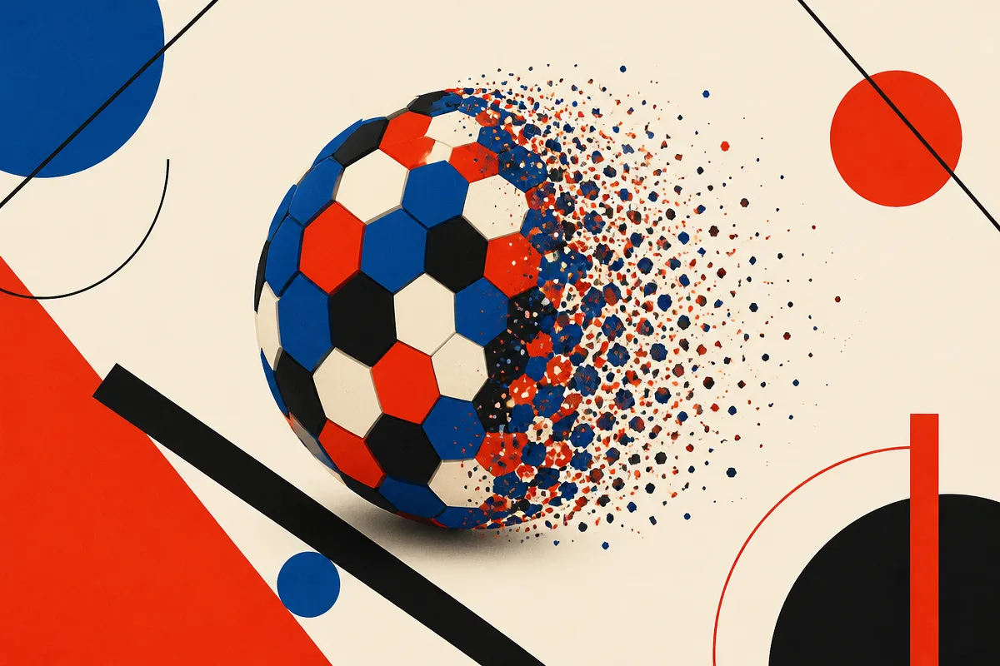

TL;DR: Hexels are a compact 3D scene primitive that may make high-quality reconstruction and rendering cheaper by using fewer, larger surface-aligned patches instead of many small splats.

## What problem are Hexels trying to solve?

The primary source here is the arXiv paper "Honeycomb-Surfels: Compact Hexagonal Primitives for Efficient Scene Rendering and Reconstruction," listed in arXiv cs.AI and cs.LG. It takes aim at a very practical bottleneck in 3D AI: radiance fields and splatting can look great, but they eat memory and compute.

That matters if you care about robots, spatial apps, game tooling, simulation, reconstruction from scans, or anything that needs 3D scenes on hardware that is not a giant GPU box. A model that only works when memory is abundant is not really a general production tool. It is a demo until proven otherwise.

The paper introduces Hexels, planar hexagonal surface elements with a first-order spatial color field. Plain English: instead of representing a scene with lots of tiny primitives, Hexels try to cover locally flat, smoothly varying regions with fewer and larger pieces. The hexagon shape is doing real work here. It gives an efficient area and boundary shape, while the local color field lets each patch capture some appearance variation inside the primitive.

That is the core bet: use geometry that better matches the surface, then spend fewer primitives to get similar or better visual quality.

## Are the reported gains meaningful?

The numbers in "Honeycomb-Surfels" are not small. Across 34 scenes, the paper reports that Hexels improve PSNR over memory-matched 2DGS by 4.53 to 7.38 dB across datasets, while requiring lower training VRAM. That is the part I care about most. Memory-matched comparisons are more useful than leaderboard wins that quietly spend more resources.

The paper also reports that, per primitive, Hexels outperform 2DGS by up to 4.74 dB, use lower training VRAM, and run at 2.31 times faster FPS. For surface reconstruction, Hexels reduce error by 28.9% compared with memory-matched 2DGS across 15 DTU scans. On 6 Tanks and Temples surface scenes, the reported mean F1 is 34.38% for Hexels versus 31.72% for 2DGS.

Those are paper results, not production guarantees. I would not read this as “Hexels replace Gaussian splatting.” The better read is narrower and more useful: surface-aligned primitives still have room for design improvement, and shape choice is not a cosmetic detail.

There is also a good constraint hiding in the method. Hexels exploit locally planar regions with smooth appearance changes. Many real scenes have plenty of those: walls, tables, floors, product surfaces, scanned objects. But not all scenes are friendly. Fine geometry, foliage, hair, transparency, specular surfaces, and high-frequency texture can punish bigger primitives. The paper says Hexels provide complementary quality-memory trade-offs even in unconstrained settings, but that still leaves the operator question: which scene types actually benefit in your pipeline?

## Why this matters beyond one rendering paper

A lot of AI progress is framed as bigger models, bigger context, more tokens, more compute. This paper is from the other side of the house: better representation. If you choose a better primitive, you may need less of everything downstream.

That is a recurring pattern worth watching. In language models, tokenization and retrieval structure matter. In video, latent compression matters. In robotics and 3D, scene representation matters. The primitive is part of the product architecture, not an implementation footnote.

For builders, the interesting path is not to wait for Hexels to become a packaged tool. It is to test the assumption behind them. If your reconstruction workflow is memory-bound, compare methods under the same VRAM budget, not just the same dataset. Track quality, training memory, FPS, and reconstruction error together. If you are building for edge devices, AR capture, robotics simulation, or scanning workflows, a representation that wins under memory pressure is more relevant than one that wins with unlimited resources.

Practitioner's Take: I would try Hexels first on scenes with broad planar surfaces and smooth color changes, then stress-test them on messy real-world scans with thin structures and shiny materials. The catch most readers miss is that “better 3D” is not one metric. A primitive can improve rendering quality, reduce memory, and still fail your weird production case. Test the representation against your hardware budget and your scene mix, not the prettiest demo.
