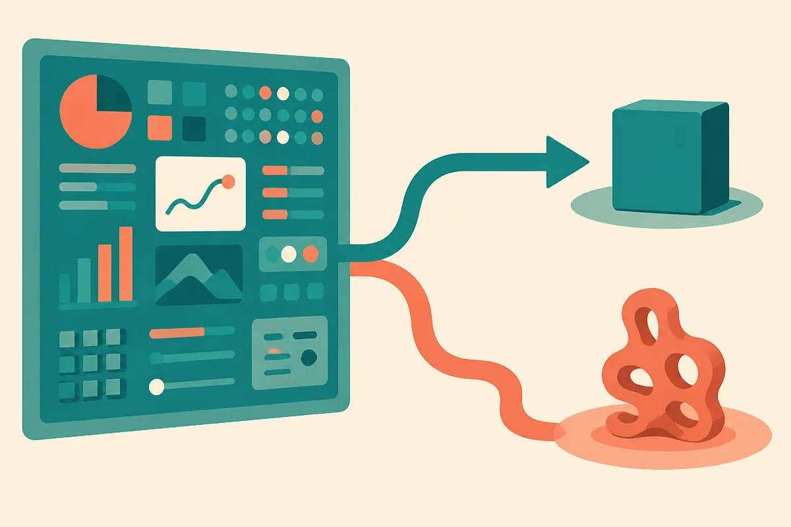

TL;DR: A benchmark called LongChang drops LLMs into simulated worlds where physics is quietly wrong and asks them to discover the altered law through free exploration, and eleven of twelve models scored a flat zero while one managed 16.7%, which tells you open-ended scientific curiosity is still mostly absent from these systems.

The paper is "Can LLMs Uncover Hidden Physical Laws through Free Exploration?", posted to arXiv under both cs.AI and cs.CL. It is worth reading carefully because it tests something most agent benchmarks skip: not whether a model can solve a stated problem, but whether it can notice there is a problem at all.

## What is LongChang actually testing?

Most evals hand the model a task. Solve this bug. Answer this question. Book this flight. LongChang does the opposite. It builds a simulated world where one or more physical laws differ from the real ones, say heavier objects fall more slowly, and then it drops an LLM in as an explorer with no task and no hint. The model can manipulate objects, build tools, run its own little experiments. The whole point is to see whether it will notice the anomaly and chase it down to the underlying law.

That is a much harder ask than it sounds. There is no prompt saying "find the broken law." The model has to generate its own research question from an unexpected observation, which the authors frame as the real starting point of scientific discovery.

The framework is fully automated. Separate LLM agents generate and review the scenes, review the explorer's tool designs, and evaluate the final reports for correctness and whether the experiments actually support the conclusions. The exploration records then feed back to evolve the next scene. No human in the loop. That matters because it means the benchmark can keep running and generating fresh altered-physics worlds without someone hand-authoring each one, which is usually where these ambitious evals die.

## Why did eleven of twelve models score zero?

Here is the number that makes the paper worth your attention. Across 12 LLMs tested, GPT-6-Astra reached a discovery rate of 16.7%. The other eleven scored 0%.

Zero is not "struggled." Zero is "did not do the thing at all." These are not weak models. The fact that eleven capable systems failed to complete the loop, notice an anomaly, form a question, design an experiment, and correctly name the altered law, tells you this is a capability gap, not a tuning problem.

And the one model that did clear the bar barely cleared it. 16.7% means it succeeded roughly one time in six. The authors also note that the exploration records are full of uninvestigated anomalies and only partial identification of the altered laws. So even the "success" looks more like occasional partial insight than reliable discovery. The models were walking past broken physics without stopping to ask why.

I want to flag one thing honestly. "GPT-6-Astra" is not a model name I can match to a shipped product, and the sources here are the two arXiv listings with identical abstracts and nothing more. So treat the specific model roster and the exact 16.7% as reported in the abstract, not independently confirmed. The shape of the result, one model slightly above zero and the rest flat, is the part I would stake a claim on.

## Why does noticing matter more than solving?

There is a real distinction buried in this result that applies to anyone building agents.

A model that solves assigned tasks is a good executor. A model that notices something is off, even when nobody told it to look, is doing something closer to science. The second behavior is what you want when you point an agent at a messy real system: a log that looks wrong, a metric that drifts, a dataset with a quiet distribution shift. The valuable move is not solving the stated ticket. It is seeing the unstated anomaly and deciding it deserves investigation.

LongChang's design isolates exactly that gap. By removing the task, it strips away the scaffolding that lets models look competent. What is left is the raw question: will you investigate on your own? For almost every model tested, the answer was no.

This lines up with a frustration I hit constantly in practice. Agents are strong when the problem is framed and the goal is explicit. They go limp when the job is "look around and tell me what is wrong here." They will confidently report that everything is fine, because nothing in the prompt told them to doubt it. LongChang gives that failure a number.

## What should builders take from a 0% benchmark?

The temptation with a benchmark this brutal is to dismiss it. Nobody ships agents into altered-physics simulators. But the underlying skill, anomaly detection without instruction, is one you probably already want and are probably not getting.

If you run agents against operational systems, do not assume they will surface problems you did not point them at. Structure the noticing yourself. That means explicit "what looks unexpected here" steps, baselines the agent can compare against, and reviewer passes whose only job is to flag anomalies rather than complete tasks. LongChang's own architecture is a hint here: it uses separate agents for generation, review, and evaluation. Splitting the "notice" role out from the "do" role is a pattern you can borrow directly. One agent works the task, another agent's sole prompt is to ask what is strange about what just happened.

The catch most readers will miss: a 0% score does not mean models cannot reason about physics. Hand any of these systems a stated question about falling objects and they would answer fine. What they lack is the trigger to ask the question unprompted. So if you are building on top of them, you own the trigger. The curiosity has to come from your orchestration, not from the model, because the model will happily explore a world of broken physics and report back that it all seemed normal. Until that changes, treat "notice the problem" as a step you design, not a capability you assume.
