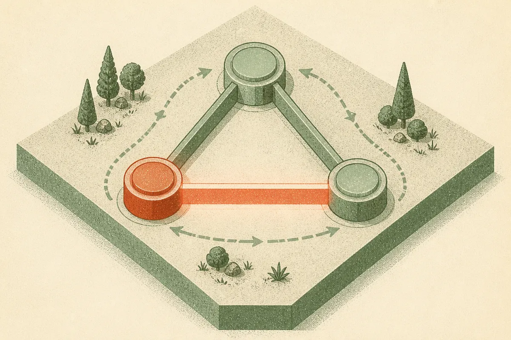

TL;DR: If your AI system reasons over relationships where order matters, triangle-shaped consistency checks may be more reliable than scoring edges one pair at a time.

## What problem is this actually solving?

The primary source here is the arXiv paper “Attention as Lattice Gauge Theory: Relations Interact Only Through Wilson Loops,” posted under cs.AI and cs.LG. The claim is narrow, mathematical, and useful: relations do not just sit between two things. They compose through shared entities.

Alice is Bob’s mother. Bob is Carol’s father. That gives you a composed relation between Alice and Carol. But order matters. A father’s mother is not the same as a mother’s father. Any model that treats those relations as commuting, meaning the order does not matter, is throwing away structure.

The paper frames this through gauge theory. Each entity can have its own coordinate frame. You should be able to rotate those local frames without changing the underlying relational facts. Under that symmetry, the paper argues, relations that do not share a cycle cannot interact in the pure-gauge sector. The invariant thing you can score is a closed loop, specifically a triangle holonomy: \(H = T_\{ij\} T_\{jk\} T_\{ki\}\). In physics language, that is a Wilson loop.

Less physics-y: if you want to check whether a relation is consistent, close the triangle and see what comes back.

## Why does this matter beyond the math?

A lot of AI systems still lean on pairwise scoring. This entity relates to that entity. This edge is likely. This document matches that query. This step follows that step. Pairwise scoring is convenient, but it can miss contradictions that only show up when you compose a path and return to the start.

The paper connects three existing threads. Knowledge graph embeddings with commuting operators are described as the abelian, or order-insensitive, case. AlphaFold’s triangle update and the Edge Transformer have a similar shape, where an edge is updated through a third vertex, but the paper says they do not impose the same gauge constraints. Lattice QCD has the equivariant construction, but on physical lattices rather than general relational graphs.

That crosswalk is the interesting part. This is not “attention, but inspired by physics” as decoration. The paper is saying the symmetry forces the form: edge attention by Wilson loops is not just one design choice among many, it is the unique form allowed under the stated assumptions.

The reported results are also specific. With no training and composition alone, the holonomy attention method infers unobserved \(S_4\) relations on sparse graphs at 0.88, even with one fifth of the edges corrupted. The paper says that is at or slightly below specialist synchronization algorithms. It also reports that every commutative architecture is capped at 0.083 in that setting. For corruption detection, the holonomy score flags corrupted triangles at AUC 0.99, while commuting scores are capped at 0.76 by a second selection rule.

Those are strong numbers, but they are not a blanket claim about LLMs getting smarter. This is a relational graph setup with symmetry assumptions. The useful takeaway is architectural: some failures are not solved by bigger pairwise scorers. They need loop consistency.

## Where would a builder use this?

The obvious use case is knowledge graphs. Family relations, permissions, organization charts, supply chains, identity graphs, provenance chains, and tool traces all have composed relations. Some commute. Many do not.

Agent systems are another fit. If an agent writes to a database, calls a tool, reads a transformed result, then updates a plan, the consistency of that loop matters. You can score each step as plausible and still miss that the whole circuit is wrong. A Wilson-loop-style check suggests a different evaluation pattern: test closed paths, not just single transitions.

I would also look at RAG pipelines. Retrieval systems often score document-query pairs independently. But enterprise knowledge is relational: contract clauses refer to entities, entities map to accounts, accounts map to permissions, permissions constrain actions. If the loop does not close cleanly, the answer may be unsafe even if each retrieved chunk looked relevant.

Practitioner’s take: if you are building with structured relations, add triangle tests before you add another model call. Pick a graph where relation order matters, define small closed loops, and score whether composed paths return a consistent result. The catch most readers will miss: this only helps when the symmetry assumption fits the domain. If your relations are vague, textual, or not compositional, Wilson-loop language can become fancy paint on a normal heuristic.
