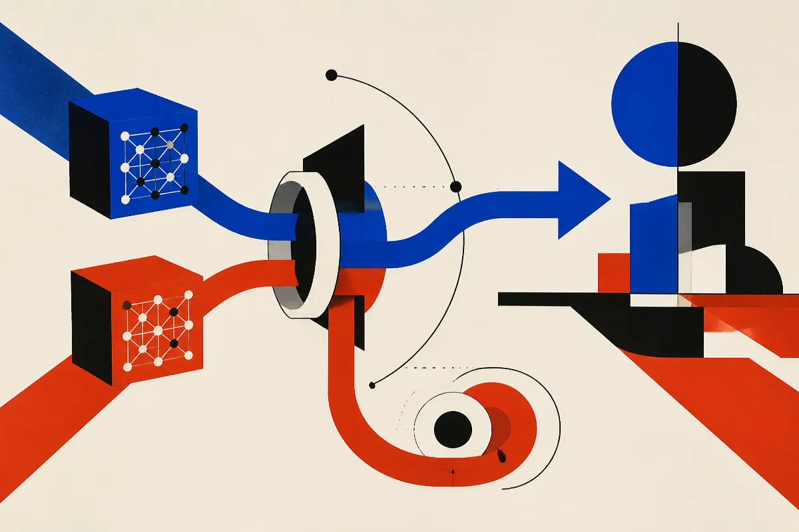

TL;DR: Treating model updates like software updates is the right direction, but only if builders bring the same release discipline: pinned versions, evals, staged rollout, and rollback.

## What does “update models like software” actually imply?

Hugging Face Blog’s “Granite Switch 4.1.1 — Update models like you update software” is interesting because of the framing. Not just “here is a better model.” Not just “here are benchmark gains.” The headline points at a bigger operator problem: models are becoming dependencies.

That sounds obvious until you look at how many AI systems are still wired together. A product team picks a model, tunes prompts around its quirks, maybe adds retrieval, maybe adds tools, then prays the next model swap improves things without breaking the hidden contract.

Software teams learned this lesson a long time ago. Dependencies need version numbers. Updates need changelogs. Releases need tests. Production needs rollback. You do not casually bump a database driver or auth library in a serious system without a path back. Yet model upgrades are often treated like taste tests.

The “4.1.1” in Granite Switch is the part that caught my eye. Patch-style versioning sets expectations. A patch should not change behavior wildly. A minor release may add capabilities. A major release may break assumptions. If AI models want to sit inside real workflows, the release language has to map to operational risk.

## What changes for teams shipping AI products?

The useful shift is moving from “which model is smartest?” to “which model can I safely operate?”

That means the model update path becomes part of the product architecture. Prompts are no longer loose text. They are fixtures. Golden datasets are no longer nice to have. They are regression tests. Human review is not just a compliance layer. It is a sampling strategy for catching behavior drift in places metrics miss.

This matters most in boring, high-value workflows: support triage, sales research, contract review, medical admin, internal search, code review, finance ops. These are not places where a model can become “more creative” without warning. A small phrasing change can break a parser. A stronger refusal habit can kill a workflow. A new tool-use pattern can call the wrong endpoint.

Hugging Face’s post, at least from its stated framing, is pointing toward the right abstraction: model updates should feel less like migrating between mysterious personalities and more like upgrading a maintained package. That does not mean models become predictable in the same way libraries are predictable. They do not. But the surrounding process can become predictable.

## Where does this go wrong?

The trap is pretending software-style labels solve model-style uncertainty.

A version number is not an eval. A release note is not a safety case. A leaderboard score is not proof your workflow improved. If a model is part of an agent loop, even small output changes can compound. If it sits behind retrieval, a “better” answer style may cite differently. If it writes code, a slightly changed preference for abstractions may create review churn. If it talks to customers, tone changes matter.

So I want more vendors and open model teams to publish model updates like software, but I also want buyers and builders to stop outsourcing judgment to the release label. The label should trigger a process, not replace one.

The minimum bar is simple. Pin the model version in production. Keep a representative eval set that includes failures, edge cases, and ugly real inputs. Run the candidate update against those cases before rollout. Canary it with a small slice of traffic. Watch task success, latency, cost, refusal rate, escalation rate, and human correction rate. Keep the old model warm enough to roll back.

My practitioner's take: if you use Granite Switch 4.1.1 or any model release packaged this way, do not start by asking whether it is “better.” Start by treating it like a dependency bump. Create a branch, replay real tasks, compare outputs against your current production model, and only ship if the gains show up in your own workflow. The catch most teams miss is that model upgrades create product work, not just infra work.
