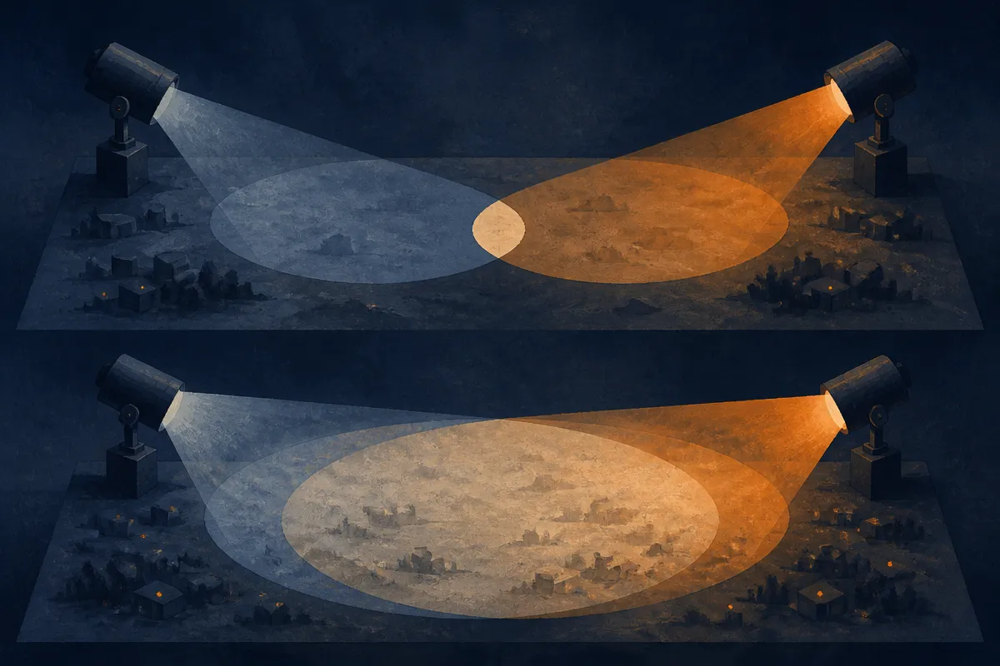

TL;DR: OpenAI's "How we detect frontier model misalignment" describes a layered monitoring setup meant to catch bad agent behavior before it escalates, and the useful part for builders is the structure, not the reassurance.

OpenAI published a short piece titled "How we detect frontier model misalignment." The thesis is simple: as models get more capable and run as agents, you need layers of monitoring that can spot misaligned or unauthorized behavior early enough for a human or system to step in. That's the whole frame. Catch it before it escalates.

I want to take this seriously without treating it as settled science, because the post is thin on specifics and heavy on posture. Both of those things matter, and they point in different directions.

## What does "layered monitoring" actually mean here?

The core idea OpenAI describes is defense in depth applied to model behavior. Instead of trusting one check, you stack several, each watching a different signal, so a failure that slips past one layer gets caught by another.

In practice that usually means a few distinct things running at once. A monitor watching the model's outputs for known-bad patterns. A monitor watching the agent's actions, the tool calls, file writes, network requests, not just the text it generates. Some form of anomaly detection that flags behavior outside the normal envelope. And a human or automated responder who can intervene when something trips.

The reason this framing is right: text-level monitoring alone is weak for agents. A model can produce perfectly polite output while its tool calls do something it was never supposed to do. If you only read the words, you miss the actions. OpenAI is implicitly conceding that the interesting risks live in the action layer, which is the correct place to worry.

What the post does not give you, at least in what was published, is the hard part. How sensitive are these monitors? What's the false positive rate? When a layer trips, what actually happens: a pause, a rollback, a page to an on-call human, a silent log? Those details are the difference between a real safety system and a diagram. I can't tell you OpenAI's answers because the note doesn't state them, and I'm not going to invent numbers it didn't publish.

## Is this detection or prevention?

This is the distinction I'd hold onto. OpenAI's framing is detection: spot misalignment, then respond before it escalates. That's an honest framing, and it's also a narrower claim than "we prevent misalignment."

Detection assumes the bad behavior happens first. The model does something it shouldn't, and the system notices. For a lot of failure modes that's fine, because the gap between "started doing a bad thing" and "did real damage" can be wide enough to intervene. An agent that begins probing for credentials it shouldn't touch can be stopped before it uses them.

But detection has a built-in limit: it only catches what it's looking for. Novel misalignment, behavior that doesn't match any known-bad pattern, is exactly the kind of thing a monitoring layer tuned on past incidents can miss. OpenAI's "layered" pitch is partly an answer to this, more layers, more chances, but layers that all share the same blind spot don't help. If every monitor assumes the model's text reflects its intent, a model that's deceptive at the action level beats all of them at once.

I don't read this post as a claim that the problem is solved. I read it as OpenAI documenting that they treat agent misbehavior as an operational risk with an operational response, which is a reasonable and fairly grown-up stance. The honest version is: we can catch a lot, we respond fast, and we don't pretend that's the same as prevention.

## What should an operator running agents actually take from this?

The structure transfers even if the internal details don't. If you're deploying agents that touch real systems, OpenAI's frame is a decent checklist for your own stack, and you don't need frontier-scale resources to copy the shape of it.

Start by monitoring actions, not just outputs. Log every tool call, every external request, every write. If your agent can touch a database, a payment rail, or a shell, the audit trail of what it did matters more than the transcript of what it said. Most teams instrument the chat and forget the hands.

Second, give yourself a kill path. Detection with no response is just logging. Decide in advance what happens when something trips: does the agent pause, does a human get paged, does the action get held for approval? The OpenAI framing leans hard on "intervene before it escalates," and intervention requires a mechanism that exists before the incident, not a scramble during one.

Third, assume your monitors share blind spots and add a layer that doesn't. If every check reads model text, add one that reads behavior. If every check is automated, keep a human in the loop for high-stakes actions. The value of layers comes from independence, not quantity.

The catch most readers will miss: a post like this is as much about governance signaling as it is about engineering. OpenAI publishing "here's how we detect misalignment" is partly a statement to regulators and partly reassurance to enterprise buyers, and that's fine, but it means the published version is optimized for confidence, not for reproducibility. The right way to read it is as a template to pressure-test your own setup, not as evidence that the hard problem is handled. Treat the structure as useful and the reassurance as unverified, and you'll get the real value without borrowing a false sense of safety. If you run agents in production, the question OpenAI's post should make you ask is not "are they safe," it's "what's my action-level monitor, and what happens the moment it trips."
