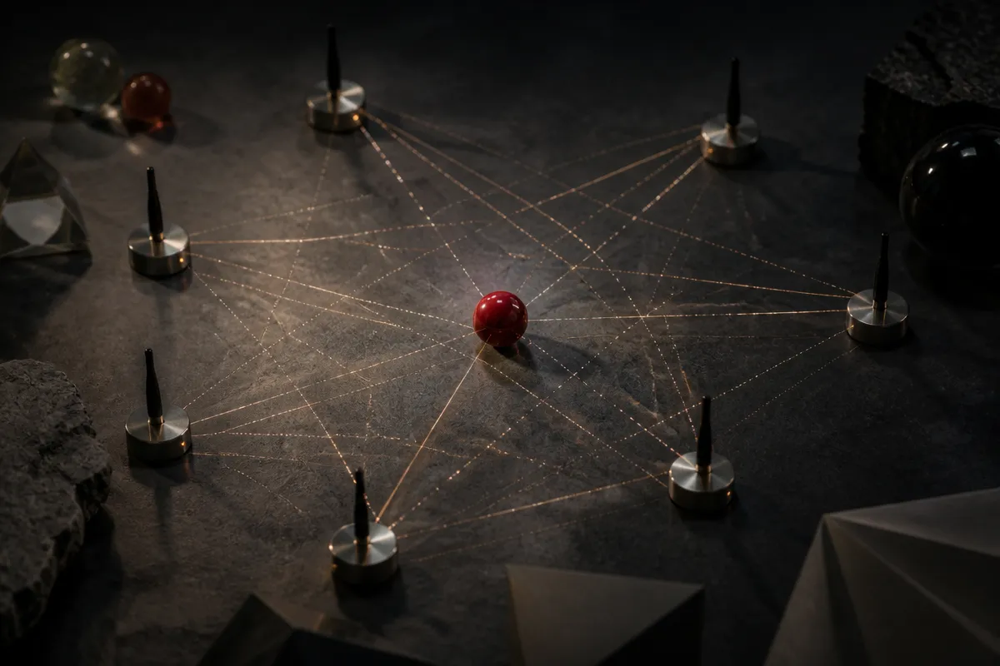

TL;DR: Deep learning may make 5G-based sensing more usable in messy real environments by cleaning up clutter that conventional signal processing struggles to separate from real targets.

## What is 5G sensing trying to do?

The arXiv paper “Multistatic ISAC with Deep Learning-Based Clutter Suppression for 5G and Beyond” looks at integrated sensing and communications, usually shortened to ISAC. The basic idea is simple: use wireless communication signals, including 5G and future network signals, for sensing as well as data transmission.

That matters because the infrastructure is already spreading everywhere. Towers, base stations, distributed receivers, phones, private networks, industrial radios. If those signals can help estimate where objects are and how fast they are moving, sensing does not always need a separate radar stack.

The paper focuses on multistatic ISAC. Instead of one transmitter and one receiver doing all the work, spatially distributed receivers listen from different locations. That can increase coverage and give better geometry for target localization and velocity estimation.

This is the practical promise: shared spectrum, shared infrastructure, more sensing coverage.

But the clean diagram version hides the hard part.

## Why does clutter break the neat version?

Real spaces are full of clutter. Not just static clutter, like walls or poles. Dynamic clutter too: moving scatterers, changing reflections, different Doppler spreads, and different radar cross sections. The paper models distributed clutter with randomly located scatterers to capture that mess.

That is the part I like. A lot of AI-for-sensing work can look good when the environment is too tidy. Here, the problem is closer to what makes deployed sensing fail: the receiver sees a mixture of target response and clutter-contaminated observations. The system then has to estimate bistatic range and Doppler. Get those wrong, and position and velocity estimates degrade.

The paper reports that a broad set of conventional signal processing baselines were evaluated for clutter suppression, and that they showed limited reliability under strong clutter conditions. That does not mean classical methods are dead. It means the operating conditions are moving into regimes where hand-designed cleanup can become brittle.

The deep learning move here is not “replace radar with AI.” It is narrower and more useful: use residual and attention-enhanced neural network architectures to enhance the target response directly from clutter-contaminated observations.

## Where does deep learning fit in the sensing stack?

The paper reports that its deep learning-based clutter suppression methods outperform conventional approaches across diverse clutter conditions for target position and velocity estimation.

That is the interesting claim, but also the claim to treat carefully. The sources provided do not include deployment details, compute cost, training data requirements, latency budgets, failure cases, or whether the model holds up outside the simulated clutter assumptions. Those are not footnotes. For ISAC, they are the product.

A model that cleans up observations after the fact is useful only if it fits inside the sensing loop. Industrial safety, traffic sensing, drone detection, warehouse automation, and smart infrastructure do not just need prettier range-Doppler maps. They need predictable behavior when the environment changes.

This is where attention mechanisms make intuitive sense. In a clutter-heavy scene, the model needs to learn which structures look target-like and which look like confusing background. Residual architectures also make sense because the task is closer to enhancement than free-form generation. Keep the signal structure. Suppress what gets in the way.

Still, learned suppression adds a new dependency. If the clutter distribution shifts, the model may clean up the wrong thing. If the target class or motion pattern changes, the system may look confident while being wrong. That is not an argument against the approach. It is an argument for evaluating it like safety-adjacent infrastructure, not like a demo filter.

A builder should read “Multistatic ISAC with Deep Learning-Based Clutter Suppression for 5G and Beyond” as a signal to prototype learned preprocessing inside the sensing pipeline, then test it against ugly scenarios: dense reflections, moving background objects, receiver dropout, weird geometry, and clutter outside the training setup. The catch most readers miss is that the model is not the sensing system. It is one cleanup stage. The real product is the full loop from raw wireless observations to trusted position and velocity estimates under conditions that do not cooperate.
