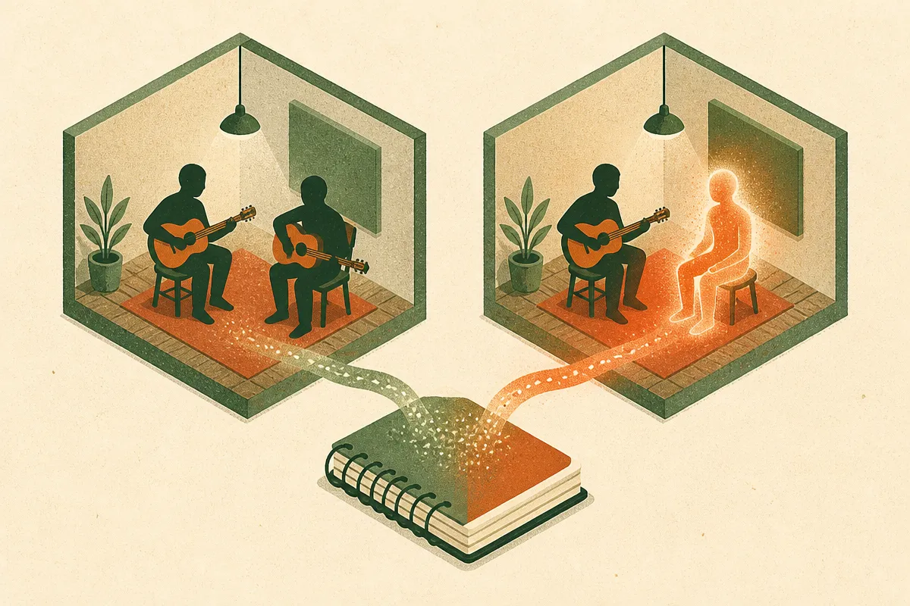

TL;DR: LLM-simulated counselling clients can be useful training partners, but their value is practice at scale, not replacing the messiness of human role-play.

## What did the counselling role-play paper actually test?

The primary source is the arXiv paper titled “Comparing Human Role-Players and LLM-Simulated Clients in Online Counselling Training: An Analysis of Counselling Patterns,” listed under cs.AI and cs.CL.

The setup is practical. Novice counsellors first ran online role-play sessions with human peers acting as clients. Then counsellors interacted with simulated clients generated by Mistral’s Mixtral 8x7B using 4-bit quantization. The interactions were analyzed at the sentence level with a counselling communication pattern system.

That sentence-level part matters. This is not a vibe check where someone asks whether the chatbot “felt real.” The paper looks at patterns in the exchange: how counsellors communicate, how the client responds, and whether the shape of the interaction changes when the client is a human role-player versus an LLM simulation.

The reported result is not “LLMs passed as clients.” It is more useful than that. “Comparing Human Role-Players and LLM-Simulated Clients in Online Counselling Training” found both similarities and differences in counselling patterns across the two settings. That is exactly the kind of mixed result I trust more than a demo clip.

## Where does an LLM client help?

The obvious win is repetition.

Counselling training needs safe practice. Human role-players are limited by scheduling, cost, consistency, and fatigue. An LLM client can sit there at midnight and run the same scenario ten times. It can let a novice counsellor try a clumsy opening question, recover, pause, and try again. That is real utility.

There is also a measurement angle. If the interaction is logged sentence by sentence, instructors can compare patterns across many sessions. Did the trainee ask too many closed questions? Did they reflect feelings? Did they rush into advice? Did their behavior shift when the “client” pushed back?

This is where simulation is strongest. Not as a fake person. As a repeatable practice surface.

The paper used Mixtral 8x7B with 4-bit quantization, which is also interesting from an operator’s perspective. This was not framed around the largest proprietary model available. A compressed open model was enough to create interactions worth analyzing. That does not mean any small model is safe for training. It does mean the infrastructure bar for role-play systems may be lower than people assume, especially when the system is supervised and bounded.

## What is the catch?

The catch is that counselling is not just language.

A human role-player brings hesitation, inconsistency, social pressure, discomfort, timing, and embodied cues. Even online, humans carry friction. LLMs tend to be cooperative in ways people are not. They may over-explain, accept prompts too readily, or produce clean emotional arcs that make the trainee feel more competent than they are.

That matters because the training target is not “can you have a nice conversation with a model?” The target is, can you develop counselling judgment with a real person who may be guarded, confused, contradictory, or annoyed?

So I would not read this paper as evidence that LLM clients should replace human role-play. I read it as evidence that LLM role-play deserves a slot in the training stack, especially before or between human-supervised sessions.

A good implementation would be narrow. Use simulated clients for deliberate practice. Keep scenarios constrained. Log the transcript. Score communication patterns. Let instructors review the moments where the trainee missed something. Use human role-players for the parts that need social realism.

For builders, the move is to treat the LLM client as a simulator with known blind spots, not a patient, not a therapist, and not a certification engine. Start with one training objective, such as reflective listening or avoiding premature advice. Run repeated sessions, compare transcripts, and have a human instructor audit the feedback. The catch most teams miss: the model’s realism matters less than whether the exercise changes the trainee’s behavior in the next human session.
