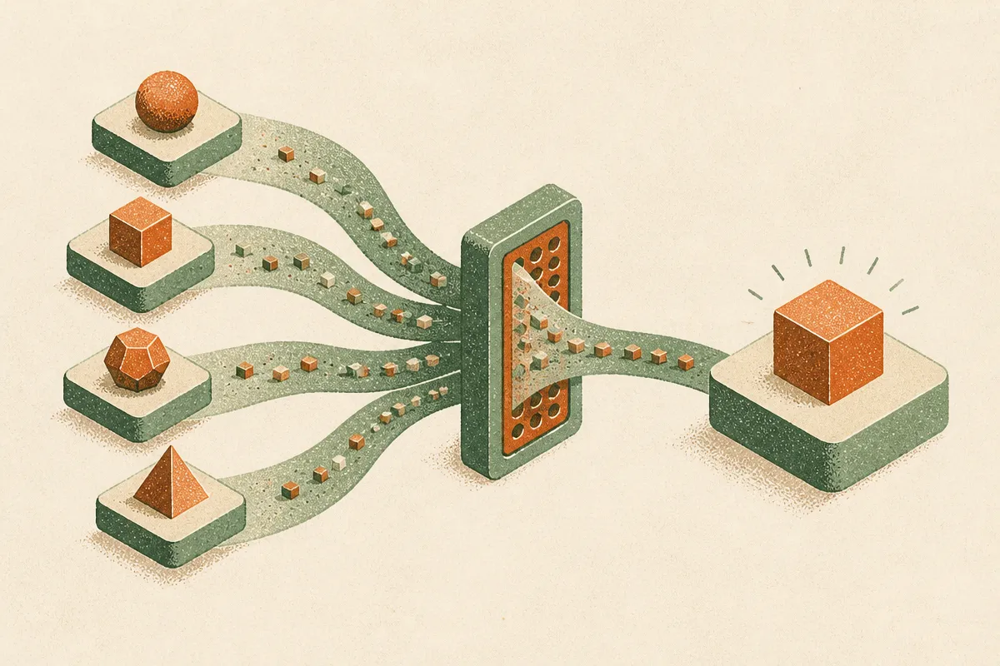

TL;DR: The useful takeaway from "Rethinking Neural Thickets Without Weight Perturbations" is not that models hide many nearby experts in their weights, but that validation-selected output diversity plus voting can buy reliability without touching the model.

## Are Neural Thickets really about hidden experts in weight space?

The Neural Thickets idea is attractive. A pretrained language model sits in a dense neighborhood of task-specific experts. Add random Gaussian noise to the weights, sample a bunch of nearby versions, and some of those perturbed models behave like better specialists.

That story has a certain magic to it. It also has an operational problem: if the gains come from full-weight perturbations, the method is heavier, more fragile, and harder to explain.

"Rethinking Neural Thickets Without Weight Perturbations" pushes on that explanation directly. The arXiv paper reports that the original gains can be reproduced, but that the geometric story is not required to get them. Perturbing a single decoder block recovers much of the improvement. More importantly, keeping the model frozen and adding a random bias to the output logits matches or exceeds full-weight perturbations on most reasoning tasks.

That is a big difference in interpretation.

If a frozen model with random logit shifts can do the job, the effect may not be “nearby experts” at all. It may be a familiar inference-time recipe wearing a new coat: generate diverse outputs, pick the variants that look good on validation examples, then aggregate their answers.

The paper names this Perturb-Select-Vote, or PSV. I like the name because it removes some mystery. Perturb for diversity. Select using a small validation set. Vote to reduce variance.

## What does Perturb-Select-Vote actually change for builders?

PSV matters because it moves the action from training to inference.

Full-weight perturbation ensembles imply model surgery. Logit PSV does not. The model stays frozen. The system perturbs outputs, scores candidates against a small validation set, and aggregates predictions. That puts it in the same practical family as self-consistency, sampling, verifier-guided selection, and other inference-time methods that try to make one model behave like a small committee.

The paper’s first-order analysis also supports the simpler explanation: small weight perturbations act mainly through the logit shifts they induce. In plain English, the perturbations may matter less because they discover special internal machinery and more because they nudge the output distribution into useful variation.

That is less romantic. It is more useful.

The result extends beyond language tasks. The paper reports that logit PSV substantially improves performance under vision domain shift, including Earth observation, while full-weight perturbations add little extra. That cross-domain result is the part I would watch. Reasoning benchmarks are noisy and often overfit to clever inference tricks. Domain shift in vision is a harder practical setting. If a frozen-model voting method helps there, it deserves attention.

Still, I would not read this as “PSV solves reliability.” It needs a validation set. It adds inference cost. It can select for the wrong behavior if the validation slice is too narrow. Voting can smooth mistakes, but it can also produce confident consensus around a shared blind spot.

## The bigger pattern: more gains are moving to inference

This paper fits a broader trend: not every improvement needs new weights.

A lot of useful AI work now lives in the layer around the model. Sampling policies. Rerankers. Verifiers. Tool checks. Ensemble-style voting. Small eval sets wired into production. Better refusal routing. Better task decomposition.

That does not make training unimportant. It means operators should stop treating model weights as the only place where intelligence can improve. Sometimes the cheapest reliability gain is not fine-tuning, distillation, or buying a larger model. Sometimes it is running the same model several ways, measuring which variants behave well on your workload, and forcing them to agree before you trust the answer.

My practical read: try PSV-like patterns where answers are verifiable and failures are costly but not latency-critical, such as classification under domain shift, structured reasoning tasks, extraction with known schemas, or decision support where you can keep a small gold set. Start with frozen models, generate diverse candidates, select against your own validation examples, and vote. The catch most readers miss is that the validation set becomes the product. If it is lazy, stale, or unrepresentative, the whole trick optimizes theater instead of reliability.
