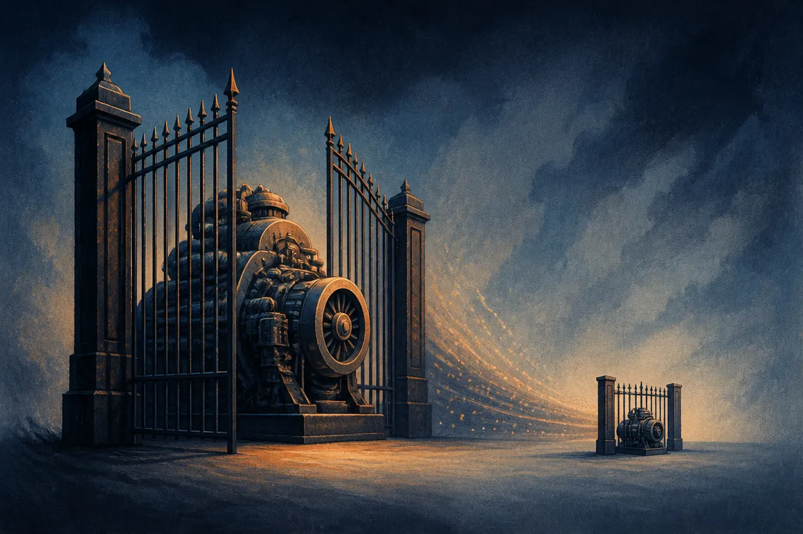

TL;DR: A proactive assistant does not need a big generator or a separate gating model to decide when to interrupt you and what to say. One 1B decoder that gates from a middle layer and generates in the same pass matches the two-model setup, runs 1.31 to 1.76x faster, and the thing that actually drives hint quality is memory, not model size or retrieval.

The paper is "When to Assist and What to Suggest: Joint Gating and Memory-Grounded Hint Generation in One Compact Decoder," posted to arXiv under both cs.AI and cs.CL. It is about a narrow but increasingly common design problem: you want an assistant that offers short, timely hints during a conversation without being asked. Two decisions sit underneath that. When should it speak. And what should it say.

Most systems split those decisions across two components. A small, cheap gate decides whether to interrupt. A larger generator writes the hint. The paper's contribution is to evaluate both decisions together, on 28,058 decision points, and to ask whether the split is worth it at all.

## Why does "when to assist" matter as much as "what to suggest"?

Because the gate is where most of the quality leaks out.

The paper reports a stage-wise ceiling using an oracle gate (a perfect "should I speak now" oracle) of 0.2971 exact match. Put a real, imperfect gate in front of the generator and end-to-end exact match drops to 0.2619, with end-to-end precision at 0.2387. That gap is the cost of not knowing when to speak. The generator can be excellent and still get dragged down because the gate fired at the wrong moment.

This is the part teams underrate. Everyone obsesses over generation quality. But a proactive assistant that interrupts at the wrong time is worse than useless, it is annoying, and annoying assistants get turned off. The gating decision is a precision problem, and precision is exactly where the authors say the real gate leaves "substantial headroom."

Worth being honest about the absolute numbers. Exact match around 0.26 is low, and the authors say so directly: they report exact match as "a strict lower bound." Graded metrics and LlamaPIE's native judge track human ratings more closely. So read exact match as a conservative floor, not the real performance. The human evaluation (1,144 ratings over 32 dialogues) is the number I trust most here.

## Does a separate gate model actually pay for itself?

This is the sharpest finding, and it is an economics finding, not an accuracy one.

A separate gate saves compute by not running the expensive generator every turn. The authors quantify the saving, and it collapses as the generator shrinks. With an 8B generator, the gate saves 4.39x on compute. With a 1B generator, the saving falls to 1.38x.

Think about what that means. The whole justification for a two-model pipeline is "don't fire the big model unless you have to." But if your generator is already small, the big model you were protecting against barely exists. The gate becomes overhead chasing a saving that is no longer there.

That reframes the architecture question. The split-model design is a response to generator cost. Remove the cost (go small) and the design loses its main reason to exist. Which sets up the paper's actual proposal.

## Can one model handle both jobs in a single pass?

Yes, and that is the headline. The authors train one 1B decoder to do both: gate from an intermediate layer, then generate in the same forward pass. Not two models, not even two passes. One decoder, an early exit for the gating signal, and the full pass for the hint.

At its final checkpoint, this single model matches or exceeds the two-model pipelines on the automatic end-to-end measures, while running 1.31 to 1.76x faster than the matched 1B pipeline in wall-clock time. Across three seeds, the deeper exit used for gating ties the separate gate model. The human study backs this up: raters put the single model level with the matched 1B pipeline, and below the 8B pipeline.

Read that last clause carefully. It is level with the 1B pipeline, not with the 8B one. So the honest claim is: you can collapse two 1B models into one and lose nothing, while getting faster. You do not magically reach 8B quality. The scale ceiling is still there. What goes away is the redundant plumbing.

## What actually drives hint quality, if not model size?

Memory. By a wide margin, and this is the finding most people will skim past.

Removing the memory profile costs 24.7 exact-match points. Rescaled BERTScore drops from 0.57 to 0.35. Meanwhile, the authors report that retrieval and a larger generator "add nothing on exact match." Sit with that contrast. Bolting on a retrieval system: no gain on this metric. Going from 1B to 8B generator: no gain on exact match (though the humans did prefer the 8B output overall). Feeding the model a memory profile of the user: a 24.7 point swing.

The lesson for anyone building proactive features: your effort is better spent on what the model knows about this specific user than on a bigger model or a fancier retrieval stack. The grounding is the product. The generator is almost a commodity once it is grounded.

I would not over-generalize from one dataset and one task. This is proactive, short, memory-grounded hints, evaluated with LlamaPIE's framing. Retrieval "adding nothing" here does not mean retrieval is useless in general, it means for this task the curated memory profile already carried the signal retrieval would have fetched. But the direction is clear and it matches what I see in practice: context quality beats parameter count for personalized assistance.

A proactive assistant is three things in a trench coat: a timing decision, a generation step, and a memory layer. This paper says the timing and generation can share one small model, and the memory is where you win or lose. If you are building this, start by cutting the second model. Train or prompt one small decoder, take an early-layer signal for the gate, run the full pass for the hint, and measure wall-clock against your current pipeline. Then pour your remaining budget into the user memory profile, because that is the 24.7 point lever. The catch most readers will miss: exact match here is a floor, so do not tune to it. Stand up a graded judge or a small human eval early, because the automatic number will tell you the memory matters and then lie to you about how good any particular hint actually is.
