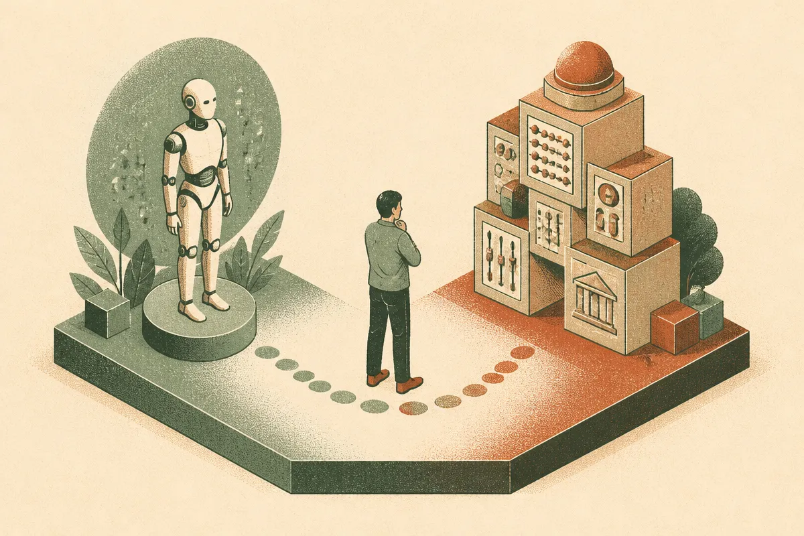

TL;DR: The useful lesson from Picard and Data is not “AI is people,” it is that rights, control, and responsibility should be argued from evidence, not vibes.

## What did Picard get right about AI?

The Hacker News item titled “Through Captain Jean-Luc Picard, Patrick Stewart taught us the measure of a man” lands because Picard remains one of the better cultural frames for AI debates. Not because Star Trek predicted chatbots. Because it treated personhood as a hard institutional question, not a parlor trick.

That matters right now.

A lot of today’s AI discourse gets stuck on surface behavior. The model sounds warm. The agent remembers your preference. The voice hesitates in a human rhythm. The avatar makes eye contact. People jump from that to “maybe conscious,” or the opposite, “just autocomplete,” and both moves skip the operational layer.

Picard’s better move was to ask what is being done to the entity, who has authority, what evidence counts, and what precedent the institution is about to set. That is a much more useful pattern for builders and policymakers than arguing from charisma.

For current systems, I do not think we have good evidence that model outputs equal inner experience. But we do have very real questions about dependency, manipulation, labor substitution, data rights, liability, and automated authority. Those are not sci-fi. They are product decisions.

## Are we asking the wrong question about “AI rights”?

“Does the AI deserve rights?” is usually too blunt.

A better first question is: what powers have we given this system over humans?

If an AI agent can spend money, message customers, generate legal drafts, approve claims, rank applicants, tutor children, or shape a person’s emotional life, then the immediate rights question may not belong to the model. It belongs to the people affected by the model.

That does not make the deeper personhood debate meaningless. It just puts it in sequence. First, protect humans from opaque automated power. Second, define duties for companies that deploy agents. Third, keep a live research question open about whether future systems could warrant moral consideration under some evidence standard.

The trap is anthropomorphic shortcutting. A system can be socially persuasive without being sentient. It can be useful without being trustworthy. It can be harmful without having intent. It can deserve audit, constraint, and disclosure without deserving personhood.

That distinction is not cold. It is how we avoid bad policy.

If you ban everything that feels eerie, you block useful tools. If you permit everything because “it is just software,” you hand institutions a shield for automated harm. The middle path is boring and practical: capability-based governance, logging, red-team tests, user consent, appeal paths, and clear assignment of responsibility to the humans and companies operating the system.

## What should builders take from this?

The Picard frame is good for product reviews.

Before shipping an agentic feature, ask what claim you are implicitly making. Are you presenting the system as a tool, a teammate, a companion, an expert, or a proxy human? Each frame creates different user expectations. If the product behaves like a companion but is optimized like an ad channel, that is not alignment. That is a dark pattern with better prose.

Also ask where the override lives. Can the user inspect what happened? Can they reverse it? Can they set boundaries? Can another human audit the chain? Can the company explain why the system acted, or only replay a transcript and shrug?

The deeper cultural lesson from Patrick Stewart’s Picard is restraint. He made moral seriousness feel procedural. Evidence first. Power second. Principle third. Not as theater, but as a way to keep institutions from doing convenient things to less powerful beings, human or otherwise.

Practitioner’s take: if you are building AI agents, do not start with a grand theory of machine personhood. Start with a permissions map. List what the system can observe, decide, change, spend, send, and remember. Then add friction where the blast radius grows. The catch most teams miss: the user’s emotional model of the agent can create risk even when the technical capability looks small.
