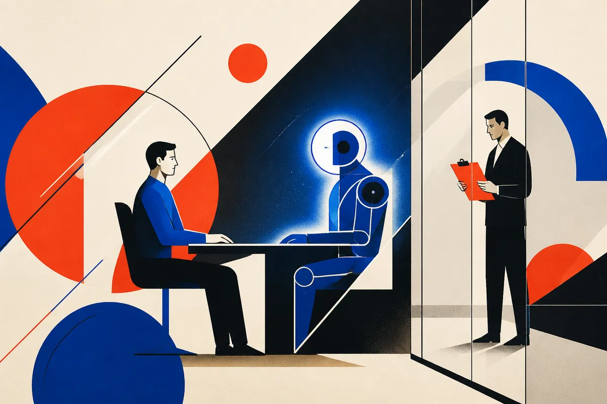

TL;DR: If an AI process can affect someone’s job, treat it like governance infrastructure, not an experiment.

## What actually changed at Proton?

My primary source here is the Hacker News item titled “Proton's CEO Cancels AI 'Re-Interviews'.” That is a thin source. It tells us the headline shape: Proton’s CEO canceled something described as AI “re-interviews.” It does not give enough detail to responsibly claim who was affected, what model was used, what the evaluation criteria were, whether this was mandatory, or what Proton’s internal rationale was.

That matters. The whole point of this story is process.

Still, the reported reversal is useful because it hits a live nerve in every company trying to push AI into operations. Hiring and internal talent assessment look like tempting AI use cases. They are structured. They involve lots of text. They are expensive. They are full of repetitive screening, writing, scoring, and comparison.

They are also high stakes.

Once a company asks an employee or candidate to sit through an AI-mediated assessment, the tool stops feeling like productivity software. It becomes management. Maybe even surveillance. The difference is not academic. A chatbot that drafts interview questions is one thing. A chatbot that appears to reassess whether an existing employee belongs at the company is another thing entirely.

## Why do AI re-interviews feel different from normal performance reviews?

People already tolerate flawed human systems at work: annual reviews, calibration meetings, interview loops, manager notes, promotion packets. Not because those systems are perfect. They are not. They are tolerated because there is usually a visible chain of accountability. Someone can explain the decision. Someone can be challenged. Someone owns it.

AI breaks that expectation if it is inserted carelessly.

The risk is not only that the model makes a bad call. The bigger risk is that nobody can say what the call means. Was the AI measuring communication skill, domain knowledge, culture fit, anxiety under pressure, prompt compliance, or ability to perform for a machine? If employees do not know, they will assume the worst. Often rationally.

This is where “we are just experimenting” stops working. If the output might reach a manager, HR file, performance plan, promotion conversation, layoff list, or future assignment decision, it is not just an experiment to the person being assessed.

The model also changes the social contract. A human interviewer can adjust for context. An AI interview can feel like a one-way extraction of speech, emotion, hesitation, and behavior. Even if the company only intends to evaluate answers, employees may not know what is being stored or inferred.

## What should companies do before using AI on employees?

Start by separating low-risk AI from rights-affecting AI.

Low-risk: summarizing interview notes after a human-led conversation, generating question banks, checking for missing skills coverage, helping managers write clearer feedback, or analyzing aggregate hiring funnel bottlenecks without scoring individuals.

Higher-risk: ranking candidates, scoring employees, conducting automated interviews, inferring traits, recommending terminations, flagging “low performers,” or creating re-interview processes for current staff.

The higher-risk category needs rules before rollout. Plain-language notice. Defined purpose. Data retention limits. Human review. A way to appeal. Bias testing. A named executive owner. Clear exclusion from unrelated decisions unless explicitly disclosed.

And the most underrated piece: tell people what the AI output will not be used for. Boundaries build more trust than slogans.

Vendors will keep pitching this stuff because the market is obvious. HR teams are overloaded. Managers are inconsistent. Interview loops are slow. AI can help. But “can help” is not the same as “should mediate employment status.”

The practical move is to run an internal AI assessment map this week. List every place AI touches hiring, reviews, promotions, compensation, staffing, and exits. Then mark which tools generate content, which tools summarize human judgment, and which tools influence decisions. Keep the first two moving. Put the third under governance before it ships.

For builders, the product lesson is blunt: if your AI touches someone’s livelihood, the feature is not the model. The feature is due process. Try building the boring parts first, consent screens, audit logs, reviewer workflows, appeal records, retention controls. The catch most teams miss is that trust is not recovered by canceling a bad rollout. It is earned by proving the system was constrained before anyone had to complain.
