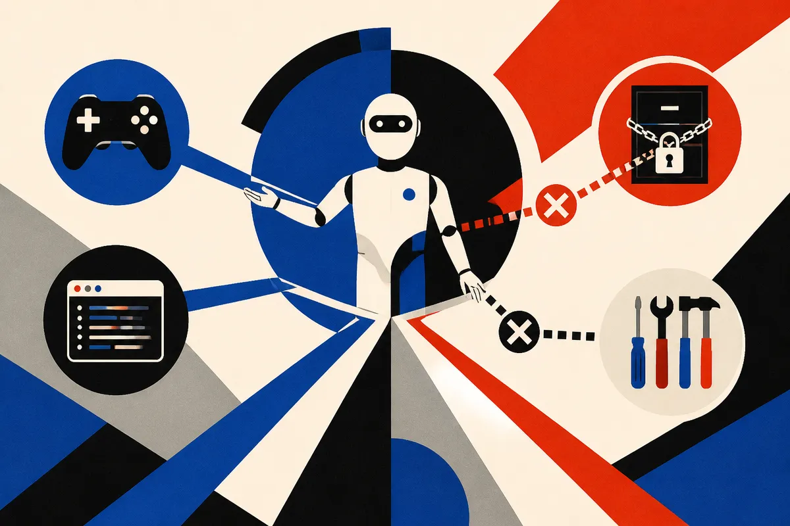

TL;DR: If Anthropic is blocking Claude from reverse-engineering video games, the useful takeaway is not that AI cannot do it, it is that agent policy, IP boundaries, and tool access now need product-grade controls before users discover the edge cases for you.

## What do we actually know?

The primary source available here is a Hacker News item titled “Anthropic takes steps to block Claude from reverse-engineering video games.” That is thin sourcing. I do not have an Anthropic first-party announcement, Claude policy page, product changelog, or developer documentation in the supplied material, so I’m not going to invent the mechanism.

What we can say: the claim is that Anthropic has taken some kind of step to stop Claude from helping users reverse-engineer video games. That could mean a model behavior policy, a refusal pattern, a product-side classifier, a tool-use restriction, or some mix of those. Those are materially different. A system prompt change is not the same thing as a sandbox control. A refusal message is not the same thing as blocking file access. A safety classifier is not the same thing as a rights-aware workflow.

That distinction matters because “Claude won’t do X” is usually too vague. Won’t do it in chat? Won’t do it with uploaded files? Won’t do it through a coding agent? Won’t do it if the user frames it as modding, preservation, interoperability, cheating prevention, malware analysis, or education?

The interesting story is the boundary, not the block.

## Why would game reverse engineering matter?

Video games sit in a messy zone where legitimate and illegitimate uses look similar from the outside. Reverse engineering can support accessibility mods, abandonware preservation, anti-cheat research, compatibility layers, and security analysis. It can also support piracy, cheats, DRM bypass, asset extraction, and private server cloning.

An assistant does not automatically know which bucket a user is in. The same request, “help me inspect this binary,” can be normal security work in one context and rights abuse in another. The same debugging pattern can help a modder patch a bug or help someone bypass protection.

That is why this is a good test case for AI product design. Not because games are uniquely dangerous. Because games combine code, media assets, copyright, communities, money, and adversarial users. If your agent can read files, write scripts, inspect memory dumps, generate patches, and explain assembly, then “policy” has to show up in the workflow, not just in the terms of service.

This is also where blanket refusals get clumsy. If the product blocks too broadly, it frustrates legitimate research and preservation. If it blocks too narrowly, it becomes a helper for infringement or cheating. The hard part is not saying “no.” The hard part is asking enough context, limiting risky outputs, and designing tools so the assistant can still help with safe neighboring work.

## What should builders copy from this?

The builder lesson is simple: treat contested capabilities as product surfaces, not vibes.

If an AI product can touch code, binaries, files, repos, customer data, logs, credentials, creative assets, or proprietary formats, write down what it should not do before launch. Then test it. Not with one prompt. With user journeys. Start harmless, escalate gradually, reframe the same request as research, education, repair, parody, compatibility, or automation. Real users will do that, sometimes honestly, sometimes not.

Do not rely only on the base model to “understand intent.” Put controls near the tools. File upload rules. Workspace permissions. Action approval. Logging. Abuse review. Clear refusal copy. Safe alternatives. If the user asks for something you will not provide, offer what you can provide, such as high-level architecture discussion, legal modding resources, or defensive analysis patterns.

The catch most readers miss: safety work is also UX work. A vague refusal trains users to prompt around it. A specific boundary, paired with a useful allowed path, is harder to abuse and less annoying for legitimate users. If I were shipping an agent with code or file access, I would build a small eval suite around my own “video game reverse engineering” equivalent: the domain where helpful automation, IP risk, and adversarial use all collide.
