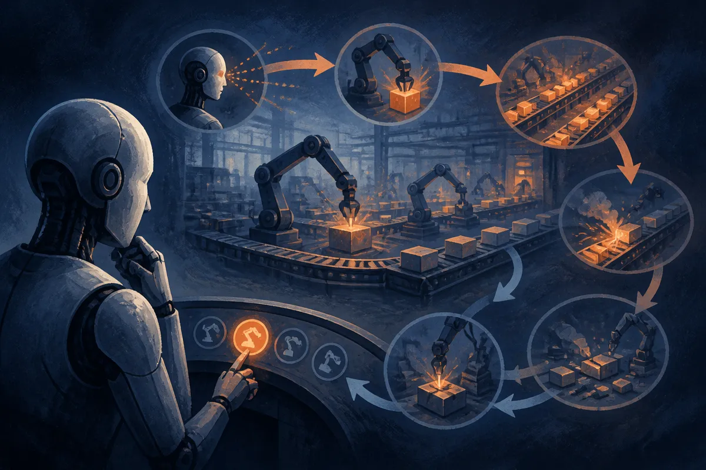

TL;DR: If an AI agent can beat Factorio on peaceful mode, the interesting part is not the win, it is whether the run proves durable planning, error recovery, and real control over a messy simulated world.

## What does “beat Factorio” actually prove?

The primary source here is the Hacker News item titled “GPT-5.6 Sol can beat Factorio on peaceful mode.” That is a thin source for a big claim. It names the model, the game, and the mode. It does not give the run logs, the task definition, the interface, the number of attempts, the amount of human scaffolding, or whether “beat” means the normal Factorio win condition.

So I would not treat this as a settled benchmark result.

Still, the choice of Factorio is interesting. Factorio is not a chat puzzle. It is a long-horizon systems game where progress depends on chaining many small decisions: mine resources, build machines, route materials, maintain power, research technologies, expand production, and fix all the things that break because your earlier choices were slightly wrong.

Peaceful mode matters. It removes, or at least greatly reduces, the pressure from hostile enemies. That makes the result less about real-time defense and more about factory planning. Some people will call that a weakened benchmark. Fair. But it may also be the cleaner first test. Before asking an agent to survive raids, ask whether it can build a functioning production graph without spiraling into nonsense.

The catch: a game completion headline hides the part builders need most. Was the agent acting through the same interface as a human? Did it use vision, game state APIs, scripts, or prebuilt plans? Did it recover after bad layouts? Could it repeat the run from different maps? Without those answers, “can beat Factorio” is closer to a demo claim than an eval.

## Why are games becoming serious agent evals again?

Games keep coming back because they expose failure in a way static benchmarks do not. A model can ace a short reasoning test and still fail when a plan has 200 dependent steps. Factorio punishes that. If you place belts wrong, underbuild power, starve science packs, or expand too early, the game does not care that your strategy sounded smart.

That is the right shape for agent evaluation.

The mistake is treating a single game as a general intelligence certificate. We did this with chess. Then Go. Then Atari. Then Minecraft. Each environment teaches us something real, but each one also creates its own shortcuts. Agents can overfit to interfaces, scripted procedures, privileged state access, and reward designs that do not transfer cleanly to real work.

Factorio is useful because it resembles a class of operator problems: resource allocation, dependency management, bottleneck diagnosis, and staged expansion. That maps loosely to software delivery, data pipelines, warehouse ops, growth experiments, and internal automation. Not because a factory game is business reality, but because the control loop rhymes.

Observe. Plan. Act. Check state. Repair. Continue.

That loop is where current agents still wobble.

## What should we ask before believing the result?

The first question is repeatability. One completed run is a clip. Ten runs across varied seeds with logs is a benchmark. One hundred runs with ablations starts to become evidence.

The second question is agency. Did GPT-5.6 Sol decide what to do next, or did a harness decompose the game into easy subgoals? Tooling is not cheating by default. Real agents need tools. But the split matters. If the system uses a planner, memory, code executor, game API, and model, we should grade the system, not pretend the base model “played Factorio” in the human sense.

The third question is intervention. Were humans nudging the run, resetting bad states, or editing plans? If yes, that can still be a useful assisted-workflow demo. It is just not autonomous completion.

The final question is measurement. I would want time to completion, action count, crash rate, number of restarts, map variability, cost, and failure modes. Especially failure modes. The failures tell builders whether the agent is bad at perception, planning, state tracking, tool use, or recovery.

A clean Factorio eval could be genuinely valuable. Start with peaceful mode. Publish seeds, harness code, logs, and videos. Then add harder variants: resource scarcity, enemy pressure, restricted APIs, noisy observations, and tasks that require adapting instead of replaying a known build order.

For a builder, the practical move is not to wait for a grand “AI beat Factorio” verdict. Steal the eval shape. Pick one messy workflow in your own operation, give an agent a controlled sandbox, define a real completion condition, log every action, and run it repeatedly from different starting states. The catch most teams miss: the headline success matters less than whether the agent can notice when its own plan has broken and repair it without a human quietly becoming the real agent.
