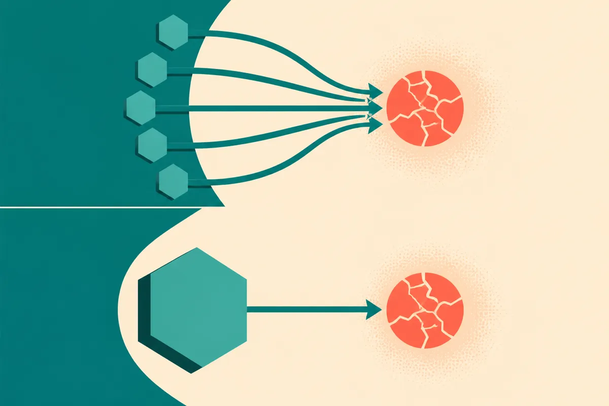

TL;DR: A team of five mid-size open models coordinating on one problem can beat a single frontier model on a hard benchmark, but the result tells you more about test-time compute and orchestration than about the models themselves.

The claim making the rounds on Hacker News and r/LocalLLaMA, posted by u/PferdOne, is tidy: Memdoor, a setup running five Qwen3.8-27B models as a team, beats Fable 5 on LiveCodeBench Hard. That is it. No paper, no arXiv ID, no methodology writeup in the sources I have. So treat everything downstream as a claim, not a confirmed benchmark, and let me walk through what would have to be true for it to mean anything.

## What is Memdoor actually claiming?

Strip it down and there are three moving parts. First, the orchestration layer: "a team of 5" models. That means multiple instances of the same base model working a problem together, some combination of generating candidate solutions, critiquing each other, and voting or selecting a winner. Second, the base model: Qwen3.8-27B, a 27B-parameter open model you can run locally. Five of them. Third, the comparison: Fable 5, treated here as the single large model being beaten, measured on LiveCodeBench Hard.

LiveCodeBench is the one piece here I can speak to with confidence, because it exists independently of this claim. It is a coding benchmark that pulls fresh problems from competitive programming sites over time, specifically to dodge the contamination problem where models have memorized the test set. The "Hard" split is the subset that trips up most models. So beating a frontier model on that split is a real thing to claim, if the measurement is clean.

The part I cannot verify from Hacker News and a Reddit link is the measurement. How many problems? What pass@k setting? Did Memdoor get to run its five models with unlimited retries while Fable 5 got one shot? Those knobs decide the whole story, and none of them are in the sources.

## Why would five small models beat one big one?

Because this is mostly a test-time compute story, and test-time compute is the most reliable lever in the field right now.

Here is the mechanism. A single model given one attempt at a hard problem has some probability of getting it right. Give that same model five attempts and keep the best one, and your success rate climbs, sometimes dramatically, on problems where the model can recognize a correct answer even when it cannot reliably produce one on the first try. Coding is close to the ideal case for this because correctness is checkable: you run the tests. A verifier that can tell good from bad turns five mediocre tries into one good answer far more often than you would expect.

So "five 27B models beat one big model" is often a disguised version of "five tries with a verifier beat one try." That is not a knock. It is a genuinely useful pattern. But it reframes what you are learning. You are not learning that Qwen3.8-27B is secretly as smart as a frontier model. You are learning that orchestration plus a checker plus more sampling closes a gap that raw single-shot capability leaves open.

The honest comparison would give Fable 5 the same budget: five samples, same verifier, same selection logic. If Memdoor still wins under equal compute, that is a much stronger and more interesting result. If it only wins because it got five swings to Fable's one, you have measured your wallet, not your models.

## Does this hold up without a paper?

Right now, no, and I want to be blunt about that. Two tier-two social posts with an identical title and no methodology is the thinnest possible evidence for a benchmark-beating claim. I am not saying it is false. Multi-agent sampling on checkable tasks is exactly the kind of thing that does work. I am saying the burden of proof sits entirely on the side that hasn't shown its work yet.

The specific things I would want before repeating this as fact: the full LiveCodeBench Hard problem count and date window, the exact pass setting for both systems, the compute budget per problem on each side, and ideally the raw transcripts so you can see whether the five models genuinely collaborated or just ran parallel and voted. Also worth noting: "Qwen3.8-27B" and "Fable 5" are the names in the posts, and I am taking them as given. If either is mislabeled, the comparison shifts.

None of this is cynicism. It is the same discipline you would apply to any "small beats big" headline, and there have been a lot of them lately. The pattern is real; most individual claims are undercooked.

## What should a builder take from this?

The transferable idea is worth more than the specific scoreboard. If your task has a cheap, reliable verifier, running several instances of a smaller open model and selecting the best output is a legitimate way to punch above the weight class of any single one of them. Coding, SQL, math, structured extraction, anything where you can check the answer, these are the sweet spots.

Try this: take a task you currently send to a frontier model once, and instead run a 27B-class open model five times with a verifier that discards failures. Measure two things against your current setup. Measure quality, and measure total cost including the extra samples. On local hardware the samples are nearly free, which is why the LocalLLaMA crowd cares. On metered API calls, five-of-27B can quietly cost more than one-of-frontier, and the win evaporates.

The catch most readers will miss is that the orchestration is the product, not the model. Memdoor, if it works, is a coordination recipe. The Qwen checkpoint is swappable. What you are actually buying when you copy this pattern is the critique-and-select loop and the verifier quality, and those are the parts nobody in a one-line benchmark post ever shows you. Build the loop, test it on your own verifiable task, and ignore the scoreboard until someone publishes the compute budgets on both sides.
