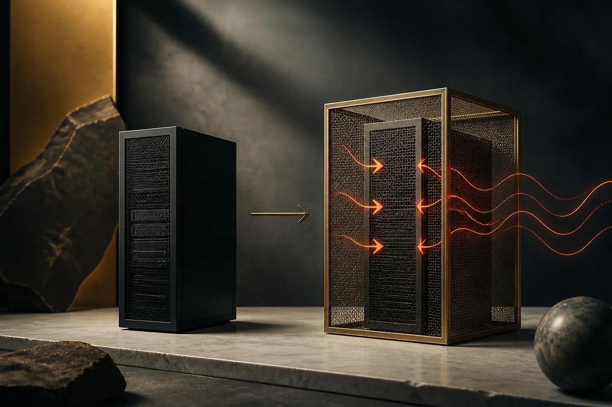

TL;DR: An air-gapped computer can still leak secrets by using regular RAM as a low-power radio transmitter, which matters for anyone who assumes physically isolating a sensitive AI model makes it safe.

The story going around Hacker News points back to RAMBO, a covert-channel attack published in 2024 by Mordechai Guri, the researcher at Ben-Gurion University of the Negev who has spent years building these things. The paper is titled "RAMBO: Leaking Secrets from Air-Gap Computers by Spelling Radio Signals from (Covertly) using Memory." The idea is simple and unsettling: carefully timed memory access patterns make the RAM bus emit electromagnetic radiation, and you can modulate that radiation to encode data. A nearby receiver picks it up. No network, no USB, no cable. Just physics.

I want to be clear about what this is and is not, because the gap between the headline and the real threat model is where people make bad decisions.

## What is the RAMBO attack actually doing?

Air-gapping means a machine has no network connection, wired or wireless. The assumption is that if data cannot travel over a wire or a radio you control, it cannot leave. RAMBO breaks that assumption by creating a radio you did not know you had.

The mechanism, as Guri describes it, is that DRAM access generates electromagnetic emanations. When a program reads and writes memory in deliberate patterns, it shapes those emanations into a signal. Encode bits into the timing, broadcast at a frequency a software-defined radio can tune to, and you have an exfiltration channel out of a box with no antenna attached.

This is not a flaw in one chip or one vendor. It is a side effect of how computers work. Every component that switches current fast enough radiates. Guri's whole research program, going back years, is a catalog of these channels: hard drive LEDs, fan noise, power lines, heat, screen brightness. RAMBO is the memory-bus entry in that catalog. The reported rates are low, on the order of hundreds of bits per second, and the range is short, meters not kilometers. That is enough to steal a password, an encryption key, or a small block of text. It is not enough to stream a model's weights out the window.

## Does this change the threat model for AI teams?

Here is where I push back on the instinct to panic. RAMBO, like every acoustic and electromagnetic covert channel Guri has published, requires that the air-gapped machine already be running malicious code. Something has to be on the box, deliberately hammering memory in the right pattern. The air gap stopped the easy exfiltration paths. The attacker still had to cross the gap once to plant the implant, which usually means a supply-chain compromise, a malicious insider, or infected removable media.

So the honest framing is: this is a last-mile exfiltration trick for an adversary who already got in. That is a real scenario for nation-state targets and nothing to wave off. It is not a reason for most teams to rethink their stack.

Why does it matter for AI at all? Because the push toward local and on-prem inference is partly a security argument. "Run the model in your own building, air-gapped, and nobody can touch your data." I hear that pitch constantly now that open weights are good enough to run serious work locally. The pitch is mostly right. Local inference genuinely removes a huge class of network risk. But air-gapped is not a magic word. If your threat model includes a determined adversary who can place code on the machine, physical isolation narrows their options, it does not close them.

The thing most people get backwards: the valuable secret in an AI deployment is rarely a 20-character key you could spell out at a few hundred bits per second. It is the model weights (gigabytes), the training data (terabytes), the customer records. RAMBO-class channels are far too slow to move those. They threaten the small, high-value secret, not the big asset. If you are defending model IP, your real exposure is the admin who can copy a file to a drive, not the RAM radio.

## What should a security-conscious builder actually do?

Match the defense to the asset and the adversary. For most teams running sensitive AI workloads, the ordinary controls do the real work: strict control over what code runs on the machine, locked-down removable media, signed and verified software supply chains, and monitoring for processes doing weird things to memory. If malware cannot get onto the box, it cannot transmit.

For the rare shop that genuinely faces nation-state-grade threats, the countermeasures Guri's own work points to are old TEMPEST ideas: Faraday shielding around the room or the rack, radio-frequency jamming in the relevant bands, and physical separation zones that keep receivers far from the hardware. These are expensive and most organizations do not need them. Knowing they exist is the point. It tells you the problem is solved by physics and distance, not by a software patch.

The practical read for AI specifically: treat "air-gapped" as one layer, not the whole wall. Local inference is a strong privacy and security move for the right reasons, keeping data off third-party APIs and out of training pipelines you do not control. Just do not let the air gap lull you into skipping endpoint hygiene on the isolated box. The gap raises the cost of attack. It does not make you invisible.

Practitioner's take: if you are standing up on-prem or air-gapped AI inference this quarter, write down your actual threat model before you write the check, because RAMBO only bites targets who have already been breached and are worth hundreds of bits per second to spy on. For the 99% of teams, spend the budget on controlling what executes on the machine and what media touches it, not on Faraday cages. Audit your supply chain, lock the USB ports, and monitor for processes doing strange, rhythmic memory access, which is the actual signature of these attacks. The catch most readers miss: the covert-channel research is genuinely clever and genuinely real, which makes it easy to overweight. The boring controls stop it just as dead as the shielded room does, and they stop a thousand more likely attacks too.
