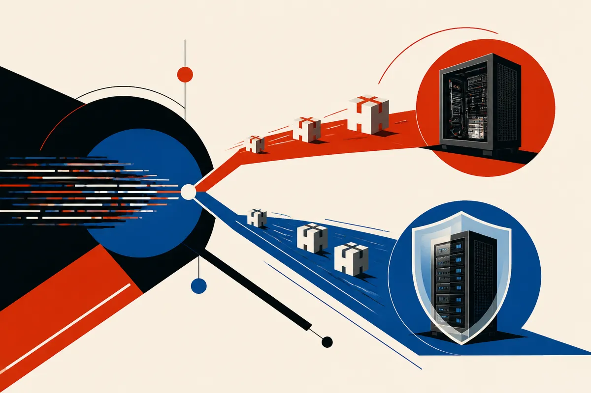

TL;DR: The security risk is not that Claude can write exploit code in isolation, it is that AI makes exploit development faster while patch pipelines still move at human speed.

## What actually happened?

Decrypt reported in “Claude-Built Linux Exploit Targets Bug That Ubuntu Still Hasn't Patched” that Anthropic says Claude wrote an attack that can take over a Linux server with no password. According to Decrypt, Red Hat patched the issue on Sunday, while Ubuntu still had no fix at the time of reporting.

That is the full shape of the claim we can safely work with from the material here. I do not have Anthropic’s underlying technical writeup in the provided sources, so I would not treat every detail as settled beyond the reporting. But the basic pattern matters: a frontier coding model was used to generate working offensive code against a real server-class Linux bug, and major distributions appear to be moving at different speeds.

The easy headline is “AI writes malware.” The more useful reading is narrower. Coding agents reduce the friction between “there is a bug” and “there is a working exploit.” That does not mean every model output becomes a clean remote takeover. It does mean the bottleneck shifts. Less time spent hand-assembling exploit logic. More pressure on patch availability, inventory, exposure control, and rapid verification.

## Why does the Ubuntu and Red Hat split matter?

The Red Hat and Ubuntu detail is the part operators should stare at. Same class of infrastructure risk, different patch state. If Decrypt’s report is accurate, one ecosystem had a fix and the other did not.

That is not a cheap shot at Ubuntu. Large distributions have different packaging systems, release policies, dependency trees, test cycles, and support contracts. Patching is not just “merge the fix.” A rushed patch can break production too.

But attackers do not wait for clean governance. Once exploit code exists, the clock changes. A vulnerability that was theoretically dangerous becomes operationally dangerous when someone can run code against it. AI narrows that gap.

This is where a lot of AI safety talk gets too abstract. You do not need a superintelligent agent to create a practical security problem. You need a capable coding model, a vulnerable target, and an environment where defenders cannot patch everything at once. That is ordinary enterprise reality.

## What should builders do with this?

Treat AI-generated exploit capability as a reason to improve defensive loops, not as a reason to ban the tools and pretend the old world still exists.

For teams running Linux servers, the immediate move is boring: know what distribution and version you run, know which packages are exposed to the network, know whether compensating controls exist when a vendor patch lags. If Red Hat has a patch and Ubuntu does not, that difference belongs in a risk register, not in a Slack panic thread.

For security teams using AI internally, this is also a cue to test more aggressively. A coding model can help write proof-of-concept checks, generate regression tests, compare package versions across fleets, and summarize vendor advisories for engineers who do not live in CVE feeds. The same capability that helps an attacker move faster can help a defender confirm exposure faster.

The catch is that AI-generated security code needs review. A model can produce plausible exploit logic, but it can also produce broken tests, noisy scanners, or code that causes damage in the wrong environment. Run it in a lab. Gate it. Log it. Keep humans accountable for what gets executed against production assets.

My practical take: if you build or operate systems, add AI to your patch and exposure workflow before attackers add it to theirs. Start with a small internal routine: feed vendor advisories into a model, map them to your actual server inventory, ask for a safe validation plan, then have an engineer approve and run it. The missed detail is that the hard part is not generating code. It is knowing where that code is safe to use, and whether the machines you care about are still waiting on a patch.
