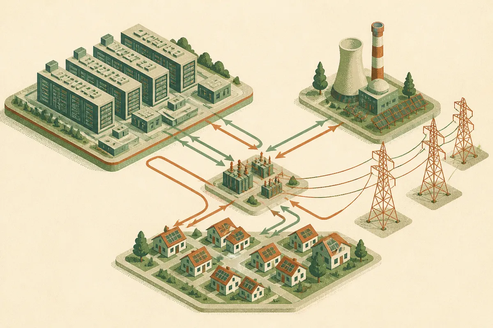

TL;DR: OpenAI is signaling that future AI compute sites need to be treated as grid infrastructure projects, not just data center real estate deals.

## What did OpenAI actually announce?

The primary source here is OpenAI’s blog post, “Introducing the Grid Protectors Program.” OpenAI says the program will work with utilities to help future compute campuses support grid reliability and protect consumer electricity costs.

That is the whole claim we can safely stand on from the announcement provided. No named utilities. No locations. No megawatt numbers. No tariff structure. No timeline. No technical playbook for demand response, onsite generation, storage, interconnection, or load flexibility.

Still, the wording matters.

OpenAI is not just saying, “we need more power.” It is saying future compute campuses should be planned in a way that supports grid reliability and shields consumers from cost pressure. That is a different posture than the usual data center story, where the headline is land, fiber, chips, tax incentives, and speed to energization.

The gap is obvious: “work with utilities” can mean many things. It could mean better siting. It could mean paying for grid upgrades. It could mean flexible load agreements. It could mean commitments to curtail during peaks. It could mean nothing operationally binding until contracts exist.

So I read this as an opening bid, not a finished program.

## Why does this matter for AI builders?

Because compute is becoming a deployment constraint.

For the last two years, most AI infrastructure talk has focused on GPUs, model serving, inference cost, and data center capacity. Those still matter. But at large scale, the unit is no longer just “cluster.” It is a site with power, cooling, transmission access, local politics, utility planning, and consumer rate sensitivity attached.

That changes who gets a vote.

A model lab can buy chips. It can rent cloud capacity. It can design a better inference stack. But it cannot wish a grid interconnection into existence, and it cannot ignore the optics of local electricity costs. If AI compute growth is perceived as raising household bills or straining reliability, the bottleneck moves from supply chain to public permission.

OpenAI’s announcement is a sign that the company knows this. It also gives utilities more room to demand concrete commitments. Not vibes. Not “AI will benefit everyone.” Real operating terms.

Can the compute campus ramp down during local peaks? Who pays for grid upgrades? Are new loads paired with new generation or storage? What happens during extreme weather? Are costs isolated from residential customers? What telemetry does the utility get? These are the questions that matter.

## The missing proof is the program design

The phrase “protect consumer electricity costs” is doing a lot of work. I like the intent. I would not treat it as evidence yet.

A credible version of the Grid Protectors Program would eventually show its mechanics. For example: standard utility agreements, public principles for cost allocation, clear rules for flexible demand, reporting on reliability performance, and examples of compute sites that changed operations to help the grid.

Without that, this is a positioning statement. Useful, but incomplete.

There is also a broader industry implication. Other AI labs and cloud providers will face the same pressure. If OpenAI makes utility partnership a public part of its infrastructure story, competitors may need to answer in similar terms. That could be good. The worst path is a private race for power where local communities find out late and pay the bill indirectly.

The practical move for builders is not to copy OpenAI’s scale. It is to copy the constraint map. If your product depends on heavy inference, batch jobs, video generation, or agentic workloads, power and compute availability are now part of product planning. Test cheaper inference paths. Design graceful degradation. Move non-urgent jobs to off-peak windows when possible. The catch most readers miss: infrastructure risk shows up as product risk long before it shows up as a public grid fight.
