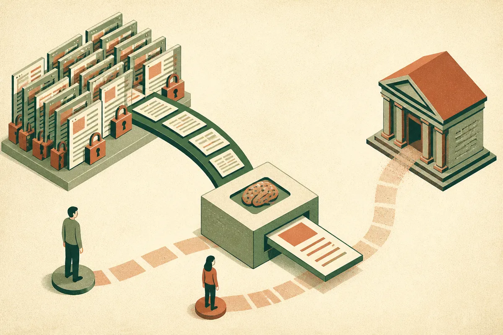

TL;DR: The New York Times-Brave dispute is a clean example of the next AI search fight: not whether crawlers can read the web, but whether they can turn publisher content into paid answer supply without sending value back.

## What is The New York Times accusing Brave of doing?

The primary published report I have is Search Engine Journal’s “NY Times Accuses Brave Of Scraping And Exploiting Content,” credited to @martinibuster. According to that report, The New York Times lawsuit accuses Brave of selling access to paywalled content to AI companies and depriving publishers of ad income.

That is an accusation, not a finding. I have not seen a court judgment here, and Search Engine Journal is reporting the claim rather than proving it. Still, the shape of the claim matters.

This is not the old crawler argument in a fresh coat. Publishers have always had a tense deal with search engines: bots crawl pages, search sends traffic, publishers monetize some slice of that attention through subscriptions, ads, affiliate links, or brand lift. Nobody loved the bargain equally, but there was at least a visible exchange.

AI search breaks that exchange when the product gives the user the answer directly. If the answer contains the useful part of the publisher’s work, and the user never visits, the publisher loses the monetizable event. If the same content also becomes a data product sold into AI systems, the complaint gets sharper: the publisher is not just losing a click, it is allegedly becoming raw material for someone else’s revenue line.

## Why is this different from ordinary search crawling?

The difference is substitution.

A normal search result points. An AI answer resolves. That does not make every AI answer unlawful or every crawl abusive. It does change the economics. A blue link is a handoff. A generated summary can be an endpoint.

That is why publishers are drawing harder lines around paywalls, robots rules, licensing, and scraping. The technical details will matter in court: what Brave allegedly accessed, whether paywalls were bypassed, what was sold, what contracts or terms applied, and whether the use fits any defense. But builders should not hide behind “the web was open” as a blanket answer. The web was open in many different ways, for many different uses, under many different expectations.

I run Lucky Domains, which works on SEO and search visibility, so I watch these fights less as abstract policy and more as a traffic supply-chain problem: 

The most important operator question is simple: if your AI product consumes third-party content, are you creating discovery for the source, or are you replacing the source? That distinction will decide how publishers, courts, platforms, and users react.

## What should AI builders do before this becomes their problem?

Do a content audit before you do a legal cleanup. Track what your system ingests, where it came from, whether it was public or paywalled, what the terms said, and whether outputs can reproduce the economic value of the original page. If the answer is “we do not know,” that is not a strategy. That is a liability queue.

For RAG products, citations are not a magic shield. They are useful for trust and user experience, but attribution does not automatically solve licensing, paywall access, or lost monetization. For AI search products, the safer design pattern is to send qualified traffic when the source carries the real value: news reporting, reviews, expert analysis, original data, local listings, and anything behind a subscription model.

For publishers, the answer is not only lawsuits. It is packaging rights more clearly. Decide what can be crawled for discovery, what can be quoted, what requires a commercial license, and what should never feed model outputs. Then make those rules visible in contracts, technical controls, and partner discussions.

Practitioner’s take: if you are building an AI answer layer, treat content provenance like infrastructure, not paperwork. Log sources, respect access boundaries, test whether outputs replace visits, and build referral paths that actually help the origin site. The catch most teams miss is that “we summarized it” can still be the product equivalent of taking the thing the publisher was paid to produce.
