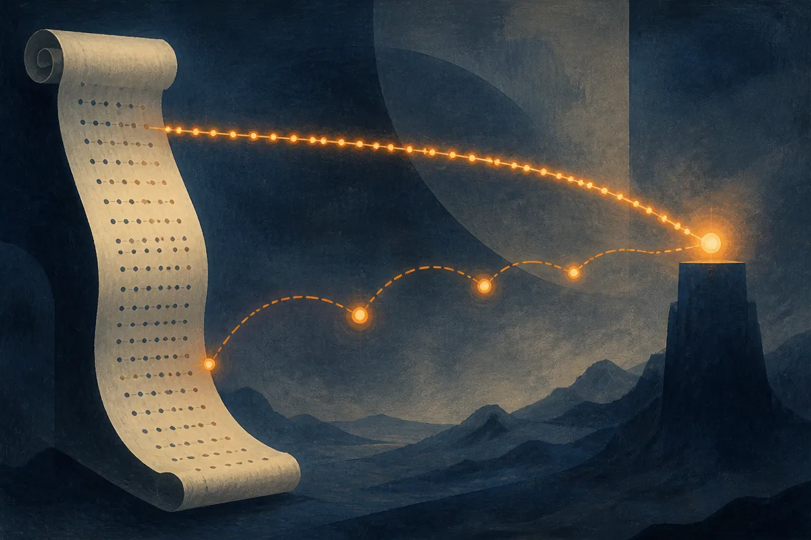

TL;DR: A new paper called "Subquadratic Attention with a Hierarchical Tree-Structured Indexer" proposes building a tree of compressed key summaries over the KV cache so queries only touch a sparse slice of it, and claims this scales subquadratically past a million tokens while bolting onto existing models with a few billion tokens of distillation.

The primary source here is the arXiv paper "Subquadratic Attention with a Hierarchical Tree-Structured Indexer," which names the method Zyphra Hierarchical Attention (ZHA). It shows up under both cs.AI and cs.CL. I will take the method claims from the paper and flag where they are projections rather than measured results, because that distinction is the whole story.

## What problem is ZHA actually solving?

Attention is quadratic. Every token attends to every prior token, so doubling the context roughly quadruples the compute for that step. That is the wall everyone hits when they try to push context from hundreds of thousands of tokens to millions.

The paper frames the existing escape routes as two dead ends. The first is cheaper attention that loses expressiveness: sliding windows that only look at nearby tokens, or linear-attention variants that compress history into a fixed-size state. You get speed, you lose the ability to reach back precisely into a long document. The second is sparse attention, where you only attend to a chosen subset of keys. That sounds right, but the catch the paper names is sharp: the indexer that decides which keys to pick usually scales quadratically itself. So you save on the final attention step and pay it all back choosing where to look.

ZHA's pitch is that the indexing itself can be made cheap. Instead of scoring every key to decide relevance, you build a tree.

## How does the tree-structured indexer work?

Picture the KV cache, the stored keys and values from everything the model has already read. ZHA builds a tree over it by recursively compressing keys into summaries. Leaves are the real keys. Each level up is a coarser summary of the level below.

When a new query arrives, it does not scan every key. It walks the tree top-down, following the summary nodes that look most relevant, and only reaches the leaves worth retrieving. That is the sparse subset it actually attends to. The routing cost is the cost of the walk, not the cost of touching every key.

The scaling claim rests on a trick that is easy to miss: as the sequence grows, you grow the tree's depth. The paper argues that with iterative depth growth the total cost, routing plus final attention, grows sublinearly in sequence length, which nets out to subquadratic overall scaling. Not linear, the paper is careful to call it superlinear but subquadratic. That honesty is worth noting, because plenty of "linear attention" work quietly hides constant factors or expressiveness losses that make the asymptotics irrelevant in practice.

Two details make this more credible than the usual long-context paper. One, the authors report ZHA is robust to tree geometry, holding up with trees as deep as six levels. If a method only works at one hand-tuned shape, it tends to break on real workloads. Two, they say it can be applied to existing pretrained models with a short KL distillation stage over a few billion tokens, rather than requiring a from-scratch retrain. If that holds, it is a retrofit, not a new architecture you have to train a foundation model around.

## Which claims are measured and which are projected?

This is where you have to read carefully, because the paper mixes two kinds of evidence and they carry very different weight.

The measured side: the authors report that after the distillation stage, ZHA maintains performance on long-context retrieval and on harder reasoning, math, and agentic coding evaluations. That is the claim that matters for whether the compression actually preserves the model's reach. Compressing keys into summaries is exactly the kind of move that quietly destroys needle-in-a-haystack retrieval, so "maintains performance" on retrieval is the load-bearing result. I would want to see the specific benchmarks and the margins, which the abstract-level material here does not give, before calling it settled.

The projected side: the headline numbers, dramatically outperforming competing methods beyond one million context, and the potential to reach hundreds of millions or billions of tokens, come from a performance model the authors built, not from running a model at a billion-token context. A performance model is a reasoned extrapolation of compute cost. It is useful and it is standard, but it is not the same as a trained system answering questions correctly at that length. The gap between "the cost curve says this is cheap at 100M tokens" and "the model is still accurate at 100M tokens" is enormous, and nothing in this material closes it. Treat the billion-token figure as a direction, not a demo.

## Does subquadratic attention change what builders ship?

For most people shipping today, nothing changes this week. ZHA is a research method from Zyphra, not a product you can call. There is no pricing, no availability, no API here, and I am not going to invent any.

But the shape of the bet matters if you work with long context. The dominant pattern right now for "read a huge corpus" is retrieval-augmented generation: chunk the documents, embed them, pull back the top matches, stuff them in the prompt. RAG exists partly because attention could not afford to read everything. If attention over tens of millions of tokens becomes genuinely affordable, some of the work you currently do in a retrieval pipeline moves back inside the model. Not all of it. You still want retrieval for freshness, for permissions, for citing sources. But the line between "retrieve then read" and "just read it all" would move.

The distillation angle is the part I would watch most. A method that retrofits onto an existing pretrained model with a few billion tokens of training is cheap enough that labs can test it on real checkpoints quickly. That is how you find out whether the retrieval quality actually survives contact with messy, long, real documents instead of synthetic benchmarks.

If you build with long context, the move is to treat this as a signal, not a tool: watch whether Zyphra or anyone else releases weights or a reproduction that hits the long-context retrieval numbers on public benchmarks, and specifically whether accuracy holds past a million tokens in a run, not a cost model. The catch most readers will skip past is that the eye-catching billion-token number is an extrapolation of compute, and compute being cheap says nothing about whether the answers are still right. Cheap attention at extreme length is only worth anything if the model can still find the one sentence that matters. That is the result to wait for.
