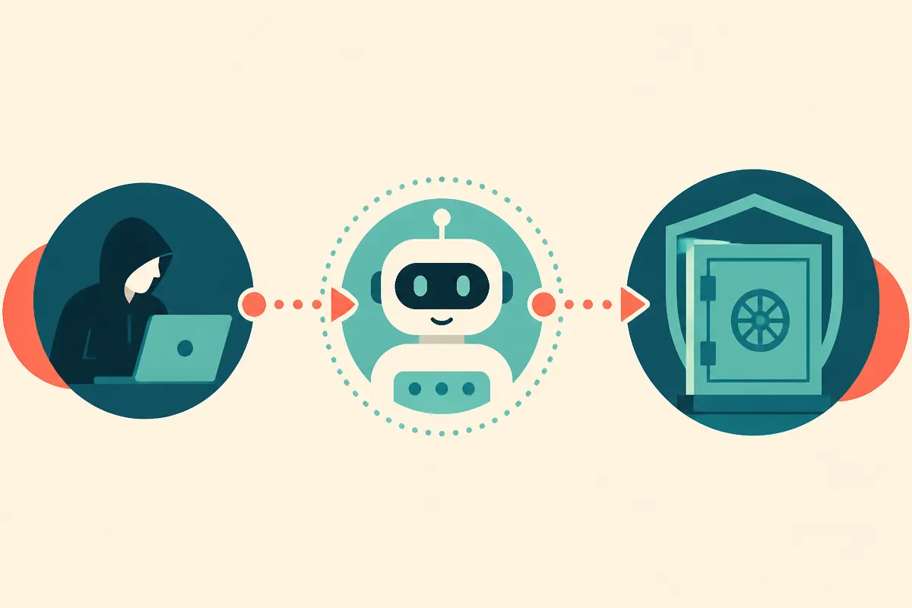

TL;DR: Treat internal AI tools like production systems with identity, logging, permissions, and containment plans, because attackers will route through them when they touch sensitive work.

## What did Binance say happened?

The primary source here is Binance’s incident report, as summarized by The Block, CoinTelegraph, and The Defiant. I do not have a public report title in the provided material, so I’m not going to dress this up as if I read a full PDF with clean exhibits.

The reported shape of the incident is still useful.

According to The Block, Binance said hackers used a fake job interview and an internal AI tool to gain access to systems involved in the theft. CoinTelegraph reported that Binance’s investigation traced the breach to compromised employee computers and stolen credentials, which then touched wallet infrastructure. The Defiant reported a slightly higher figure, $6.34 billion, and said attackers used an internal AI tool to reach wallet engineers while persistent onchain permissions made containment harder.

That is a nasty combination.

Not “AI hacked the exchange.” Not “AI caused the loss.” The more practical read is that an AI system sat inside a chain of trust. Once employee machines and credentials were compromised, the AI tool may have helped attackers get closer to the humans and systems that mattered.

This is the part many teams still underweight. Internal copilots, support bots, workflow assistants, code helpers, research agents, and ticket triage tools often become connective tissue. They see org charts, route requests, summarize sensitive context, pull from internal docs, and sometimes act inside other systems. That makes them useful. It also makes them attractive.

## Why does the AI tool matter if credentials were stolen?

Because stolen credentials are rarely the whole story.

A credential gets an attacker through a door. The next question is what that identity can see, ask, trigger, impersonate, or learn. An internal AI tool can compress that discovery phase. It can help identify who owns a process. It can expose procedures that were never meant to be public. It can make a fake request sound normal. If it has integrations, it may also become a place where permissions blur.

That does not require a sci-fi agent. A simple internal assistant connected to docs and chat history can be enough.

The Binance reporting also points to a second issue: containment. The Defiant’s note about persistent onchain permissions matters because blockchain systems can keep authority alive outside the usual enterprise controls. If a workflow depends on keys, multisig roles, allowlists, or smart contract permissions, cleaning a laptop and resetting passwords may not close the hole.

Crypto teams know this in theory. The hard part is practice. Permissions accrete. Emergency access survives too long. Wallet engineers get exceptions because production needs them. Internal tools get trusted because they are “only internal.”

That phrase should make security teams twitch.

## What should builders change after this?

Start by mapping AI tools as access paths, not chat boxes. Which systems can they read from? Which humans can they contact? Which actions can they trigger? Which logs show what they did and what they returned? If the answer is vague, the tool is already too trusted.

Then separate “helpful” from “authorized.” An assistant can suggest who to contact without being able to message them. It can summarize a runbook without exposing secrets, signing flows, recovery phrases, production wallet details, or internal escalation language that would help an attacker. It can draft a ticket without getting permission to approve one.

The same goes for recruiting and interview workflows. Fake job interviews are now a standard social engineering path, especially for engineering and security roles. If an interview task asks someone to install software, open a repo, run a local package, or join a strange conferencing setup, that is a security event waiting to happen. Treat it that way.

For AI specifically, I’d test three things this week. First, can a compromised employee account use an internal AI tool to identify sensitive operators? Second, can it retrieve procedures that would help move money, deploy code, rotate keys, or bypass review? Third, does anyone get an alert when the assistant is used in a weird pattern after endpoint compromise?

The catch most readers miss: the AI tool does not need to be powerful to be dangerous. It only needs to be trusted, connected, and boring enough that nobody watches it closely.
