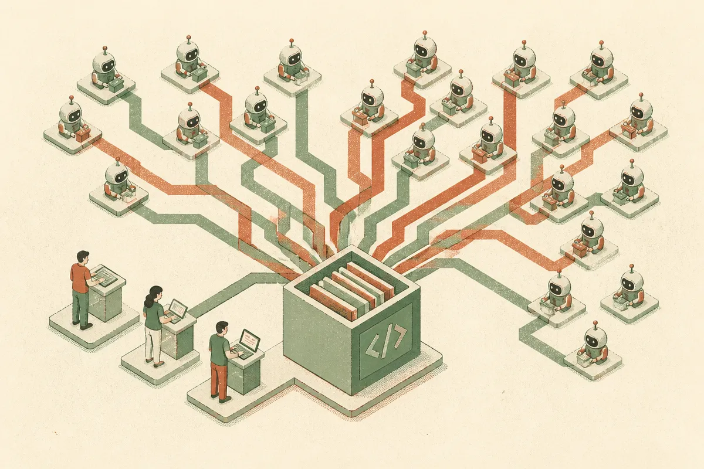

TL;DR: Coding agents do not just need better models, they need development infrastructure that can absorb many more branches, diffs, tests, reviews, and failed attempts.

## What did OpenAI actually announce?

OpenAI’s primary announcement is “Scaling Git at OpenAI,” an OpenAI Blog post about Pando, a Git-compatible backend built for the scale of development that Codex makes possible.

That wording matters. OpenAI is not framing Pando as a new developer interface or a replacement for every Git workflow. It is describing a backend. Git-compatible is the key phrase. Developers, tools, and automation already speak Git. The painful part is not the concept of commits. It is the operational load when the number of code-producing actors increases.

Codex is the pressure source in OpenAI’s framing. Human engineers create branches, patches, experiments, and dead ends. Coding agents create those too, but faster, and with less hesitation. If the marginal cost of asking for a patch drops, the number of patches goes up. Some will be good. Many will be junk. All of them still hit storage, indexing, permissions, CI, review queues, and merge logic.

Hacker News picked up the same “Scaling Git at OpenAI” announcement, which is unsurprising. Developers have a good nose for infrastructure posts that reveal second-order effects. The flashy story is “AI writes code.” The operator story is “your existing systems were sized for human-speed code production.”

## Why would coding agents stress Git infrastructure?

The easy answer is volume. The better answer is shape.

AI-generated work tends to be bursty. A person may open one branch, edit it, test it, and ask for review. An agent system may try several candidate fixes, compare outputs, run tests, discard most attempts, and keep one. That pattern creates more temporary state. More branches. More object churn. More metadata. More reads against the same history. More parallelism.

This is where “Git-compatible backend” is a smart boundary. The user-facing mental model can stay familiar while the backend changes to handle scale. That is usually how infrastructure shifts actually land. Not with a clean rewrite of the world. With compatibility at the edge and different machinery underneath.

There is a trap here, though. It is easy to read Pando as “Git cannot handle AI.” That is too broad. Most teams are nowhere near OpenAI’s scale, and most teams do not have Codex-like systems generating enough work to justify custom source-control infrastructure. For a normal engineering org, the bottleneck is more likely test quality, code review discipline, flaky CI, unclear ownership, or agents making changes without enough context.

Still, OpenAI’s move is a useful signal. When agent output rises, source control becomes part of the agent platform. Not just a place to save code.

## What should builders take from Pando?

The first takeaway is to measure the whole loop, not just model success. If a coding agent creates a plausible patch, that is only step one. The real workflow includes branch creation, dependency install, test execution, linting, review, security checks, merge, rollback, and observability after deploy.

The second takeaway is to expect waste. Good agent systems will generate failed attempts. That is not automatically bad. Search creates dead ends. Debugging creates dead ends. The question is whether your infrastructure treats failed attempts as cheap, isolated, and disposable, or whether every attempt clutters the same human queue.

The third takeaway is that compatibility wins. Builders should avoid agent workflows that require developers to abandon core tools too early. Git, pull requests, CI, issue trackers, and code owners are not glamorous, but they are where accountability lives. If an agent cannot fit into those control points, it may demo well and fail in production.

For a small team, I would not try to copy Pando. I would copy the concern. Track how many branches and PRs your agents create, how many are abandoned, how long CI takes, how often reviewers reject agent-made changes, and whether agent output is piling up faster than humans can validate it. Then tighten the loop: smaller tasks, cleaner repo context, better tests, stricter permissions, and automatic cleanup of failed attempts. The catch most readers miss is that coding agents make code cheaper, not correctness cheaper. Your bottleneck moves to the systems that decide what code deserves to live.
