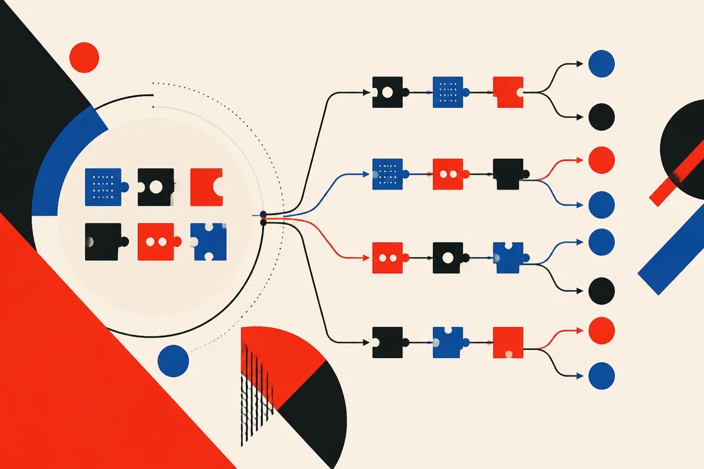

TL;DR: Agent builders should stop treating reasoning flows as one-off prompt craft and start treating them as reusable, testable code that can improve across tasks.

## What is Strategist actually changing?

The arXiv paper “Strategist: Evolving Reasoning with Agents” makes a simple but useful split: a model is not the whole agent. The other half is the inference strategy, meaning the procedure that decides how the model is called, checked, revised, and turned into an answer.

That sounds obvious if you build with agents. The model is only one part of the stack. The loop matters. Do you ask once? Decompose the task? Generate multiple candidates? Score them? Ask another model to verify? Retry after failure? Call tools before or after reasoning?

Most teams still build those loops by hand. Worse, the useful tricks often stay trapped inside one workflow. A strategy that works for math reasoning does not automatically become reusable for code repair, retrieval, or planning. It lives in a notebook, a prompt chain, or somebody’s head.

Strategist tries to make that second half of the system improve on its own. Each strategy is represented as a blueprint, executable code that can be reused by other strategies. Those blueprints form a library. Given a new task and a small development set, Strategist retrieves related blueprints, writes candidate strategies, tests them on real samples, and revises based on the results. Every candidate goes back into the library, so future tasks can build from prior attempts.

That is the interesting bit. Not “an agent writes prompts.” The real claim is compounding process knowledge.

## Do the numbers support the idea?

The paper reports results on 30 benchmarks. Strategist beats the strongest baseline on 24 of them. Average accuracy is basically tied, 74.7% for Strategist versus 74.0% for the baseline, but Strategist gets there at 39% lower inference cost.

That cost number matters more than the tiny accuracy gap. A lot of agent systems can improve scores by spraying model calls everywhere. Sample more. Verify more. Debate more. Search more. At some point, the system is not smarter. It is just expensive.

Strategist is interesting because it suggests a different direction: find the cheaper reasoning procedure that works for the task, then preserve it. If true across more settings, this is closer to engineering than prompt folklore.

There are still caveats. The source material gives benchmark-level results, not a full tour of where it fails. “Transfers to unseen tasks and other models without further search” is a strong claim, but I would want to see the boundary conditions. Which tasks? How far from the original distribution? What happens when the development set is noisy? How brittle are the generated blueprints when tool APIs change?

That is not a dismissal. It is the part builders should care about before copying the pattern.

## Why does this matter for agent systems?

The agent world has been too model-centric. Better base models help, yes. But once you are building real systems, the difference between a demo and a useful product is often in the control layer: retries, tests, memory, routing, tool choice, confidence checks, fallbacks, and cost budgets.

Strategist points at a future where that control layer becomes an artifact you can evaluate and reuse. Not just a prompt. Not just an orchestration graph. A strategy library with executable components and empirical performance history.

That fits how good software teams already work. You do not rewrite authentication, logging, or queue handling for every product. You keep patterns that work. Agent reasoning should move the same way.

I would not plug this blindly into production. I would start smaller. Take one recurring workflow, like research synthesis, customer support triage, lead qualification, code review, or test generation. Define a small development set with examples you actually care about. Then test multiple inference strategies against cost, latency, and output quality. Save the winners as named, reusable blueprints. The catch most readers miss: the development set is the product spec. If your eval examples are vague or unrepresentative, the agent will evolve toward passing the wrong game.
