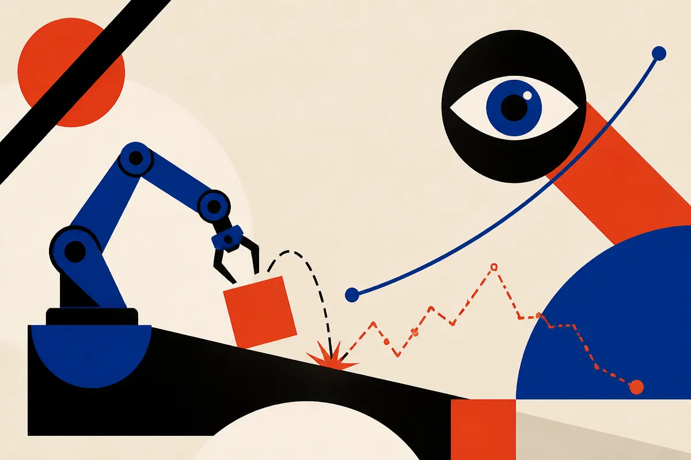
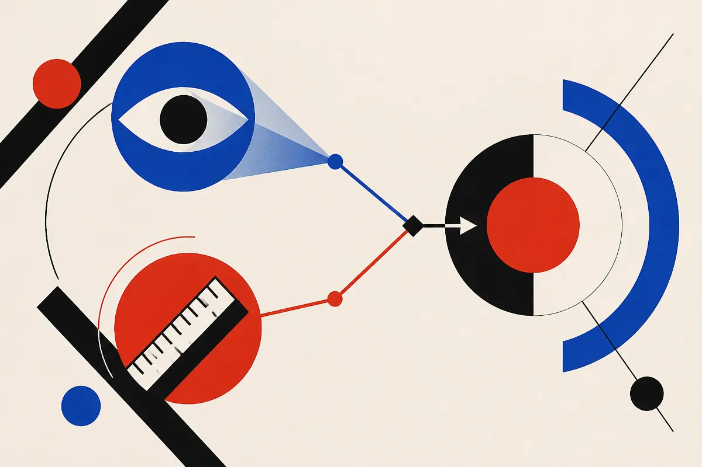

TL;DR: If you ask a vision-language model to score how well a robot did a task, it tends to assume the robot succeeded and hallucinate progress; a paper called D&A fixes this by forcing the model to describe the scene first and judge against an explicit rubric second, with no training at all.

The paper is "D&A: Decoupling Description and Assessment Enables VLMs as Zero-Shot Robotic Reward Models," posted to arXiv across cs.AI, cs.CL, and cs.LG. The problem it goes after is small-sounding and actually central to how robots learn. Reward models tell a robot whether it is doing well. If the reward model lies to you, every downstream training step inherits the lie.

## What is confirmation bias in a VLM reward model?

Here is the failure in plain terms. You hand a frontier VLM a video of a robot arm trying to stack a block, and you ask: how much progress did it make? The model, prompted naively, does one of two bad things. It collapses into a binary success detector (either "done" or "not done," nothing in between). Or it assumes the task succeeded because that is the implicit prior baked into how these questions usually read, and it narrates progress that never happened. The robot knocked the block off the table and the model still reports steady improvement.

The D&A authors call this confirmation bias, and they trace it to two design choices. First, implicit success assumptions: the prompt quietly presumes the run worked. Second, relative temporal ranking: frameworks that ask "is frame 50 better than frame 10?" anchor the whole judgment to the video's own timeline rather than to what success actually means. If the video just shows a robot flailing in increasingly confident ways, a timeline-relative scorer will happily call the last flail "more progress."

That distinction matters because a lot of people building with VLMs right now assume the model is grounding its answer in the pixels. It often is not. It is pattern-matching the shape of the question. Ask it to rank, and it ranks. Ask it in a way that presumes success, and it finds success.

## How does decoupling description from assessment fix it?

D&A, which stands for Describe and Assess, splits the job into two passes.

In the first pass, the model does nothing but describe. It produces an objective, task-grounded account of the scene dynamics: what the arm is doing, where the object is, what physically happened. No scoring, no judgment, no progress estimate. Just observation written down as text.

In the second pass, the model assesses. But before it scores anything, it is compelled to write out an explicit, text-based definition of what absolute success means for this task. Then it grades the described scene against that rubric. The authors' framing is that this anchors the evaluation to an external, global criterion instead of the video's internal timeline. You are no longer asking "did this get better?" You are asking "measured against what finishing actually looks like, how far did this get?"

That is the whole trick, and it is worth sitting with why it works. The description step strips out the success prior by making the model commit to what it literally sees before it is allowed to have an opinion. The rubric step gives it a fixed yardstick so it cannot drift along with the footage. Separately neither is novel. Chain-of-thought and rubric prompting are old ideas. The specific claim here is that this particular decoupling kills the specific bias that wrecks robotic reward estimation, and that it does so without touching the model's weights.

## Why does "no training" matter so much here?

This is the part I would underline for anyone building agents or robot stacks. The usual way to fix a biased reward model is post-training: collect real-world robotics data, fine-tune the model to score honestly. The paper is blunt about the cost. That data is expensive to gather, and the computationally intensive post-training has to be redone for every single base model you want to use. Swap from one VLM to another and you pay the whole bill again.

D&A is purely prompt-based. Nothing gets trained. Which means the method rides along with whatever frontier VLM you point it at, and it inherits that model's improvements for free when the next one ships. The authors report that it generalizes across tasks, embodiments, and benchmarks, and that its reward estimates match or surpass post-trained reward models. They also claim the estimates are good enough to drive efficient downstream reinforcement learning, which is the real test: a reward signal is only worth anything if a policy can actually learn from it.

I want to be careful here. This is an arXiv preprint, and the sources I have are the abstract, repeated across three category listings. I do not have the per-task numbers, the benchmark names, or the baseline reward models they compared against. "Matches or surpasses post-trained models" is their phrasing, not a figure I can check. Treat the headline claim as promising and unverified until the tables are in front of you. The mechanism is believable. The magnitude is not something I can confirm from an abstract.

## What should a builder actually do with this?

The narrow use is obvious if you are training robot policies: try the two-pass prompt before you spend a dollar on collecting preference data to fine-tune a reward model. If a frozen frontier VLM with the right prompt structure gets you a usable, non-linear progress signal that correctly punishes failures, you have skipped the most expensive and least portable part of the pipeline.

The broader use is the one most readers will miss. This pattern is not really about robots. It is about any time you use an LLM or VLM as a judge, which is now a huge share of agent evals, content scoring, and automated QA. The same confirmation bias shows up everywhere: ask a model "did the agent complete this task?" and it leans toward yes. The fix generalizes. Make the model describe the raw evidence first with zero judgment, then force it to write the success criteria explicitly, then grade against that criteria. Separate perception from scoring. Separate the rubric from the instance.

Here is the catch. Two passes means more tokens, more latency, and more cost per judgment. For a reward model feeding an RL loop that runs millions of times, that overhead compounds fast, and the paper's "efficient downstream RL" claim is about sample efficiency of learning, not inference cost of scoring. So the real engineering question is not "does decoupling help," it clearly does, it is "where on your pipeline is an honest-but-expensive judge worth more than a cheap-but-biased one." For final evals and reward shaping, almost certainly worth it. For a tight inner loop, measure before you commit. The method is a prompt. The tradeoff is yours.
