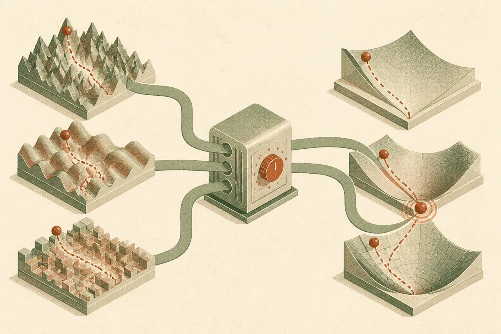

TL;DR: The useful takeaway from A2ODA is not “new optimizer beats everything,” it is that low-cost preconditioning and geometry-aware updates are still live areas for making training and fine-tuning less wasteful.

## What does A2ODA actually change?

The primary source here is the arXiv paper “A simple adaptive accelerated optimistic dual averaging method for unconstrained convex optimization in $p$-norm geometry,” listed under cs.AI and cs.LG. The paper proposes adaptive accelerated optimistic dual averaging, written as $\text\{A\}^2$ODA, for unconstrained convex optimization.

That phrasing sounds academic because it is. But the practical center is simple: first-order optimization often benefits from preconditioning, and good preconditioning can be expensive. If you can get some of the benefit without heavy matrix machinery, you have something worth studying.

A2ODA does three concrete things the paper emphasizes.

It uses low-cost preconditioning based on $p$-norm geometry for $p \in [2,\infty]$. It is line-search-free. And it uses a new stepsize selection technique based on an aggregated affine lower model.

The nice engineering detail is that the update structure is described as simple and unified across the whole $p$ range. The paper says the $p > 2$ case does not require more elaborate updates than the Euclidean $p = 2$ case. That matters because a lot of “better optimizer” work dies when the update logic becomes too fussy to implement, too expensive to run, or too fragile to tune.

## Why should AI builders care about convex optimization papers?

Because optimizer ideas tend to travel.

Not directly. Not cleanly. And not on the timeline that hype posts imply. A convex optimization result is not proof that your next transformer run will converge faster, need fewer GPUs, or beat AdamW. Deep learning training is stochastic, nonconvex, distributed, numerically messy, and packed with tricks that do not show up in clean theory.

Still, this is the layer where boring improvements compound. Optimizers sit under model training, fine-tuning, embedding models, ranking systems, preference models, adapter training, and a long list of convex or nearly convex subproblems around AI systems. If a method reduces the need for line search, keeps update logic cheap, and handles different geometries without special-case machinery, that is relevant even before anyone proves it works at frontier-model scale.

The paper’s theoretical claim is also more careful than “faster optimizer.” Under a generalized local smoothness condition, it gives a convergence bound that separates constant curvature from gap-dependent curvature. The gap-dependent part can produce faster-decaying terms. In the special case of local smoothness, the paper reports a nearly optimal convergence rate.

That is a specific claim, not a benchmark flex.

## What is the catch?

The catch is scope.

This is unconstrained convex optimization. The paper does not, from the supplied material, report large language model training runs, GPU throughput numbers, optimizer wall-clock comparisons, or production fine-tuning benchmarks. So I would not read A2ODA as a drop-in replacement for Adam, Adafactor, Lion, or whatever your current stack uses.

I would read it as another signal that optimizer research is moving toward practical frugality: less expensive preconditioning, fewer brittle line-search requirements, cleaner behavior across geometries, and adaptive steps that can be justified mathematically.

That is the right direction. AI infrastructure has spent the last few years making huge models possible. The next phase needs more work that makes the same class of work cheaper, more stable, and easier to reproduce. Not every gain has to come from a bigger cluster or a better data mixture.

For a builder, I would not swap this into production training on faith. I would look for places where convex optimization is already inside the workflow: linear probes, retrieval/ranking calibration, classical ML baselines, small fine-tuning experiments, or internal optimization routines that currently need annoying line-search tuning. Try A2ODA there first, compare wall-clock time and final objective against your boring baseline, and watch the implementation cost. The missed catch is that optimizer elegance only matters if it survives contact with your actual loss, hardware, and debugging budget.
