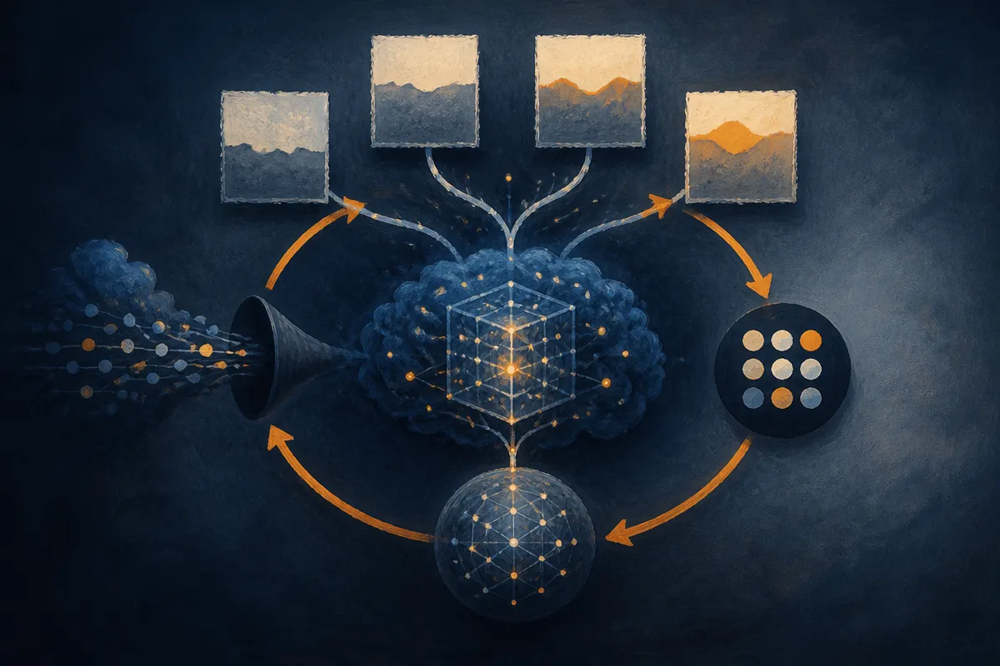

TL;DR: An independent replication of Direct Nash Optimization lifts a Llama 3.1 8B model past Llama 3.1 70B on AlpacaEval 2.0, and the honest part is that the authors tell you why that number is softer than it looks: GPT-4o is both the teacher and the judge.

The paper is "Aligning Language Models with General Preferences: An Empirical Study of Direct Nash Optimization," posted to arXiv across cs.AI, cs.CL, and cs.LG. What makes it worth reading is not the method, which traces back to the original DNO work. It is that someone re-implemented the practical variant from scratch, ran the ablations, and published the cost and the confound instead of burying them. That is rarer than a new loss function.

## What is Direct Nash Optimization actually doing?

Standard preference tuning like DPO assumes you can collapse human taste into a single reward number. DNO drops that assumption. It treats alignment as a two-player preference game and aims for the Nash equilibrium of a general preference function, which is a formal way of saying it optimizes against "which of these two answers do people prefer" directly, without pretending preferences are transitive or scalar.

The practical recipe the authors call DNO-Prct is a loop. Sample on-policy responses from the model you are tuning. Have an LLM rate those samples alongside a teacher's gold response. Select large-margin preference pairs, meaning cases where one answer clearly beats another. Then run a DPO-style contrastive update. Repeat. Three iterations is where the reported gains land.

The important design choice is that gold responses from the teacher sit inside the rating pool. The model is not just learning to prefer its own better samples. It is being pulled toward a stronger reference on every pass.

## How big are the gains, and against what?

On AlpacaEval 2.0 with GPT-4o as judge, three iterations raise the length-controlled win rate against GPT-4o from 31.7% to 45.3% for Llama 3.1 8B Instruct, and from 6.8% to 18.4% for Mistral 7B Instruct v0.1. The authors report that the tuned 8B model scores above Llama 3.1 70B Instruct on every reported win rate.

Sit with that for a second. An 8B model, after three rounds of this loop, beats a 70B model from its own family on this benchmark. That is the kind of result that makes post-training look like free lunch.

It is not free lunch, and the paper is upfront about why. Every one of these numbers lives inside a single evaluation harness, with a single judge, measuring a single kind of task. AlpacaEval 2.0 rewards a particular style of helpful, well-formatted instruction following. Beating Llama 3.1 70B on AlpacaEval LC win rate is not the same as matching it on reasoning, long-context work, or anything the benchmark does not probe. The headline is real and narrow at the same time.

## Does the rating step need a proprietary model?

This is the part operators should care about most. The expensive, lock-in-prone piece of the loop is the LLM doing the rating. If that has to be GPT-4o, the whole method is renting someone else's model to improve yours.

The authors tested it. With same-family open-weight annotators instead of GPT-4o, the runs retain 62% of the LC gain for Llama and 82% for Mistral. So you lose some lift, more for Llama than Mistral, but the method does not collapse without a proprietary judge. You can run the whole pipeline on open weights and still get most of the benefit. For anyone who cannot or will not pipe their training data through a closed API, that is the single most useful finding here.

## Which parts of the recipe carry the weight?

Ablations are where you learn whether a method has a real mechanism or just a lot of knobs that happen to be set well. This one has a clear answer.

Three things matter. Remove the gold responses, remove the data look-back, or accept only teacher-preferred pairs, and the score drops 6 to 10 LC points below the full procedure. Those are the load-bearing walls. The gold reference and the full pair-selection logic are doing the work.

Two things barely matter. Varying on-policy samples per prompt from 1 to 7 moves the LC win rate by at most 2.1 points. A margin sweep from 1 to 5, run in its own pipeline, moves it by at most 2.4 points. So the knobs people instinctively want to tune, how many samples to draw, how aggressive the margin filter is, are close to noise compared to the structural choices.

That contrast is the real lesson. If you were going to replicate this, you would spend your budget getting the gold responses and pair selection right, and you would not agonize over sample counts.

## Why does the teacher-is-also-judge problem matter?

Here is the honesty that makes this paper worth your time. The authors state plainly that all results are single runs, and that GPT-4o is both the teacher that provides gold responses and the evaluation judge on AlpacaEval 2.0. They discuss what that implies rather than hoping you miss it.

Think about the loop. The model is trained to produce responses a GPT-4o-style rater prefers, using GPT-4o gold answers as the target, and then scored by GPT-4o on how often it wins. Some portion of that 45.3% is the model learning the judge's taste, not getting better in a way a different judge would recognize. The same-family annotator experiment partly addresses this, since the open-weight runs still gain even when GPT-4o is not the teacher. But the evaluation judge is still GPT-4o, so the circularity is reduced, not removed. Single runs mean no error bars either. A two-point ablation difference could be variance.

None of this makes the method fake. It makes the number soft at the edges, and the paper tells you exactly which edges.

A builder using this would run DNO-Prct as an open-weight pipeline, because the 62% to 82% retention says you do not need to send data to a closed API to get most of the lift. Spend your effort on the gold references and pair selection, not sample-count tuning, because that is where the ablations say the gains actually come from. And before you trust your own AlpacaEval jump, change the judge: score the tuned model with a different evaluator, or on a task the training loop never optimized for, and see how much of the win survives. The catch most readers miss is that a result where the teacher and the judge are the same model is a floor on skepticism, not a ceiling on performance. The number that matters is the one a judge you did not train against gives you.
