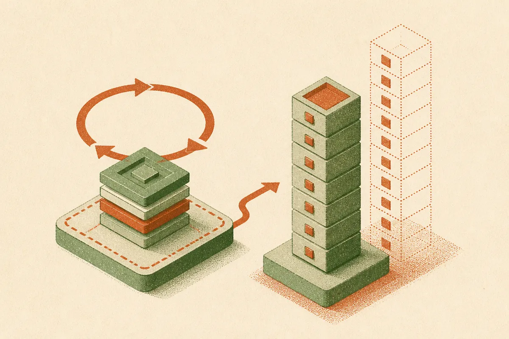
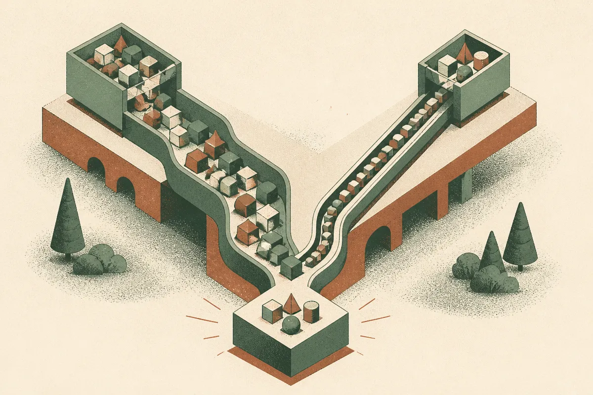

TL;DR: LoopVQ compresses the key-value cache of looped transformers to under one bit per element and reports up to 6.1x higher serving throughput, which matters because looped models trade parameter memory for a KV cache that quietly balloons.

The paper is "LoopVQ: Sub 1-bit KV Cache Quantization for Looped Transformers," posted to arXiv across cs.AI, cs.CL, and cs.LG. The core claim is narrow and worth taking seriously: looped transformers solve one memory problem and create another, and this method attacks the second one directly.

## What is a looped transformer, and why does its memory behave differently?

Standard transformers stack unique layers. A looped transformer reuses the same layers over several passes, what the paper calls loop steps. The payoff is parameter efficiency. The authors note that recent looped language models match the performance of non-looped models several times their size, which is a real win if you care about model weights sitting in memory.

But there is a tradeoff hiding in the attention mechanism. Every loop step still generates and stores its own keys and values. So while the weights stay small, the KV cache grows linearly with the number of loop steps. For anyone who has deployed a model, this is the familiar story: the weights are the thing you brag about, and the cache is the thing that actually eats your VRAM at long context. Looped models make that tension sharper, not softer. You picked the architecture to save memory, and the cache hands part of the bill right back.

That framing is the most useful thing in the paper even before you get to the method. If looped transformers are going to be a serious path for parameter-efficient models, and the Ouro and Huginn families suggest people are betting on it, then the KV cache is the bottleneck that decides whether they ship.

## How does LoopVQ get below one bit per element?

Two observations drive the design. First, the KV cache of looped models is highly redundant along the loop axis. Different loop steps produce keys and values that look a lot like each other. Second, the loop steps differ substantially in their sensitivity to quantization. Some steps can be crushed hard without hurting output; others cannot.

LoopVQ is a vector quantization method that codes channels across multiple loop steps jointly, which is how it exploits that redundancy instead of quantizing each step in isolation. Then it fine-tunes the codebooks to match the output of the full-precision model. That second part matters. This is not a pure post-training rounding trick. There is a calibration step where the codebooks learn to reproduce what BF16 would have produced, which is where a lot of the accuracy retention comes from.

The headline number: at 0.5 bits per element, the authors report LoopVQ outperforms existing KV cache vector quantization methods built for standard LLMs, tested on general tasks, long chain-of-thought reasoning, and long-context retrieval with Ouro and Huginn. Push further, combine it with a method called TaSQ, and they report retaining much of the BF16 accuracy even at 0.25 bits per element. A quarter of a bit per element is aggressive. Treat the "much of the accuracy" phrasing as the authors' own, because that is the kind of claim where the gap between "much" and "all" is exactly where production pain lives.

One point in its favor that is easy to skim past: the authors say the design is orthogonal to existing methods. Orthogonal means stackable. If it holds up, you are not choosing LoopVQ instead of your current compression stack, you are adding it on top of the loop axis that other methods were never built to exploit.

## Do the throughput numbers hold up to scrutiny?

This is where the paper moves from theory to something an operator can feel. The authors implemented LoopVQ in SGLang, a real serving framework, not a toy harness. They report that it nearly halves decode latency at a 32K-token context, and raises peak serving throughput by up to 4.3x on the 1.4B Ouro model and 6.1x on the 2.6B model, both against a BF16 baseline.

Read those numbers with the usual care. "Up to" is doing work, and peak throughput at a favorable context length is the best case, not the average you will see across mixed traffic. The baseline is BF16, which is the uncompressed starting point, so the comparison is "us versus doing nothing," not "us versus your already-optimized FP8 or INT4 setup." That is a fair baseline for a research paper and a generous one for a deployment decision. Still, a BF16 KV cache is a genuinely common starting point, and halving decode latency at 32K tokens is the kind of result that changes what a single GPU can serve.

What I like here is that the gains are concentrated where small-model deployments actually hurt: the 1.4B and 2.6B range, running long contexts, on hardware where every gigabyte of cache is competing with batch size. These are exactly the models people run locally or at the edge, where you cannot just rent another node.

## What should a builder actually do with this?

The honest answer: watch it, do not bet production on it yet. LoopVQ only applies if you are running looped transformers, and right now that means Ouro, Huginn, and a small set of research models. Most teams are running Qwen, Llama, or Gemini-class dense models where this does not apply directly. The redundancy LoopVQ exploits lives specifically along the loop axis, which standard architectures do not have.

But the strategic read is bigger than one method. The paper is a data point that looped transformers are becoming practical enough that people are solving their second-order problems. That is usually the sign an architecture is maturing. The first wave of papers proves it works; the second wave fixes the thing that makes it annoying to deploy. KV cache memory is squarely a deployment problem.

If you run small models at long context and care about tokens per dollar, the move is to track whether the looped families start shipping in the frameworks you already use. SGLang support out of the gate is a real signal, because it means someone built this to serve, not just to publish. The catch most readers will miss is the calibration step. LoopVQ fine-tunes its codebooks against full-precision output, which means you need a representative calibration set and a pass to fit it before you deploy. That is cheap compared to training, but it is not zero, and if your traffic drifts far from the calibration data, the sub-one-bit accuracy claims are exactly the thing that quietly degrades. Compress aggressively, then measure on your real workload, not the paper's benchmarks.
