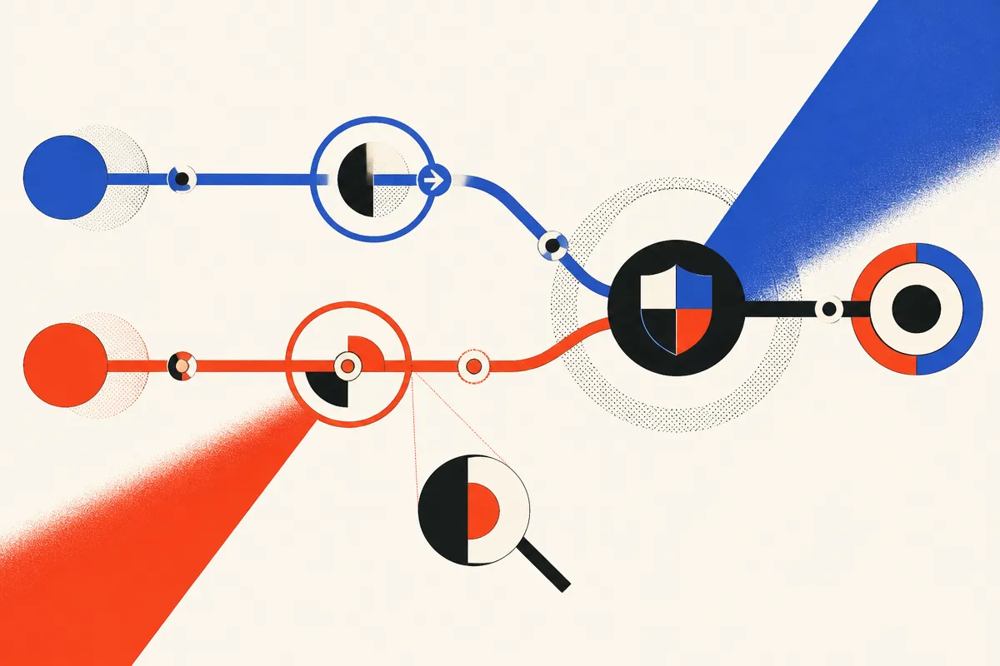

TL;DR: MedPhysBench is useful because it tests the thing high-stakes AI systems actually need to do: not just calculate correctly, but catch wrong work from someone else.

## What does MedPhysBench actually measure?

The primary source here is “MedPhysBench: A Benchmark for Evaluating Language Models on Medical Physics Calculations and Error Detection,” an arXiv benchmark for medical physics tasks across radiation therapy, diagnostic imaging, nuclear medicine, and radiation protection.

That matters because medical physics is not a vibes domain. A monitor-unit calculation or beam calibration error can affect every patient treated under that setup. The benchmark is built around ten seeded generators, from standard calculations up to clinical worksheets like TG-51 calibration. Reference answers come from code implementing the relevant protocols, with grading that handles unit conversions and tolerance bands.

The smart part is that MedPhysBench does not stop at “can the model solve the math?” It creates paired checking tasks from the same inputs. Sometimes the model sees a colleague’s worksheet. Sometimes it only sees the colleague’s result. Half are correct. Half have one planted error.

That design gets closer to the workflow people actually want from AI in clinics, labs, finance, engineering, and compliance. We rarely need a chatbot that free-solos a final answer. We need systems that draft, check, flag, explain uncertainty, and know when a human needs to slow down.

## Why is “can solve” different from “can check”?

MedPhysBench reports that 12 models scored from 33.3% to 100.0% on calculation across a held-out test split of 1,200 items, with half used for two models. The top four landed between 99.3% and 100.0%. That sounds excellent, but the misses are where the benchmark gets interesting.

Of the nine incorrect answers from those top four models, five were model errors. Four followed NCRP Report 151 on points the benchmark items misstated or left open. Good benchmark practice includes admitting that. In high-stakes domains, “wrong” can mean the model failed, or it can mean the test encoded ambiguity. The MedPhysBench team released code, per-item outcomes, and targeted-test responses, which is the right move if this is meant to be inspected instead of quoted in a launch deck.

Below the top tier, the harder clinical tasks exposed bigger gaps. MedPhysBench reports that Claude Sonnet 5.5 omitted the inverse-square correction in 19 of 20 isocentric MU items. That is not a harmless formatting miss. It is the kind of repeated pattern error that makes aggregate accuracy less comforting.

The checking results are the more operator-relevant piece. Five models detected at least 96.7% of mostly large planted errors with at most 4% false alarms. But for four of the other seven models, checking only the result significantly increased false alarms. Context changed behavior.

Then comes the most useful failure mode: in an exploratory targeted test with 20 public cases where an inverse-square correction was omitted, the three best tested models caught it in every worksheet. Three weaker models accepted 16 to 18 of 20 planted wrong worksheets. One did that while applying the correction in most of its own calculations. Claude Opus 5.5 accepted 6 of 20 wrong results, even though it applied the correction in all 20 of its own answers.

That is the key lesson. Knowing a rule during generation is not the same as noticing its absence during review.

## What should builders take from this?

MedPhysBench is a benchmark about medical physics, but the pattern is broader: evaluator behavior is its own product surface. If you are building an AI checker, do not assume a model that can do the task can reliably audit the task. Test the audit path separately. Give it the full worksheet when possible, not just the final result. Track false alarms, not only missed errors, because noisy checkers get ignored. And seed targeted regressions for known failure modes, especially cases where the model succeeds as a solver but fails as a reviewer. The catch most readers miss: the safest architecture may not be “one stronger model,” it may be separate solve, review, and escalation loops with evals for each role.
