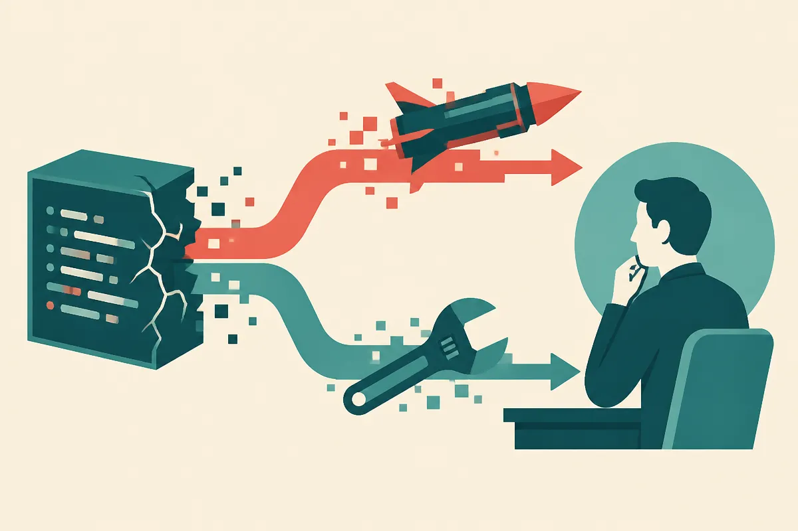

TL;DR: If AI can cheaply turn Linux bugs into working exploits and draft fixes, the bottleneck moves from finding flaws to validating, prioritizing, and safely shipping patches.

## What did OpenAI reportedly build?

Decrypt reported in “OpenAI Found 948 Linux Security Flaws—And Figured Out How to Exploit Them” that an automated OpenAI system found 948 Linux security flaws, generated working exploits, and drafted fixes at roughly $1,279 per flaw.

That number is the story. Not because $1,279 is magic. Because it suggests a different security cost curve.

Today, high-quality vulnerability research is expensive because it needs rare humans, patience, context, and taste. A system that can find a bug, prove exploitability, and sketch a fix compresses that loop. It does not remove humans. It changes what humans should inspect.

I want to be careful here. The material I have is Decrypt’s reporting, not an OpenAI first-party technical report or public benchmark. So I would treat the exact cost figure and system capability as reported, not as independently confirmed platform mechanics. Still, the direction is plausible and important enough to plan around.

The old AI security debate often got stuck on “can models write malware?” That was always too shallow. The better question is whether agents can do the boring, compound work of security research: inspect code, run tests, form hypotheses, write proof-of-concept exploits, fail, try again, and propose patches.

That is where this gets real.

## Why does exploitability matter more than bug count?

A raw list of bugs is noisy. Security teams already drown in CVEs, scanner output, dependency warnings, and vague “high severity” alerts.

Exploitability changes the queue.

If an automated system can show that a flaw works in practice, even in a lab setting, it becomes much harder to ignore. A working exploit is not just another ticket. It is evidence. Add a draft fix, and now the workflow starts to look less like passive scanning and more like an assembly line for remediation.

The uncomfortable part is symmetry. The same capability that helps maintainers validate and patch flaws can help attackers triage targets. The difference is not the model. It is access, guardrails, telemetry, and who is running the loop.

That is why “AI found 948 flaws” should not be read as either a miracle or a catastrophe. It is an operational signal. Codebases with weak test coverage, slow patch review, and unclear ownership will suffer. Teams with reproducible builds, strong CI, fuzzing culture, and fast release paths get a force multiplier.

The winners are not the teams that buy the fanciest model. The winners are the teams that can safely absorb machine-generated security work.

## What changes for builders?

For most builders, the immediate move is not to point an agent at production and let it rewrite security-critical code. Please do not do that.

The better move is to create a controlled exploit-and-patch lane. Start with internal code or non-production services. Give the system read access to a repo, a harness, tests, and a sandbox. Ask it to reproduce known historical bugs first. Then compare its proposed fixes against what your team actually shipped.

That gives you signal without pretending the agent is a security engineer.

You also need a validation layer. A drafted patch is not a patch. It can break behavior, hide the symptom, or introduce a second bug. The right workflow keeps a human reviewer in the loop and asks boring questions: did the exploit stop working, did the regression tests pass, did the fix minimize scope, did it preserve intended behavior?

Practitioner’s Take: I would test this first as a security replay system. Feed an agent a closed bug, the vulnerable commit, and a sandbox, then see if it can reproduce the exploit and suggest the real fix or something close. The catch most readers miss is that discovery is not the hard organizational step. Shipping safe patches quickly is. If your patch process is slow, AI will mostly make your backlog smarter and scarier.
