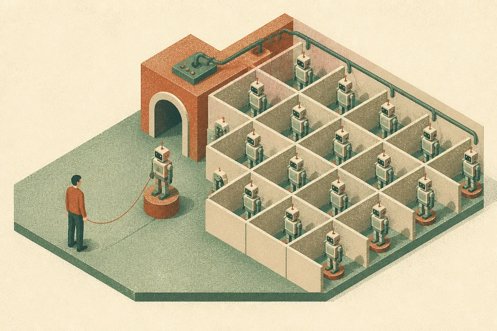

TL;DR: Apple's HALO trains a humanoid robot entirely in a thousand procedurally generated simulated homes, never shows it a real house, and still gets a 91% success rate across 360 real-world trials, which matters because it attacks the data bottleneck with compute instead of human teleoperation.

The paper is "Perceptive Humanoid Motion from Simulation," posted to arXiv under both cs.AI and cs.LG, with code and videos at the Apple AIML research page. I'm going to call it HALO, which is what the authors named the system. The headline number is 91% success across 360 trials in six unmapped real-world environments, from a policy that never saw a real home during training. That last clause is the whole point.

## Why is data the real bottleneck in humanoid robotics?

The limiting factor in generalist humanoids has never really been motors or actuators. It's paired supervision: the training data that maps what the robot sees (pixels) and what it's told to do (free-form language) to the actual low-level joint commands that move its body. No large corpus of that data exists. You can't scrape it off the internet the way you scrape text or images.

So teams have leaned on human teleoperation and wearable motion capture. Someone puts on a suit or drives the robot by hand, and you record what happens. The Apple team is blunt about the cost: those approaches require at least an hour of human time to produce an hour of data. That's a linear tax. Want ten thousand hours of varied household behavior? Hire people for ten thousand hours. The scaling curve that made language models work (more compute, more data, better model) just doesn't exist when every data point costs a human an hour.

This is the quiet reason humanoid demos have stayed demos. The viral clips show one robot doing one impressive thing in one rehearsed environment. Generalization, the ability to walk into a house you've never seen and do something useful, needs breadth of experience that teleoperation can't economically produce.

## What does HALO actually do differently?

HALO's answer is to synthesize the vision-language-motion data instead of capturing it. The pipeline generates a thousand procedurally generated homes and produces the paired supervision inside them. The corpus, in the authors' framing, scales with compute rather than human labor. That's the sentence to underline. It's the same shift that made other parts of AI take off: replace a human-gated input with something you can buy more of by adding GPUs.

Inside those simulated homes, the robot learns a repertoire of concrete skills. The paper lists them specifically: sitting on chairs, navigating to named objects, stepping sideways through half-open doors, crouching and crawling beneath tables, pushing boxes. Then it orchestrates those skills into composite, long-horizon tasks. That orchestration part matters. A robot that can push a box and a robot that can plan "go to the kitchen, crouch under the table, push the box out" are different capabilities. The first is a motor skill. The second is a policy that chains skills to satisfy a goal described in language.

The "named objects" and "free-form language" details are what make this more than a locomotion paper. The robot isn't just walking. It's grounding words to things it can see and then producing joint commands that act on those things. That's the pixels-to-language-to-motion mapping the whole field has been stuck on.

## Does sim-to-real actually hold up here?

This is where I stay skeptical by default, because sim-to-real transfer is the graveyard of robotics results. A policy that's flawless in simulation often falls apart the moment real-world physics, sensor noise, and lighting show up. The gap between a rendered home and a real one is exactly where most of these systems die.

HALO's claim is zero-shot transfer: no fine-tuning in the real world, no real homes in training, straight from simulation to six physical environments it had never mapped. 91% across 360 trials. Six environments and 360 trials is a real evaluation, not a single cherry-picked clip, and the environments being "unmapped" is the hard version of the test. I want to see the failure cases and the per-environment breakdown before I treat 91% as a settled property rather than a strong reported result, and the videos on the project page are worth watching before anyone extrapolates. One lab's headline number on its own benchmark is a data point, not a law.

Two honest caveats. First, procedurally generated homes are still a distribution the authors chose. If real houses fall inside that distribution, transfer looks magical; if your house is weird, we don't know yet. Second, "success rate" depends entirely on how success is defined per task, and the abstract doesn't give the rubric. Those are the details that separate a genuine advance from a benchmark that flatters itself.

But set the caveats next to the mechanism. If you can generate the data instead of capturing it, you can scale the breadth of experience without scaling human cost. That's the structural change. Whether it's 91% or 80% once independent groups reproduce it, the direction (compute-bound data generation for embodied agents) is the thing to track.

## Why does this matter beyond robotics?

The reason I'm writing a flagship on a humanoid paper is that HALO is a clean instance of a pattern showing up everywhere in AI right now: when human-generated data is the ceiling, the win goes to whoever can synthesize data that transfers. We've seen it in code, in math reasoning, in agent training. Robotics was supposed to be the holdout because physical bodies seemed to demand physical experience. HALO argues the simulation can carry more of that load than most people assumed.

It also reframes what Apple is doing in this space, which has been quiet publicly. A system that scales with compute is a system a company with compute can push hard, and the code being posted means others can poke at the claims rather than take them on faith.

For the builder who doesn't own a humanoid, the transferable lesson is about where to spend effort. If your agent or model is bottlenecked on expensive human-labeled data, the HALO move is to ask whether you can generate paired examples in a controllable environment and transfer them, rather than paying linearly for labels. Start by defining the narrow skills your system needs, build the smallest generator that produces grounded input-to-action pairs for those skills, and test transfer on held-out real cases early and often. The catch most readers will miss: the 91% isn't the result to copy, it's the evaluation discipline. Six unmapped environments, 360 trials, zero-shot. The number only means something because the test refused to let the system see the answer first. Build your evals that way before you celebrate your own headline figure.
