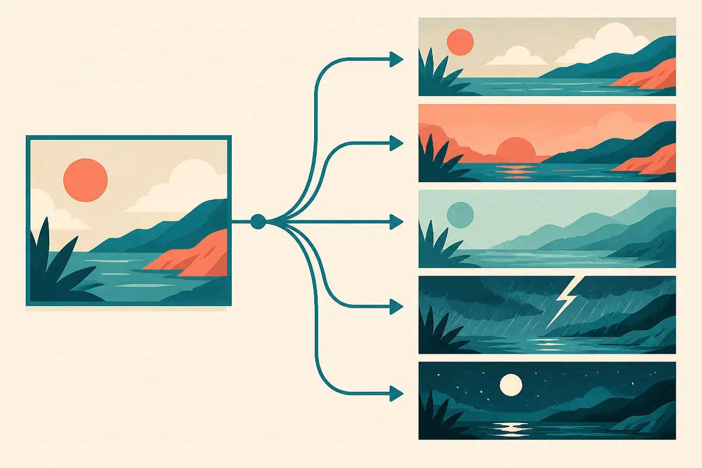
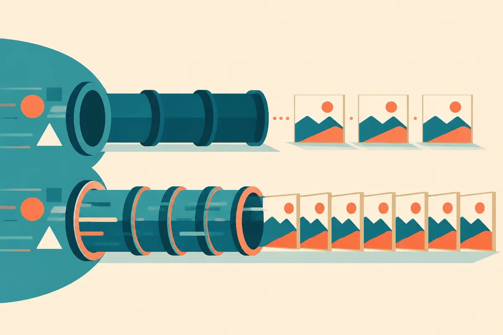

TL;DR: Images 2.6 is an iteration, not a leap: faster generation on two new API models, GIF output, reference-image conditioning, and tighter edit control, all of which matter more for production pipelines than for one-off prompting.

The primary source here is OpenAI's own announcement, "Introducing Images 2.6," published on the OpenAI blog and echoed in their launch video of the same name. Both land the same four points: faster generation, GIF creation, more precise editing, and new API controls, rolling out across ChatGPT, Codex, and the API. That is the whole surface area. No benchmark numbers, no model cards, no pricing in what was shared. So let me separate what OpenAI actually said from what I would want to test before building on it.

## What is actually new in Images 2.6?

Four things, per OpenAI.

First, speed. The launch video says two new models are coming to the API with "50% faster image generation." Note the framing: the speed claim is attached to two new API models, not to the ChatGPT experience broadly. That distinction matters. If you are a builder, the win is in the API, where latency is a real cost line and a real UX constraint. A 50% cut in generation time changes what you can do inside a request budget.

Second, GIFs. ChatGPT Images can now produce animated GIFs. This is the flashiest consumer-facing addition and the one I would treat with the most caution for production. Short looping animation from a text prompt is a different problem than a single still, and "GIF creation" in a blog bullet tells you nothing about frame count, resolution, loop quality, or how much control you get over motion.

Third, reference images. The video calls these out explicitly: you can feed in reference images to condition the output. This is the feature I would actually build around. Reference conditioning is how you get brand consistency, character consistency, and style lock across a batch. If it works well, it is the difference between a toy and a tool.

Fourth, more precise editing plus new API controls. OpenAI's blog groups these together. "More precise editing" and "new API controls" are exactly the kind of phrases that mean everything and nothing until you see the parameter list.

## Who should care, and who can wait?

If you generate images one at a time in a chat window, 2.6 is a nice-to-have. GIFs are fun. Faster is nicer. Reference images save you some prompt gymnastics. None of it changes your day.

If you run an image pipeline through the API, the calculus flips. Three of the four updates are production features dressed in consumer language.

Reference images attack the single hardest problem in generated imagery at scale: consistency. Anyone who has tried to produce fifty on-brand images from a text prompt knows the model drifts. Palette wanders, style mutates, the "same" character shows up with a different face. Reference conditioning is the standard fix, and OpenAI naming it as a first-class input is the quiet headline here.

Speed on two new API models is the second production story. Half the generation time means either a snappier end-user experience or more images per unit of compute per request window. Either way it moves a number you are already paying for.

The new API controls are the third. More knobs on editing means fewer regeneration loops, which is where image workflows bleed both time and money. But "new API controls" is a placeholder phrase until the docs land. I am not going to tell you what they do, because OpenAI has not told me.

## What did OpenAI not tell us?

This is where I earn my keep. The announcement is a feature list, not a spec sheet, so here is what is missing and why each gap matters before you commit.

Pricing. Neither the blog summary nor the video shared per-image or per-call costs for the two new API models. A 50% speed gain is great, but if it rides on a higher price per image, your real question is cost per finished asset, not raw latency. Treat pricing as unknown until OpenAI's API docs say otherwise. Do not let a trade write-up fill that number in for you, and do not let me either.

Availability and rollout timing. The video uses "coming to the API" for the two new models, which reads as not-yet-fully-shipped at announcement. The blog says the update spans ChatGPT, Codex, and the API, but staged rollouts are normal and "available" in a launch post does not always mean available to your account today. Check your own access before you plan around it.

Quality under load. There are no sample benchmarks, no failure-rate numbers, no text-rendering claims, nothing on how reference-image fidelity holds up across a batch. "50% faster" with no quality baseline is half a sentence. Faster at what quality, measured how? Unstated.

GIF specifics. Frame rate, duration, resolution, file size, motion control: all unaddressed. If GIF output is load-bearing for your product, assume nothing and test the edges first.

The honest read is that the two sources agree completely because they are the same announcement in two formats, blog and video. That is not independent corroboration. It is one message, twice. So everything above is OpenAI's own claim about OpenAI's own product, which is appropriate for a feature launch and also means there is no outside party yet confirming the speed or quality numbers.

## The practitioner's take

If you ship image generation through the OpenAI API, do three things this week. One, run a head-to-head latency test on the two new models against whatever you use now, measured in cost per finished asset, not raw milliseconds, because the speed claim means nothing until you price the output it produces. Two, pressure-test reference images on your hardest consistency case, a repeating character or a strict brand palette across a batch of twenty, since that is the feature most likely to change your architecture if it holds up. Three, read the actual API docs for the new controls and GIF parameters before you promise anything to a stakeholder, because the announcement gives you the what and almost none of the how.

The catch most readers miss: the exciting bullet (GIFs) is the least production-ready, and the boring one (reference images plus new edit controls) is the one that quietly earns its place in a real pipeline. Build for the boring feature. Demo the fun one.
