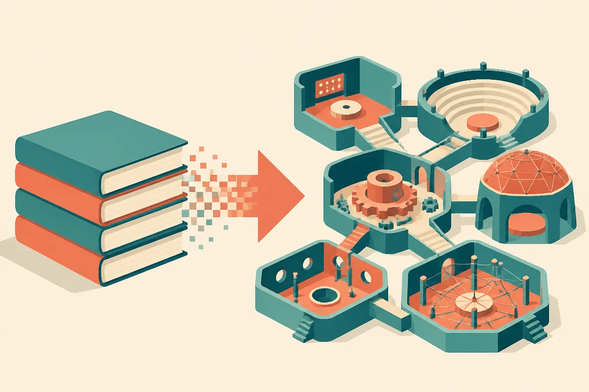
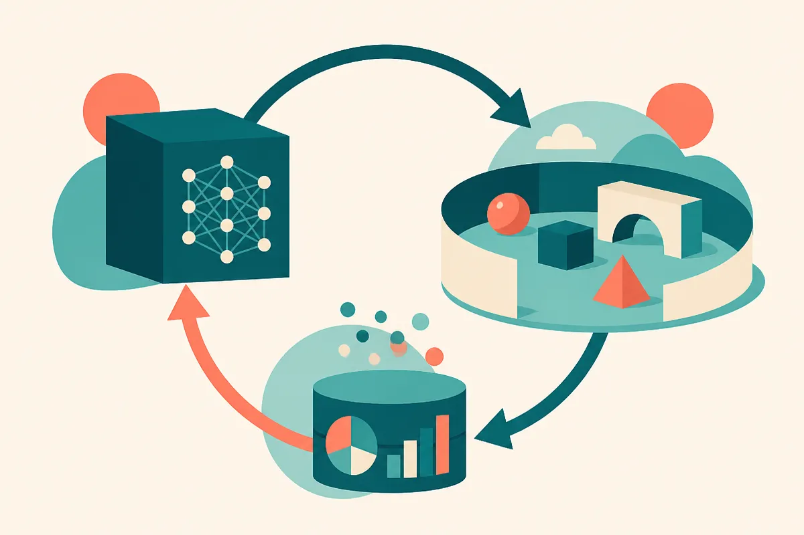

TL;DR: A paper called "Scientist World" turns 1,000 research papers into executable environments and reports that frontier AI-Scientists beat the human authors' results 74% of the time, which is a real benchmark advance and a claim you should read narrowly, not as "AI does science better than people now."

The headline number will travel faster than the method, so let me slow it down. The paper is "Scientist World: Grow a Research World for AI-Scientists," posted to arXiv across cs.AI, cs.CL, and cs.LG. The core move is clever and worth understanding on its own terms, separate from the win rate everyone will quote.

## What does Scientist World actually do?

Most AI evaluation for research-style tasks hits the same wall: a paper is readable but not runnable. You can hand a model the PDF of some method, but you cannot drop the model into the actual problem and watch it work, fail, and iterate the way a researcher would. The literature is a library, not a gym.

Scientist World's pipeline tries to fix that by converting each paper into an executable environment. For every paper, it extracts the open-ended research question and reproduces the paper's proposed method as a baseline. An AI-Scientist then enters that environment and gets measured against what the human authors achieved on their own problem. So the comparison is not "model versus a generic benchmark." It is "model versus the specific result reported in that specific paper."

The authors released the first 1,000 verified environments. That verification word matters. Reproducing a paper's method as a working baseline is hard, often harder than the original research, because papers omit details, hardcode assumptions, and depend on data that is not shared. A pipeline that does this autonomously across 1,000 papers is doing serious engineering, and the fact that they call the set "verified" is the part I most want to see others poke at.

## How should I read the 74% number?

Carefully. "Frontier AI-Scientists can already surpass the human researchers 74% of the time" is the line that will get screenshotted. Here is what it does and does not say.

It says: inside these reconstructed environments, on the metric each environment uses, a frontier model's output beat the reported human baseline in roughly three of four cases. It does not say the model did original science from scratch, nor that it beat humans on open frontier problems with no prior answer to anchor to. The environment is built from a paper that already contains a solved problem and a method. The AI is optimizing inside a space where the question is already well-posed and the yardstick already exists.

That is the quiet catch in a lot of "AI beats researchers" framing. Posing the right question, deciding a result matters, and reproducing the baseline are the hard, human parts here, and in this setup the pipeline did them, not the AI-Scientist being graded. The model competes on the downstream optimization, which is exactly the part machines tend to be good at. None of this makes the result fake. It makes it specific. A 74% win rate on "beat the reported number given the question and a working baseline" is a different claim from "AI out-researches humans," and the gap between those two is where most of the hype will live.

I also want to flag what I cannot verify from the abstract alone. There is no breakdown here of which fields these 1,000 papers come from, how the win metric is defined per environment, or how much the baseline reproduction itself constrains the ceiling. Those details decide whether 74% is a strong signal or a selection artifact. Until the full method and the environments are inspected by people who did not build them, treat the number as reported, not settled.

## Why the training-ground result might matter more

Buried under the win rate is the claim I find more useful for builders. The authors say they used the environments as a training ground and raised a small model's research ideation by 158%, enough to match frontier models on that task.

That is the pattern worth watching across AI right now. Environments plus traces plus reinforcement-style training on a narrow capability, then a small model catches up to a big one on that specific skill. Scientist World also ships 6,400 hours of research traces: every idea, experiment, failure, and success logged. Traces of failure are rare and valuable, because most training data shows you the polished answer and hides the dead ends. If those traces are clean, they are arguably the most reusable asset in the whole release, more durable than any single leaderboard score.

The caution is the same one that applies to every "small model matches frontier" claim. It matches on the trained task, inside the distribution the environments define. That is genuinely useful and also narrow. A model tuned to ideate well against reconstructed ML papers is not suddenly a general scientist. It is good at the thing you trained it on, which is the whole point and also the whole limit.

## What does this mean for how we evaluate AI research agents?

The structural idea here outlives the headline. "Make the artifact runnable, then score the agent against the human who made the artifact" is a template that generalizes far past science papers.

Think about what an executable environment gives you that a static benchmark does not. It is self-refreshing, because new papers become new environments, so the eval does not saturate the moment a model memorizes it. It is adversarial in a healthy way, because the human baseline is a real result, not a hand-written answer key. And it produces traces as a byproduct, so evaluation and training feed each other. That loop, eval becomes data becomes better agent becomes harder eval, is the mechanism that actually moves capability, and Scientist World is a concrete instance of it pointed at science.

The risk in the loop is contamination and overfitting to the environment's quirks. If the baseline reproduction is systematically weaker than the original human work, every win rate inflates. If the environments reward a narrow kind of answer, agents learn to game that shape. Those are exactly the failure modes to check before anyone builds policy or procurement on a number like 74%.

Practitioner's take: if you build or evaluate research-style agents, the move to copy is not the win rate, it is the construction. Take a corpus you care about, your own past experiments, internal reports, solved tickets, and ask what it takes to make each item runnable so an agent can be scored against the real outcome, not a rubric. Start with ten, not a thousand, and verify the reconstructed baseline by hand, because a weak baseline is how you accidentally manufacture an impressive win rate. Harvest the failure traces while you are at it, since those are the training signal almost nobody else has. The catch most readers will miss: "beat the human 74% of the time" was measured after a pipeline did the hard human work of posing the question and rebuilding the method, so the number describes optimization inside a solved frame, not science from a blank page. Useful, real, and much narrower than it sounds.
