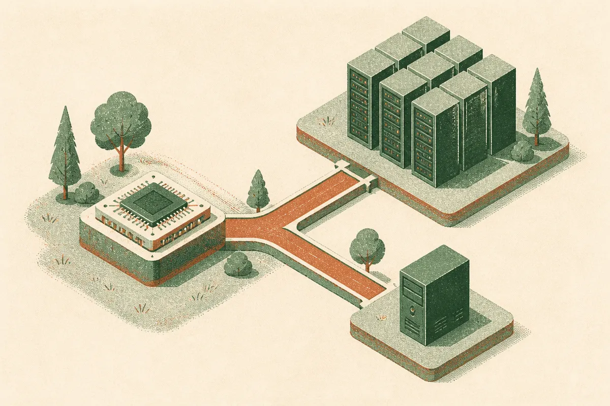

TL;DR: If AMD is prioritizing data center AI hardware, local AI builders should plan around scarcity, used-market tradeoffs, smaller models, and software efficiency instead of waiting for cheap high-VRAM consumer GPUs.

## Is AMD really saying local builders are not the priority?

The primary source here is the r/LocalLLaMA thread titled “Good Luck Getting a Cheap GPU. AMD Is a 'Data Center First Company,' CEO Says.” That is thin sourcing for the exact executive quote, so I would not treat every detail as confirmed without AMD’s own transcript or announcement. But the market signal is clear enough to discuss.

The local AI crowd wants something simple: affordable cards with lots of VRAM, decent drivers, and broad framework support. The data center buyer wants something different: dense accelerators, predictable supply, support contracts, and enough performance per watt to justify massive capex.

Those two customers are not equal.

If a chip company can sell limited silicon into enterprise AI clusters, it has every reason to do that first. Data center buyers place bigger orders. They pay for platforms, networking, support, and long-term roadmaps. A hobbyist or indie builder buying one card is important culturally, but not strategically, especially during an AI infrastructure boom.

That is why the frustration on r/LocalLLaMA lands. The open-source AI community helped prove that local inference matters. It created demand for quantized models, llama.cpp workflows, home servers, small labs, and private assistants. But community demand does not automatically translate into consumer-first silicon allocation.

## What does “data center first” mean for local AI?

It means the cheap VRAM dream probably stays messy.

Not impossible. Messy.

Local AI runs on constraints: 12GB, 16GB, 24GB, maybe a used workstation card if you are willing to accept power draw, noise, driver quirks, or no warranty. That constraint shapes everything. Model choice. Quantization. Context length. Batch size. Whether you run one assistant locally or a whole agent stack.

The mistake is assuming the consumer GPU market will soon behave like the open-source model market. Models keep getting smaller, faster, and more capable at the edge. Hardware does not move with the same distribution curve. A model file can be mirrored globally. A GPU needs wafers, packaging, board partners, memory supply, logistics, and margins that beat other uses of the same capacity.

This is also why software efficiency matters so much. Quantization is not a side quest. Neither are speculative decoding, better KV cache handling, CPU offload, model routing, and small-model specialization. For most builders, those will deliver more near-term value than waiting for a miracle $399 card with enough VRAM to run everything comfortably.

## Does this hurt open-source AI?

A little. But not in the simple “local AI is dead” way.

Open-source AI has already adapted to scarcity. That is part of its culture. People run 7B, 8B, 14B, and 32B-class models because they have to. They quantize aggressively because they have to. They build wrappers around imperfect toolchains because they have to.

The risk is not that local AI disappears. The risk is that the gap between hobbyist compute and institutional compute gets wider. If frontier capability depends on large clusters, the center of gravity stays with companies and labs that can buy access. Local AI then becomes less about frontier training and more about private inference, customization, workflow automation, coding support, and small-agent systems.

That is still useful. Very useful. But it is a different promise than “everyone gets a personal frontier model at home.”

There is also a policy and competition angle, though the Reddit thread is not enough to prove any specific claim there. If consumer hardware becomes an afterthought across major vendors, the open ecosystem depends even more on efficient runtimes, open weights, used hardware liquidity, and smaller specialized models.

If you are building with local AI, assume hardware remains constrained. Buy for the workload you actually have, not the model you hope to run someday. Test small models first. Keep cloud fallback for heavy jobs. Design agents that can route between local privacy-sensitive tasks and remote high-compute tasks. The catch most people miss: local AI is not only a hardware problem. It is a systems design problem, and better architecture often beats waiting for cheaper silicon.
