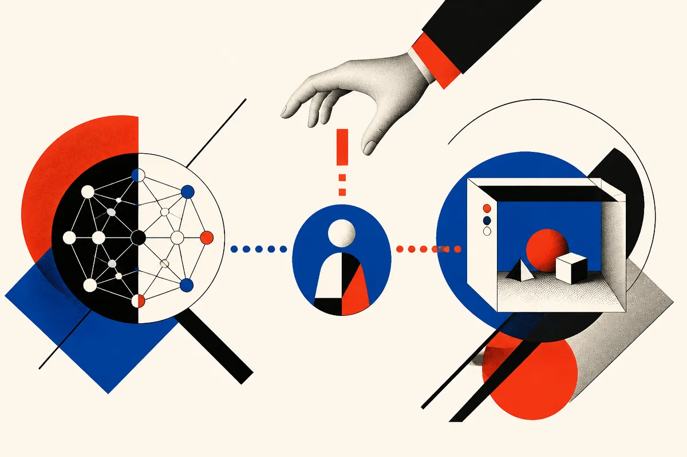

TL;DR: The interesting part is not that a local model drew a dog in Paint, it is that local agents are getting closer to controllable, inspectable desktop sandboxes.

## What actually happened here?

The primary source is the r/LocalLLaMA post, “We are cooked. My QFN 3.8 NVFP4 just drew a dog freehand in MS Paint (using new Open WebUI 0.13.0 and Open Terminal 0.17.2).” A user, u/Porespellar, reported running QFN 3.8 NVFP4 through Open WebUI 0.13.0, connected to Open Terminal 0.17.2, and having the model draw in MS Paint by moving the mouse inside a VM.

That matters less as art than as interface.

The user’s claim is that Open WebUI can now drive a full desktop environment through Open Terminal, with both programmatic control and “Computer Use” style interaction. The same post says the setup can be observed in the browser, and that a human can take over when needed. The screenshot was apparently Windows 11, although the described Open Terminal setup is Linux-oriented. u/Porespellar says they had another agent, Hermes, create a Windows 11 VM variation in about 20 minutes.

I would not treat this as a confirmed Open WebUI product spec from first-party docs, because we were not given those docs. Treat it as a field report from a power user. Still useful. Sometimes the first signal that a tool crossed a practical threshold shows up as somebody doing something weird with it.

Like making a local model draw a dog in Paint.

## Why does mouse-level control matter?

Most agent demos cheat in a way that is fine for demos and bad for reality. They call APIs. They emit SVG. They write Python. They operate in clean text environments.

Real work often lives in messy software. Old admin panels. Desktop apps. Spreadsheets with modal dialogs. Browser sessions with state. Windows apps nobody is going to wrap in an API next quarter.

Mouse and keyboard control is crude, but it is universal. If an agent can see the screen, click, type, wait, correct itself, and let a human interrupt, it can start touching workflows that never made it into clean automation land.

The sandbox is the key word. A local model controlling your real desktop is a bad idea unless the task is trivial and the permissions are tight. A model controlling a disposable VM is different. You can watch it. Reset it. Record it. Give it fake credentials. Let it fail without losing your day.

That is the practical path for local agents: not autonomy everywhere, but contained action in places where failure is cheap.

## What is still missing?

Reliability. Always reliability.

A dog in Paint is a great smoke test because it proves perception, cursor control, and tool interaction are connected. It does not prove the agent can complete long tasks, recover from popups, avoid destructive clicks, or know when to stop. It also does not tell us which part did the real work: the model, the Open WebUI agent layer, Open Terminal, the VM plumbing, or the prompt.

That is not a knock. It is just where computer-use agents are. The interface layer is getting more accessible before the behavior layer is fully trustworthy.

For builders, the next useful tests are boring. Can it install an app in a VM? Fill a form from a CSV? Reproduce a browser bug? Run a local workflow ten times and only ask for help when stuck? Can it leave an audit trail clear enough that a human can tell what happened?

That last one matters. Agent products often chase hands-off automation too early. I would rather have an agent that gets 70 percent done inside a sandbox, shows me every step, and pauses at risk points than one that pretends to be independent and quietly breaks things.

Practitioner’s Take: If you are building with local agents, set up a disposable VM and give the model a narrow desktop task with visible success criteria. Start with observation, screenshots, cursor logs, and human takeover. The catch most people miss is that “computer use” is not a model feature by itself. It is a system feature: model, UI bridge, sandbox, permissions, logging, reset button. Build that system first.
