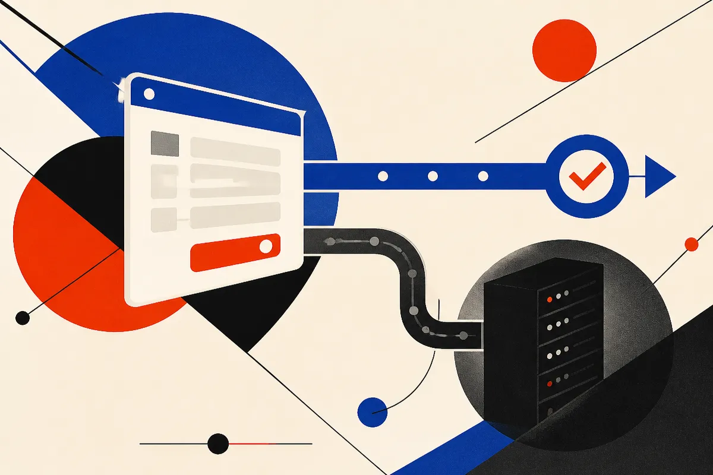

TL;DR: A skimming campaign against restaurant delivery sites is a classic client-side card theft attack, and the fastest-growing attack surface is exactly the kind of third-party script and auto-generated checkout code that AI build tools are now shipping by default.

The story surfacing today is thin on specifics. A Hacker News (AI) post titled "Restaurant Delivery Payment-Skimming Campaign" points to a coordinated effort to steal payment data from restaurant and food-delivery websites. That is the whole confirmed claim. I am not going to pretend there is a 40-page threat report behind it, because there isn't one in front of me. But the pattern it names is one of the oldest and most durable attacks on the web, and it has new relevance because of how sites get built in 2026.

So let me do the useful thing: explain the mechanics, say plainly what is and isn't established here, and connect it to the AI-assisted web development most of you are actually doing.

## What is a payment-skimming campaign, mechanically?

Payment skimming on the web is usually client-side card theft, often called Magecart-style after the loose set of groups that popularized it. The attacker gets malicious JavaScript onto a checkout page. When a customer types their card number, the script reads the form fields and sends a copy to a server the attacker controls. The real transaction still goes through. The customer gets their food. Nobody notices for weeks.

The script gets there one of a few ways. Sometimes the site itself is compromised and the code is injected directly. More often, it rides in through a third party: an analytics tag, a chat widget, a reviews plugin, a payment-adjacent library that the site owner trusted and loaded from someone else's domain. That is the part worth sitting with. The restaurant never got hacked in the traditional sense. A thing the restaurant's site loads got hacked, and the restaurant inherited the breach.

Restaurant delivery is a good target for the same reason it is a good business: high transaction volume, lots of small independent operators, sites assembled from templates and plugins, and owners who are running a kitchen, not a security program. The card data is fresh and the detection is slow.

I want to be honest about the limits here. The Hacker News item names the campaign and the sector. It does not, in what I have, specify the exact scripts, the groups involved, the number of sites hit, or the payment processors affected. Treat the sector and the attack type as the story. Treat any specific victim count or named tool as unconfirmed until someone publishes the forensics.

## Why does AI-assisted site building make this worse?

Here is the connection that matters for builders. The way a lot of sites get stood up now is: describe what you want, let an AI tool scaffold it, accept the dependencies it pulls in, ship. That workflow is fast and genuinely useful. It also optimizes for "it works" and almost never for "it loads the minimum number of third-party scripts from the fewest external origins."

Ask a coding agent to add a reviews section, a live chat, an analytics setup, and a payment form, and you will frequently get four external scripts loaded from four domains you have never audited. Each one is a path for someone else's compromise to become yours. The agent is not being careless by its own lights. It is giving you working code with popular libraries, which is what it was trained to do. Supply-chain risk is invisible in a demo and invisible in the generated output.

The second-order problem is that AI tools make it cheap to spin up the kind of site that gets targeted. More small operators with template checkout pages, fewer with anyone watching the script inventory. The attack surface is growing faster than the security practice around it.

I run Lucky Domains, which does website builds, and the thing I keep coming back to is that a build is not done when the page renders. It is done when you know what every script on the checkout page is and where it comes from. That is unglamorous work an AI agent will not do for you unless you make it.

## What should a builder actually check?

A few concrete moves, in rough order of payoff.

Know your script inventory. Open the checkout page, look at every external request, and ask whether each one needs to be there and whether it needs to be there on the page that handles card data. The strongest version of this is: the page that touches payment info loads nothing non-essential, period.

Use Subresource Integrity and a Content Security Policy. SRI lets the browser refuse to run a third-party script if its contents changed from the hash you expect, which directly counters the "trusted script got swapped" attack. A tight CSP limits which origins a page is allowed to talk to at all, so even an injected skimmer struggles to exfiltrate. Neither is exotic. Both are routinely skipped by generated code.

Keep card entry off your own DOM where you can. Hosted payment fields and iframe-isolated checkout from a serious processor mean your page never sees the raw card number, so a skimmer on your page has much less to steal. This is the single biggest structural defense for a small operator.

Audit what the agent added. When a coding agent adds a feature, read the diff for new external domains. Make "what third-party origins did this introduce" a standing question in your review. You can even make the agent answer it: ask it to list every external resource the page now loads and justify each.

## What is the honest state of this story?

Established: there is a skimming campaign aimed at restaurant delivery sites, and skimming of this type works by getting malicious JavaScript onto checkout pages, frequently through third parties. That matches a well-documented attack class.

Not established from what I have: the specific groups, the exact scripts, the scale, the processors, and any link to AI-generated code in these particular victims. I am drawing the AI connection as analysis of where the attack surface is heading, not as a reported finding about this campaign. If someone publishes forensics that name the vector, I will update.

What does not change either way: client-side card theft is cheap, quiet, and aimed at operators who are not watching. The defenses are known and mostly free. The gap is attention, and AI-assisted building widens that gap by making it easy to ship a checkout page without ever meeting the code on it.

Practitioner's take: before your next site goes live with a payment form, do one pass that no AI tool will prompt you to do. List every external script on the checkout page, delete the ones that don't need to touch a card, add SRI hashes and a Content Security Policy to the rest, and move actual card entry into a hosted field from your processor so your own page never holds the number. Then set a reminder to re-run that script inventory monthly, because the dangerous change is not the script you approved, it is the one that quietly got updated on someone else's server three weeks later. The catch most people miss: the agent that built your site measured success by "it works," and a live skimmer looks exactly like a site that works.
