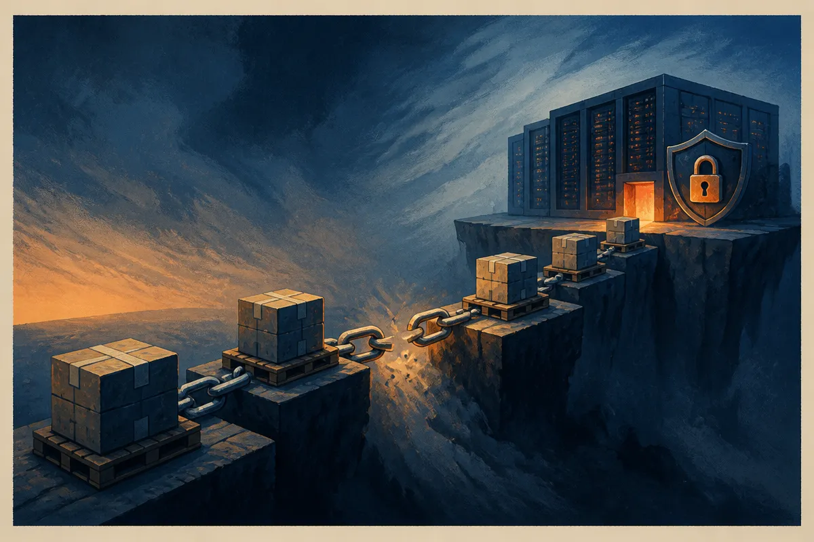

TL;DR: Treat AI hardware as high-value infrastructure before it reaches the rack, because procurement, shipping, custody, and insurance are now part of your compute strategy.

## What do we actually know?

The primary source here is the r/LocalLLaMA submission titled “Six Pallets of NVIDIA Hardware Worth $11.4 Million Stolen on the Way to Texas,” submitted by /u/chemist_slime.

That is a narrow fact base. The headline claims six pallets of NVIDIA hardware, valued at $11.4 million, were stolen while headed to Texas. It does not give the model mix, the buyer, the carrier, the shipper, the route, the law enforcement agency, the insurance status, or whether the equipment was recovered.

So I would not build a whole crime story out of it. No mystery buyer. No cartel theory. No “AI arms race” theatrics.

But even a thin report can point at a real operator problem: AI compute is now dense, portable value. A pallet can represent a large amount of capital. A shipment can be easier to attack than a data center. And the risk window opens before the hardware is installed, tagged, monitored, powered, or protected by the controls people usually associate with infrastructure.

That matters.

## Why would AI hardware be a target?

NVIDIA hardware sits at the center of AI buildouts because training, fine-tuning, inference, simulation, and high-end research all need accelerators. I do not need to know the exact SKUs in this report to see the incentive structure.

High-value compute has three properties that thieves like. It is expensive. It is movable. It has global demand.

That does not mean stolen hardware is easy to monetize. Serial numbers, firmware, vendor records, customs controls, service contracts, and resale scrutiny can make liquidation risky. But black and gray markets do not need clean channels to create a theft incentive. Some buyers care less about provenance than capability. Some intermediaries exist to launder supply. Some stolen goods never touch normal resale markets at all.

For AI teams, the bigger lesson is not “someone might steal your GPUs.” It is that compute procurement has moved from a back-office purchasing function into operational risk.

If your whole roadmap depends on a cluster arriving on time, then a logistics failure is not just a logistics failure. It can delay model training, customer commitments, deployment schedules, financing milestones, or migration plans. The hardware does not have to be stolen to hurt you. It can be delayed, misrouted, damaged, held at customs, or delivered without the right chain-of-custody records.

Theft just makes the risk visible.

## What should builders change?

The practical fix is boring. Good.

For smaller AI labs and enterprise teams buying their own hardware, the controls should start at purchase order, not receiving dock. Know who touches the shipment. Require documented handoffs. Use carriers that understand high-value electronics. Confirm insurance details in writing. Track serial numbers before shipment where possible. Separate public announcements from delivery timing. Do not let “our H100s land Friday” become free targeting data.

For larger deployments, procurement should sit in the same risk conversation as security, finance, and infrastructure. A compute plan should include lead times, spare capacity, loss scenarios, replacement paths, and custody requirements. If a missing shipment can derail a launch, it belongs in the risk register.

Cloud does not remove this problem. It moves it. Hyperscalers and colocation providers absorb much of the physical supply chain risk, but you still inherit capacity risk, regional scarcity, quota limits, and vendor concentration. Owning hardware gives control. It also gives you the unglamorous parts of ownership.

My take: this is another sign that AI infrastructure is becoming normal critical infrastructure. Not magical. Not abstract. Boxes, trucks, warehouses, invoices, insurance, locks.

If you are building with rented compute, ask what happens if capacity disappears for a week. If you are buying hardware, map the journey from vendor to rack and identify every handoff you currently trust by vibes. The catch most readers miss is timing: the most exposed moment may be before your security team thinks the asset exists.
