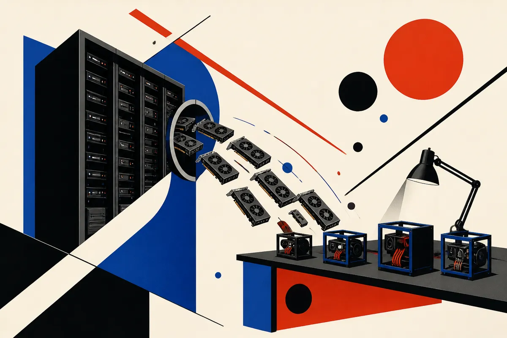

TL;DR: Treat falling used GPU prices as an opening for inference and experimentation, not as proof that AI compute demand has cooled.

## Are GPU prices actually loosening?

The primary source here is the r/LocalLLaMA thread “Some GPU prices are dropping” by /u/Bascilian. It is a community report, not a market index, so I would not build a procurement plan from it alone. But the details are worth watching.

The post claims RTX 6000 cards peaked around $18,000, with Micro Center listing RTX 6000 MaxQ cards around $14,000 for about a month, and the workstation version cut to $16,500 from a reported $18,000 high. /u/Bascilian also pointed to Dell discounts where some buyers reportedly got cards around $11,500.

That is not the same as “GPUs are cheap now.” It is more like the top end is getting less irrational in specific channels.

The more interesting claim is second-hand supply. /u/Bascilian says a contact at a company that buys decommissioned hardware is seeing “tons of A100s” being dumped, and that used A100 40GB SXM4 units could fall toward $1,000 per unit for single purchases in 3 to 6 months. Again, that is a reported anecdote, not confirmed pricing. But if true, it would matter more than a small haircut on new workstation cards.

Why? Because used A100 40GB parts sit in an awkward but useful middle. Too old and power-hungry for many hyperscale refresh plans. Still very usable for local inference, batch jobs, fine-tuning older model sizes, embeddings, reranking, vision workloads, and internal agent systems that do not need H100-class training throughput.

## Why would old accelerators get dumped now?

The simplest answer is efficiency.

Data centers do not only care about sticker price. They care about watts, cooling, density, maintenance, and how much useful model throughput they get per rack. If a newer system does more work inside the same power envelope, older gear becomes expensive even when it is already paid for.

That is the part small builders often miss. The buyer who wants one or four cards has a totally different equation than a company operating thousands. A card can be unattractive at hyperscale and still be a gift for a lab, a local AI hobbyist, or a startup trying to avoid API bills for steady inference.

The thread also speculates that RTX 6000 supply increased because production may have been routed from 5090-class chips into RTX 6000 and 5500 segments. Treat that as speculation. It could be right, but the useful signal is narrower: workstation-class inventory appears less locked up than it was during the worst squeeze.

The policy angle is murkier. /u/Bascilian argues that data center construction may continue, but face more pressure from permitting and electricity costs. That is plausible in some regions, but too broad to use as a price forecast. Power constraints are real. Local politics are real. The timing is not clean.

## What changes if used A100s get cheaper?

A cheaper used A100 does not magically make training frontier models practical. Memory helps, but clusters need networking, cooling, chassis compatibility, drivers, power, and someone willing to debug old enterprise hardware at 1 a.m.

The SXM4 detail matters too. SXM modules are not drop-in PCIe cards. If the cheap supply is mostly SXM4, buyers need compatible servers or carrier systems. That can turn a bargain into a project. PCIe A100s are usually easier to place in small deployments, but the thread specifically says the expected price pressure is on SXM4, not PCIe.

For operators, the better use case is local inference capacity. Run open-weight models for private workflows. Host embeddings and rerankers. Build evaluation pipelines without paying per token. Test agent loops against your own services. Fine-tune smaller models when the economics make sense. Keep the boring workloads off premium APIs.

The catch: used accelerators are not just cheaper GPUs. They are used data center parts with heat, noise, firmware, interconnect, and support risk. If you cannot afford downtime, buy from someone who will stand behind the hardware. If you can afford tinkering, watch the A100 secondary market closely, but do not assume a Reddit price rumor is your clearing price. For builders, the play is to price the full box, power, cooling, and failure risk first, then decide whether cheaper compute changes what you can actually ship.
