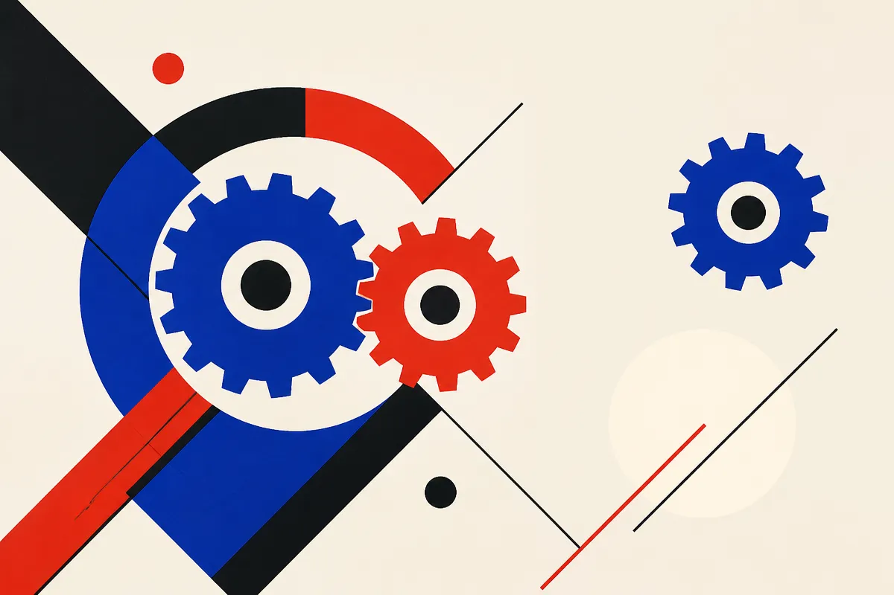

TL;DR: AI is genuinely speeding up parts of AI research, but the gains are concentrated in code, experiment plumbing, and literature triage, not in the hard part, which is still deciding what is worth testing.

The claim making the rounds on Hacker News this week, under the blunt headline "AI is dramatically accelerating AI research," is the kind of thing that sounds either obvious or overheated depending on how close you sit to the work. I want to split it apart, because the interesting version of this claim is not the one that gets shared.

The source here is a single discussion thread, not a paper or a lab report, so I am treating the headline as a hypothesis to test against what we can actually observe, not as a finding. When the primary source is a title and a comment section, the honest move is to say so and reason from there rather than dress it up as settled research.

## Where is AI actually speeding up AI research?

The real acceleration is unglamorous and it is already here. It shows up in three places.

First, code. Writing training loops, data loaders, eval harnesses, and the thousand small glue scripts that connect a model to a dataset. This is the single biggest time sink in day-to-day research, and it is exactly what coding agents are good at. A researcher who used to spend a morning wiring up an ablation can now describe it and get a working first draft in minutes. That is a real multiplier on the part of the job that is closest to typing.

Second, experiment management. Agents that can launch runs, read logs, notice a diverged loss, and summarize what happened across fifty configurations. The bottleneck in a lot of research is not having an idea, it is keeping track of what you already tried. Offloading that bookkeeping is quietly valuable.

Third, literature triage. Not "read this paper for me," which still fails in subtle ways, but "find me the six papers that tried this specific trick and tell me which ones reported it not working." That is a search-and-filter problem, and current models are decent at it when you keep them honest with citations.

Notice what these have in common. They are all tasks where the answer is checkable, the loop is fast, and a wrong output costs you minutes, not months. That is the zone where AI assistance compounds. The further you get from that zone, the thinner the acceleration gets.

## Does faster code mean faster discovery?

This is where the headline oversells. Writing an experiment faster is not the same as doing better science faster, and conflating the two is the central hype move.

The hard part of research is taste. Which of the hundred plausible directions is worth the compute. What the result actually means when it comes back ambiguous, which it usually does. Whether the gain you saw is real or a measurement artifact. None of that is bottlenecked on typing speed, and none of it gets dramatically faster when you can generate code more quickly. If anything, cheaper experiments can make the judgment problem worse, because now you can run a thousand things and drown in noisy results you do not have time to interpret.

There is a recursive version of this claim that shows up in the same conversations: AI improving AI, which improves AI, in a tightening loop. I am skeptical of the strong form. The loop is real at the tooling layer. It is not obviously real at the ideas layer, and the ideas layer is where the actual frontier moves. An agent that writes a flawless CUDA kernel has not had an idea about what the kernel should compute.

The honest framing is a lopsided speedup. The mechanical half of research got a lot faster. The judgment half did not. When those two halves move at different rates, the overall pace is set by the slow one, and the slow one is still human.

## What does this mean for a builder who is not running a frontier lab?

Most people reading this are not training foundation models. The useful question is which of these lab-level gains transfer down to normal applied work, and the answer is: most of them, because the pattern is the same.

If you build with AI, your version of "AI research" is probably prompt iteration, eval design, data cleaning, and debugging pipelines. Every one of those is a checkable, fast-loop task, which means every one of them benefits from the same tooling acceleration labs are seeing. The lesson is not "AI will think for you." It is "AI collapses the cost of the mechanical steps around your thinking, so the thinking becomes the whole job."

That has a sharp implication. If the typing is cheap, your bottleneck moves to deciding what to test and knowing how to read the result. Those are the skills worth investing in now, because they are the ones not getting automated. The people who win are not the ones who generate the most experiments. They are the ones who ask the best questions and throw out bad results fastest.

## What is the catch everyone skips?

The verification tax. Every AI-generated experiment, script, or literature summary has to be checked, and checking is not free. When you ten-x your output of plausible-looking code, you also ten-x the surface area for silent bugs: an eval that looks right but leaks test data, a data loader that quietly drops a class, a summary that cites a paper that says the opposite of what the model claimed. These errors do not announce themselves. They show up as a result that looks great and is wrong.

So the acceleration is real but it is gated on your ability to verify at speed. A team with strong eval discipline gets a genuine multiplier. A team without it gets faster at fooling itself. Same tools, opposite outcomes.

Practitioner's take: treat the "AI accelerates AI" story as a prompt to audit your own loops, not as a reason to generate more. This week, pick one research-shaped task you do by hand, whether it is a prompt sweep, a data audit, or a benchmark run, and hand the mechanical scaffolding to an agent while you keep the decision and the verification. Then measure the thing nobody measures: how long it takes you to trust the output. If an agent saves you an hour of setup but costs you ninety minutes of checking, you have not sped up, you have just moved the work. The win is only real when your verification is faster than your generation, and that is a skill you build, not a feature you buy.
