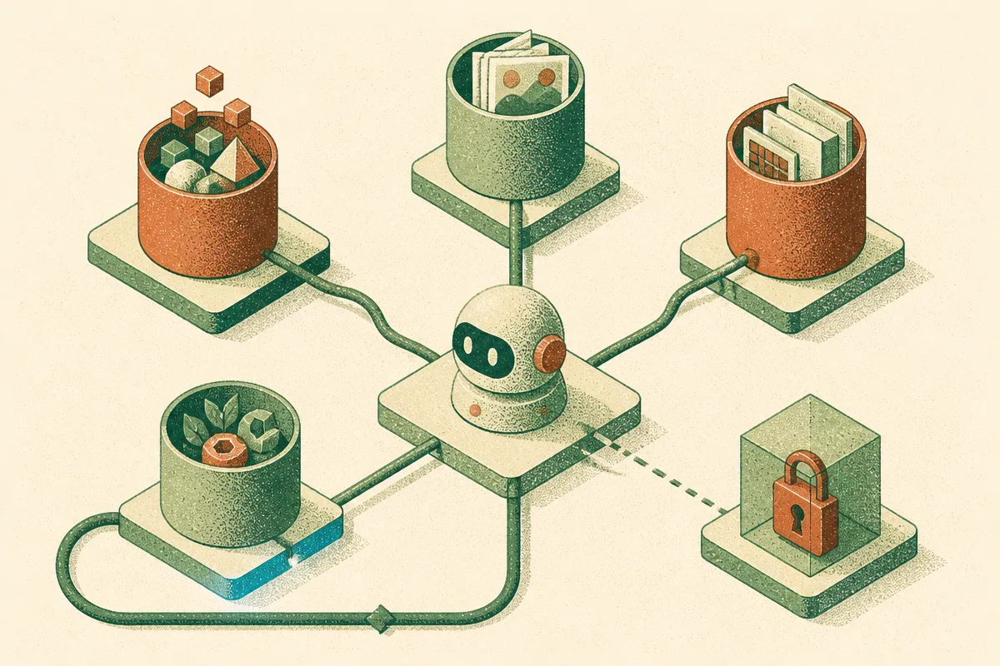

TL;DR: Treat agent memory as several small, inspectable systems, not one magic place where everything gets saved.

## What counts as memory in an agent?

The primary item here is **“The Components of Agent Memory,”** surfaced via Hacker News (AI). The title gets at the right problem. “Memory” is too often used as one bucket word. In real products, it is several different things that only look similar from the outside.

There is short-term conversation state. That is the active thread, usually stuffed into context until it gets too large or too stale.

There is user memory. Preferences, constraints, names, recurring facts, working style. This is the stuff a good assistant should remember without being creepy or overconfident.

There is task memory. What happened in this project last week, which files changed, which tickets were blocked, what decision was made and why.

There is procedural memory. Not facts about the user, but learned ways of doing work. “When preparing this report, always check these three systems first.” That is closer to an operating manual than a diary.

And then there is external knowledge. Docs, CRM records, codebases, emails, support tickets, databases. This is often called memory, but I think that muddies the water. Retrieval is not memory by default. It becomes memory when the agent can select, update, and use it as part of an ongoing relationship with the task.

## Why does agent memory go wrong?

The common failure is saving too much. Builders see a forgetful agent and respond by storing everything. That feels safe. It usually makes the system worse.

Bad memory creates three problems.

First, retrieval noise. The agent pulls old facts into new situations where they do not belong. A preference from one project becomes a rule for all projects. A stale draft becomes “context.” A one-off exception becomes policy.

Second, trust decay. Users will forgive a model for asking a clarifying question. They are less forgiving when it confidently “remembers” something wrong. Memory errors feel personal because the system is claiming continuity.

Third, governance gets harder. If the agent remembers across sessions, teams need answers to basic questions. What was stored? Who can see it? Can the user edit it? Can it expire? Can the model cite why it thinks something is true?

This is where the hype around agents runs into normal product work. Memory is not only a model capability. It is a permissions model, an interface design problem, a data retention policy, and an evaluation problem.

Longer context does not remove this. A million-token window can hold more stuff, but it does not decide what deserves to persist. Context is workspace. Memory is commitment.

## What should builders ship first?

I would start with narrow, user-visible memory.

Let the agent remember a small number of facts that clearly improve the next interaction. Show them. Let the user delete or edit them. Separate “I observed this” from “I inferred this.” That one distinction prevents a lot of weirdness.

For team workflows, I would avoid global memory at first. Use project-scoped memory. A coding agent should remember repo conventions inside that repo. A sales assistant should remember account context inside that account. A research agent should remember decisions inside that research thread. Scope is safety.

Then evaluate memory like a product feature, not a vibe. Test whether saved memory improves task completion. Test whether stale memory hurts it. Test whether the agent refuses to use irrelevant memory. Test whether it asks before storing sensitive facts. The hardest eval is not “can it remember?” It is “can it remember only what helps?”

A builder should try one practical pattern this week: add a separate memory review surface before adding more storage. Let users see the agent’s saved facts, approve new ones, and mark some as temporary. The catch most readers miss is that better agent memory is not mainly about making the model more human. It is about making persistence boring, scoped, and correct enough that users can rely on it.
