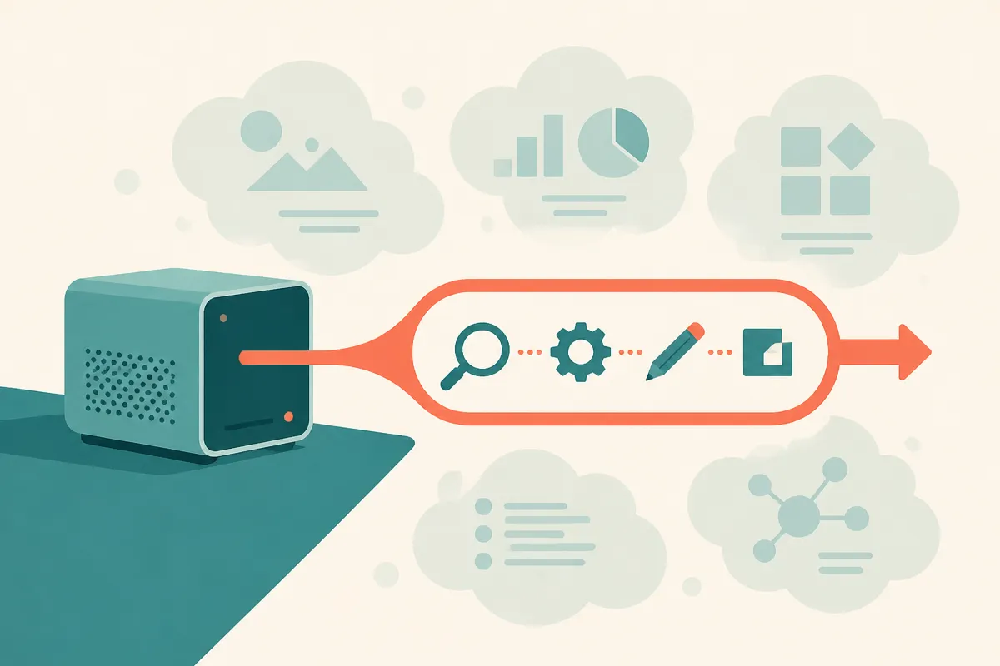

TL;DR: A 16GB VRAM local AI setup can be useful, but not if the goal is “three autonomous agents”; start with one narrow workflow, one model, and a measurable job.

## Can 16GB VRAM run useful local AI agents?

The primary source here is the r/LocalLLaMA thread, “Anyone running local AI on 16GB vram?”, posted by /u/Stitch10925. The setup is familiar: a GeForce RTX 5070 Ti X3 with 16GB VRAM, 32GB DDR5 RAM, Ollama as the current runner, and prior attempts with Goose, Hermes Agent, and OpenCode.

The ask is also familiar. The user wants a helper agent for daily tasks, a research agent, and a developer agent. They tried a few harnesses, did not get much useful output, and are unsure whether the issue is skill, tooling, harness choice, model tuning, or all of the above.

My read: it is probably all of the above, but not in an insulting way. That is the normal local-agent stack right now.

16GB VRAM is not nothing. It can run useful local models, especially quantized instruct and coding models. But “useful local model” and “useful local agent” are different claims. The model answers. The agent has to plan, call tools, inspect results, recover from errors, preserve state, and know when to stop. Local hardware makes the model constraint visible, but the agent constraint is usually the bigger one.

The trap is treating “agent” as the product. It is not. The product is the completed task.

## Why do local agents feel worse than chat?

Local chat has a forgiving interface. You ask, it answers, you judge. If the answer is off, you redirect.

Agents do not get that luxury. A research agent has to decide what to search, what to keep, what to ignore, and how to cite. A developer agent has to read the repo, edit files, run commands, interpret failures, and avoid making the codebase worse. A daily helper has to touch calendars, files, email, notes, or the browser, which means permissions and messy personal context.

That is a lot to ask from a local setup before you have even chosen the right model.

The r/LocalLLaMA post also mentions vLLM breaking when given the wrong model, which points to another practical issue: local AI still has too many sharp edges. Ollama is popular because it removes some friction. vLLM can be powerful, but the operational burden matters. If the runner fails, the agent never gets to be judged on intelligence.

This is why I would not start by comparing harnesses. Goose, Hermes Agent, OpenCode, and similar tools may all be capable in the right lane. But if the job is vague, the harness cannot save it. “Help me research topics” is not a task. “Read these five pages, extract claims, flag contradictions, and produce a source-linked brief” is a task. “Help with development” is not a task. “Open this repo, run the test suite, fix one failing test, and show the diff” is a task.

## What should a builder try first?

I would build one local workflow before trying to run a local staff.

Pick the developer agent first, because it is the easiest to grade. Give it a repo. Give it a small issue. Keep the tool permissions narrow. Require it to show the changed files and the command output. If it cannot run tests or inspect errors reliably, do not move on to broader autonomy.

For research, do not begin with open-ended web wandering. Start with a folder of saved PDFs, markdown files, or clipped pages. Ask for extraction, comparison, and citation back to the provided material. That shifts the task from “know the internet” to “work through this context.” Local models are more useful when the boundaries are clear.

For a daily helper, avoid anything that can create damage on day one. Summarizing notes, drafting reminders, renaming files in a sandbox, and preparing checklists are better first tests than touching email or calendars.

The hardware question still matters. On 16GB VRAM, you will feel context limits, quantization tradeoffs, and latency. But the larger mistake is spending all weekend swapping models when the actual workflow has no pass/fail test. A smaller model on a crisp task will look smarter than a bigger model asked to improvise a job description.

Practitioner’s take: if I were setting this up today, I would choose one runner, one local model, and one task with an obvious success condition. For example: “given this repo and this failing test, propose a patch, run the test, and stop.” Log every failure. If the failures are tool access, fix the harness. If they are bad edits, try a coding model. If they are bad instructions, tighten the prompt. The catch most people miss is that local AI agents are not blocked only by VRAM. They are blocked by fuzzy jobs.
