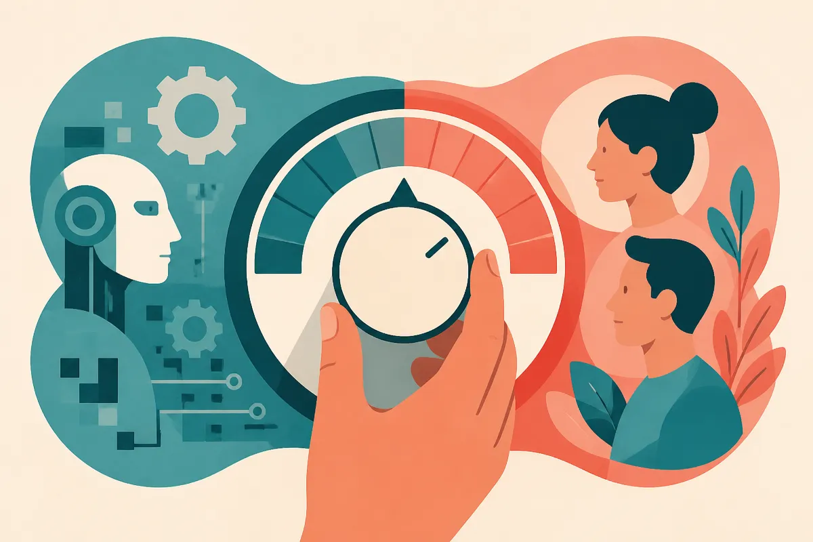

TL;DR: The "Goodbye Claude, hello Pi" post making the rounds on Hacker News is less about which model wins and more about a working style split: do you want a model that executes orders, or one you argue with before any code gets written.

My primary source here is a single Hacker News submission titled "Goodbye Claude, hello Pi." I want to be upfront about that, because the post is thin on verifiable specifics and heavy on vibes, and that is exactly why it is worth writing about carefully rather than breathlessly. The headline implies a clean defection story. The more useful read is about how practitioners are starting to sort coding tools by interaction model, not by benchmark score.

## What is the "Goodbye Claude, hello Pi" post actually claiming?

Stripped down, the submission is a personal switching story: a developer moved their daily coding work off Claude and onto something called Pi, and liked the change enough to write it up. That is the whole verifiable core. The Hacker News framing does not give me a published benchmark, a reproducible eval, or a vendor announcement with pricing and limits. So I am not going to tell you Pi is faster, cheaper, or smarter than Claude, because the source does not establish any of that as fact.

What I can say is what these posts almost always encode: a mismatch between how a tool wants to be used and how the person wants to work. When someone writes a "goodbye" post about a model they used every day, the model did not usually get worse. The fit got worse, or a different fit got discovered.

That is the frame I think is missing from most model-switching discourse. We argue about capability as if it is the only axis. In practice, the axis people quietly optimize for is: how does this thing behave while I am in the loop with it.

## Why does interaction style matter more than the model name?

There are, roughly, two postures a coding model can take.

The first is the vending machine. You put in a precise request, you get out code. It assumes your spec is right. It does not push back much. It is fast and frictionless when you already know exactly what you want, and it is dangerous when you don't, because it will confidently build the wrong thing well.

The second is the pair. It asks clarifying questions. It challenges a premise before writing a function. It is slower at the top of a task and often faster across the whole task, because it catches the misunderstanding before it becomes three files of rework.

Most of the "I switched models" stories I read, including this one, are really someone discovering they preferred one posture over the other, then attributing the whole experience to the brand on the box. The HN post presents Pi as the better collaborator for its author. Maybe it is. But the lesson that transfers is not "use Pi." It is: figure out which posture you actually want for the work in front of you, because the same model can feel like a genius or an idiot depending on whether that posture matches the task.

A lot of this is also configuration, not identity. Claude's behavior changes enormously with system prompts, tool setups, and whether you are running it through a bare chat box or an agent harness. A "goodbye" to Claude is sometimes a goodbye to one specific way of invoking Claude. The source does not tell me how the author had it set up, which is precisely the detail that would make the comparison mean something.

## How should a builder read these switching posts without getting played?

Treat them as hypotheses, not findings. A single developer's workflow preference is real signal about that developer and weak signal about your stack.

The questions I ask before I take a switching post seriously:

- What task were they doing. Greenfield prototyping, large-codebase refactors, and debugging legacy systems reward completely different behaviors.
- How was the losing tool configured. Default chat, or a tuned agent setup. If it is default versus tuned, the comparison is noise.
- What got worse, specifically. "It felt better" is a preference. "It stopped asking before deleting tests" is a behavior you can check.
- Is there anything reproducible. The honest answer for this HN post is no, and that is fine as long as you hold it as anecdote.

None of that is a knock on the author. Personal accounts are how most of us first hear that a tool exists. But the gap between "this changed how I work" and "this is better" is where a lot of wasted tool-churn lives. I have watched teams burn a week migrating agents on the strength of one enthusiastic blog post, only to rediscover the same friction under a new name, because the friction was in their process, not their model.

## What is the real lesson under the headline?

The durable insight is that we are moving from choosing models to choosing relationships with models. The capability floor across serious coding tools is high enough now that raw ability is rarely the thing that makes you quit one. The thing that makes you quit is a hundred small moments of friction: it over-explains, or it under-asks, or it charges ahead when you wanted it to stop, or it stops to ask when you wanted it to charge ahead.

That is why "Goodbye Claude, hello Pi" resonated enough to climb Hacker News despite being light on evidence. People recognize the shape of the story. They have had their own version of it. The model name is interchangeable. The feeling of finally working with something instead of commanding it is the part that sticks.

Practitioner's take: before you switch anything, spend an afternoon deliberately changing the posture of the model you already have. Write a system prompt that forces it to ask clarifying questions and challenge your spec before writing code, and run a real task through it. Then write one that tells it to execute without questions and ship. You will likely find that most of what you envied in the switching post was a behavior you can turn on where you already are. The catch most readers miss: the "better model" in these stories is frequently the same tier of model with a different default personality, and defaults are the cheapest thing in your entire stack to change. Switch tools when you have a reproducible task where one genuinely wins. Switch prompts first.
