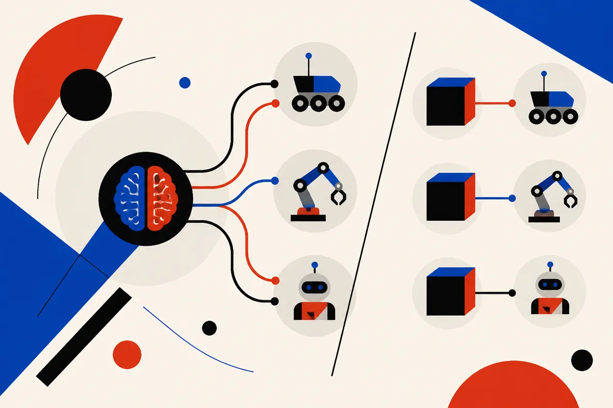
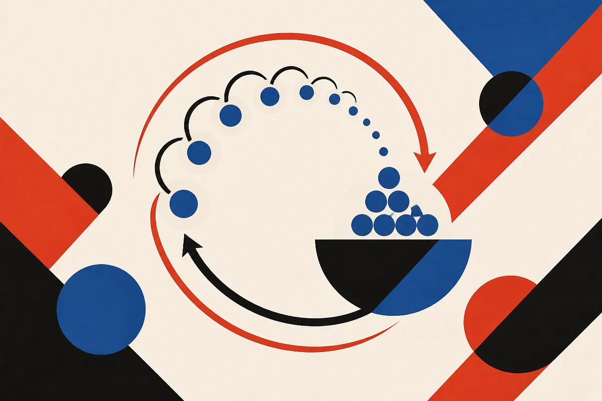

TL;DR: A paper called "On Agentic Manipulation Policies" reports that a general-purpose AI model, told to drive a robot arm directly and figure out its own strategies, beat purpose-trained robot policies by a wide margin with zero demonstrations, which flips the usual assumption that you need demos to get reliable manipulation.

For a few years the robot learning playbook has been: collect demonstrations, train a specialist policy, hope it generalizes. Vision-language-action models (VLAs) and world-action models (WAMs) are the current state of that art. The paper "On Agentic Manipulation Policies" (arXiv cs.AI and cs.LG) argues the whole frame is backwards. Instead of training a policy, let a generalist model run the show as an agent, planning and adjusting as the task unfolds. The authors call this an agentic manipulation policy, or AMP, and their reference system is AMP1.

The headline numbers are the kind you double-check. On the RoboLab-120 benchmark, AMP1 hits 85.6% success zero-shot. The leading VLA gets 49.2%, the leading WAM 42.9%. In the real world, 104 of 108 trials succeeded across twelve tasks and three different robots, which the authors frame as a 20x and 15x reduction in failure rate versus strong VLA and WAM baselines. Those are big claims, so let me unpack what is actually being measured and where the catch sits.

## What is an agentic manipulation policy, and how is it different?

A specialist policy is a trained function. You feed it camera frames and robot state, it outputs motor commands, and all of its competence lives in weights shaped by demonstrations. If the task drifts outside the training distribution, the policy has no fallback. It does not know it is failing.

An AMP inverts that. The generalist model sits on top and issues commands to the manipulator, watching results and revising. The paper describes a harness, AMP1, that "runs unchanged across single-arm, bimanual, and mobile manipulation." That phrase matters more than the success rate. One harness, three very different robot form factors, no retraining per platform. Specialist policies usually need re-collection and re-training when the embodiment changes.

The part I find most telling: the basic harness "supplies no grasping, pushing, or placing skills." The agent is not given primitives. It develops its own strategies, including searching for hidden objects, using objects as tools, and calibrating its own cameras. That is not a policy executing a learned skill. That is a model reasoning about a physical problem and improvising. Whether you call that intelligence or expensive trial-and-error, it is a different mechanism than a VLA, and it fails differently too.

## Why would a generalist beat a model trained for the job?

On the face of it this is strange. The specialist saw thousands of grasp demonstrations. The generalist saw none. How does the one with less task-specific data win?

My read: because manipulation failures are usually not motor-control failures, they are situation-handling failures. The object is occluded. The first grasp slipped. The scene is slightly off from training. A specialist policy has no machinery for noticing and recovering. A generalist agent has exactly that machinery, because recovery, retrying, and reframing a problem are what these models are trained to do in every other domain. The paper's own examples, searching for hidden objects and using objects as tools, are recovery behaviors, not precision behaviors.

That reframes the benchmark gap. The 85.6% versus 49.2% is not "the generalist has better hands." It is "the generalist knows what to do when the easy path fails." On a benchmark full of varied tasks, that compounds fast.

The honest counterweight: this is a single paper with its own reference harness tested on its own chosen benchmarks. RoboLab-120 and CaP-Gym are the authors' evaluation surface. We are told AMP1 is "state-of-the-art" on them, but we are not given the latency, the cost per task, the model being used, or how fragile the harness is to prompt and scene changes. Zero-shot on a benchmark is not the same as reliable on your bench. Treat the 20x and 15x failure-rate reductions as reported results from one group, not a settled industry fact.

## Does the memory result change the story?

This is the piece I would watch most closely. The base agent is zero-shot every episode, so it re-derives strategy each time and pays for the same mistakes repeatedly. The authors add a persistent memory store, a representation carried across episodes, and report the failure rate on RoboDojo bimanual tasks drops 4.6x relative to zero-shot deployment.

That is learning from experience without training. No gradient update, no new demonstrations, just accumulated episodic memory the agent reads before acting. If that holds up, it is a meaningful shift in how you deploy a robot: the system gets better on your specific tasks by doing them, not by sending data back for a retraining cycle. The same agent-memory pattern is reshaping software agents right now, and seeing it carry into physical manipulation is the connective tissue I would not skip past.

The catch is that memory is also where quiet failure lives. A bad early strategy can get stored and reinforced. The paper reports a 4.6x improvement; it does not, from what the sources give, report how memory handles conflicting experiences or degrades over long horizons. "Learns from experience" and "accumulates confident mistakes" are the same mechanism viewed from two angles.

## What should a builder actually take from this?

Most readers here are not wiring up robot arms. The transferable idea is the architecture, not the hardware. The pattern is: stop baking all competence into a trained artifact, and put a generalist reasoner in the control loop with the ability to observe, retry, and remember. That is exactly the choice you face when you build a software agent. Do you fine-tune a model to do the task, or do you give a capable general model the tools and let it reason through failure?

This paper is a data point for the second approach in a domain, robotics, where everyone assumed the first was mandatory. If a generalist beats trained VLAs at moving physical objects with no demos, the bar for "you must fine-tune for this" in your own stack just went up. Try the agentic version first and measure.

Practitioner's take: if you are building any agent, the actionable move is to separate competence into three layers and test each: the reasoning model in the loop, the recovery behavior when step one fails, and the memory that carries lessons forward. AMP1's whole advantage lives in layers two and three, not in raw skill. Most teams over-invest in the first layer, a better base model or a fine-tune, and ship with no real recovery and no memory, then wonder why the agent is brittle in production. Copy the structure, not the robot: give your agent explicit permission to retry and reframe, log what worked into a memory store, and read that store before the next run. The catch most people will miss is that an untended memory store becomes a liability, so build the review and pruning path before you build the writing path, because a confidently stored mistake is harder to debug than no memory at all. And remember this is one group's harness on one group's benchmarks until someone independent reproduces the 20x.
