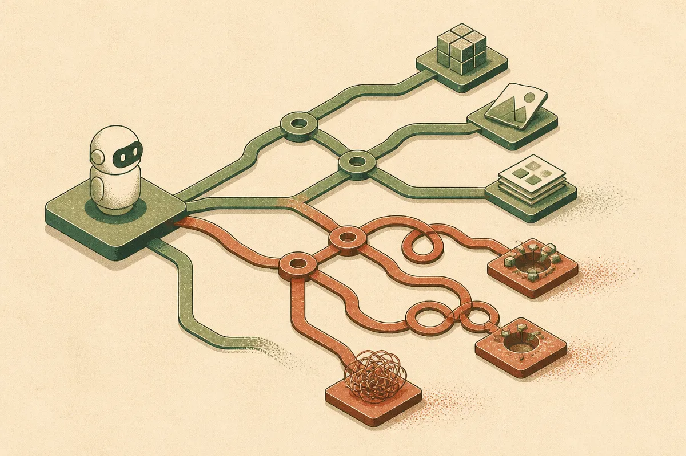

TL;DR: If Decrypt’s reporting on Claude Fable 5.2 and Mythos 5.0 is directionally right, the frontier-agent story is shifting from “can it do the task?” to “can you afford, inspect, and control the task?”

## What did Decrypt report about Claude Fable 5.2 and Mythos 5.0?

Decrypt’s piece, titled “Anthropic's Claude Fable 5.2 and Mythos 5.0 Are Impressive, But Be Prepared to Sell a Kidney to Afford Them,” says users are producing eye-catching results with Anthropic’s latest Claude models, including complex software builds and even physical object design.

That is the shiny part.

The more useful part is the cost anxiety. Decrypt frames the demos as impressive but expensive, with estimated bills large enough to make developers wince. I’m wording that carefully because the supplied material does not include Anthropic’s own pricing page, model card, API docs, or launch post. So I would not treat any specific cost, availability, usage limit, or product mechanic as confirmed from Anthropic here. The reliable claim is narrower: Decrypt reported strong user demos and serious cost concern.

That narrower claim is still important.

For the last two years, a lot of AI product work has been bottlenecked by capability. Could the model write the code? Could it keep enough context? Could it follow multi-step instructions without drifting? Could it inspect its own output? Those questions are not gone, but they are no longer the whole game. The new bottleneck is operational control.

If an agent can spend 40 minutes planning, coding, revising, calling tools, reading files, generating assets, and checking its work, it can also burn through budget in ways a normal chat session never would.

## Why do better agents make cost harder, not easier?

Better models are not automatically cheaper to use.

A stronger model may solve a task in fewer attempts. That helps. But it may also encourage bigger tasks. A quick prompt becomes a repo-wide refactor. A design request becomes a CAD-like exploration. A bug fix becomes an agent running tests, editing files, generating variants, and retrying until something passes.

That is where the bill can jump.

The cost problem is not just tokens. It is iteration. It is tool calls. It is long context. It is repeated evaluation. It is the human tendency to say, “one more run,” because the output looks close. When the model is weak, you stop early. When it is good, you keep pushing.

This is why impressive demos often hide the part operators care about most: how many attempts failed before the recorded win, how much context was carried, how many tool calls fired, and what the total run cost would look like at team scale.

I do not read this as anti-agent. I read it as pro-instrumentation. Agents need the same basic operating discipline as paid acquisition, cloud workloads, and contractor time. Set a budget. Track runs. Compare outputs. Kill runaway jobs. Store artifacts. Review failures. Keep the receipt.

## What should builders do before putting this in the workflow?

The practical move is to build a cost harness around the model before you build mythology around the demo.

Start with bounded jobs. Not “build the app.” Try “write the auth tests for this existing module,” “draft three implementation plans,” or “inspect this component for accessibility regressions.” Give the agent a fixed budget in time, tokens, tool calls, or attempts. Then log what happened.

The key metric is not whether the output looked magical once. It is cost per accepted artifact. A code patch that takes twelve agent loops and still needs a senior engineer to untangle may be worse than a simpler assistant flow. A design exploration that produces five viable options in ten minutes may be a bargain, even if the raw model call looks expensive.

Also separate exploration from production. Frontier models can be great for the messy front end of work: mapping a codebase, proposing architecture, generating variants, finding edge cases. Production changes need narrower permissions, tests, review, and audit trails. That is not bureaucracy. That is how you keep a powerful agent from becoming an expensive slot machine.

My practical take: try these models on one workflow where the value of a finished artifact is obvious, then cap the run and measure accepted output, not vibes. The catch most readers miss is that the demo is not the product. The product is the loop: prompt, tool access, budget, evaluation, human review, and a hard stop when the agent starts wandering.
