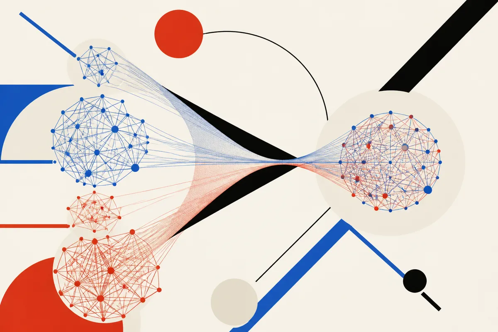

TL;DR: FiLSim’s useful claim is not that GNNs solve graph similarity exactly, but that a simpler learned approximation can stay usable on graphs over 150,000 nodes when classic baselines break.

## What problem is FiLSim trying to make practical?

Graph similarity sounds boring until you need it.

Compare two chemical compounds. Compare two program dependence graphs. Compare two social networks. Find the largest shared structure, or estimate how much editing it would take to turn one graph into another. That is Graph Edit Distance (GED) and Maximum Common Subgraph (MCS) territory.

The catch: both are NP-hard to compute exactly.

That is the starting point for the arXiv paper **“Scaling Graph Similarity Learning with Graph Neural Networks”**, listed under cs.AI and cs.LG. The paper introduces **FiLSim**, a scalable GNN-based framework for graph similarity learning.

The important part is the scaling claim. Prior GNN approaches have mostly lived on smaller graph datasets. Useful research, but not always useful systems work. FiLSim asks a more operator-shaped question: can a simplified GNN pipeline keep competitive accuracy while handling much larger graphs?

According to the paper, FiLSim was tested on four standard benchmark datasets and four newly created large-scale datasets. The reported headline: FiLSim remains accurate on graphs with more than **150,000 nodes**, while baseline methods run out of memory or fail to learn. It also scores all test pairs within seconds on a single GPU.

That is the kind of claim I pay attention to. Not because it ends the problem. Because it changes where the bottleneck might be.

## Why does the dataset construction matter?

The paper’s quieter contribution may be its labeling strategy.

Large-scale graph similarity needs labels. But exact GED labels get expensive fast, because exact GED itself is computationally hard. If your benchmark labels are weak, your “scalable” model might just be learning the quirks of a toy setup.

FiLSim uses a **sequential graph-editing strategy** to construct large-scale graph datasets with reliable GED labels. That matters because evaluation is often the soft underbelly of applied AI. A model can look great when the benchmark is too small, too clean, or too disconnected from deployment constraints.

The paper does not make the wild claim that learned graph similarity replaces exact solvers everywhere. Good. It frames FiLSim as a scalable approximation framework. That is the right mental model.

In practice, this sits in the same bucket as many useful AI systems: not perfect, not mathematically exact, but fast enough and accurate enough to sit inside a workflow. Candidate retrieval. Near-duplicate detection. Program analysis. Similarity search across graph-shaped records. Triage before an expensive exact method.

That last point matters. A learned graph similarity model does not have to be the final judge. It can be the filter that makes the final judge affordable.

## Where would this actually show up?

The obvious applications are the ones named in the paper: chemical compound analysis, program dependence comparison, and social network analysis.

The less obvious pattern is broader: many real systems become graphs once you stop pretending everything is a flat document. Codebases are call graphs and dependency graphs. Customer journeys are event graphs. Fraud systems are transaction graphs. Infrastructure maps are service graphs. Research corpora are citation graphs. Security incidents are relationship graphs.

For those use cases, the practical question is rarely “can I compute perfect similarity?” It is usually “can I compare enough candidates quickly enough to make the next step better?”

FiLSim’s reported single-GPU scoring time is useful if it holds outside the paper’s setup. But I would still test it hard before building around it. Graph distributions are nasty. A model trained on one edit process may behave differently on organic graphs from production systems. Node and edge semantics matter. So does whether your graph size, density, and label noise match the benchmark.

My read: FiLSim is a useful signal that graph ML is moving from neat benchmark graphs toward messier scale. The win is not a new universal graph brain. The win is a simpler pipeline that may survive when older approaches hit memory walls.

For a builder, I would try FiLSim-style graph similarity as a prefilter, not an oracle. Start with one concrete task: retrieve the top 50 similar code graphs, molecules, user networks, or transaction subgraphs, then compare those results against your current slower method or human review. The catch most readers miss: speed on large graphs is only useful if your labels reflect the edits and similarities your domain actually cares about.
