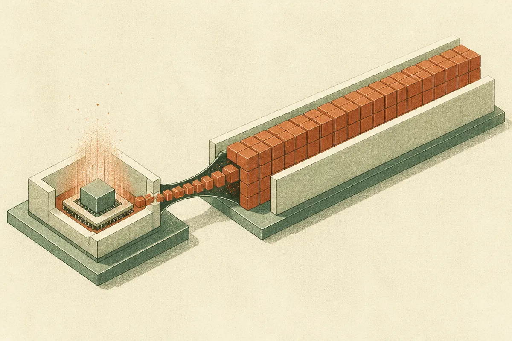

TL;DR: BitDecoding-FP4 shows you can run the KV cache in native 4-bit floating point and still stay within 0.5 points of BF16 accuracy while serving 2.4 to 3 times faster, which is the first time the cheap-but-sloppy and accurate-but-slow camps of FP4 KV quantization got reconciled in one system.

The paper is **BitDecoding-FP4: Native FP4 KV Cache Decoding via Algorithm-System Co-Design**, posted to arXiv (cs.AI and cs.CL), with code at github.com/OpenBitSys/BitDecoding-FP4. If you serve long-context models and you have been watching your GPU memory disappear into the KV cache, this is the one worth reading closely.

## Why does the KV cache matter so much for long-context serving?

When an LLM generates tokens, it caches the key and value vectors for every token it has already seen so it does not recompute them. That cache is the KV cache. The longer the context, the bigger it gets, and it grows linearly with sequence length. On long-context workloads it stops being a side cost and becomes the dominant one: it eats memory capacity and, just as badly, memory bandwidth. Every decode step has to read the whole thing.

So the KV cache is where the money leaks. Shrink it and you fit more concurrent requests on a GPU, push longer contexts, and read less data per token. That is why everyone has been chasing 4-bit formats for it.

The catch, as the authors lay it out, is that the field split into two unsatisfying camps. One camp uses microscaling FP4 formats like NVFP4 and MXFP4, which are native to the new Tensor Cores and run attention directly in FP4. Fast, but naive quantization of the cache causes "severe accuracy drops." The other camp chases accuracy with vector codebooks, which quantize well but add lookup overhead on every decode step that kills throughput. You got to pick: cheap and wrong, or accurate and slow.

## What is actually new in BitDecoding-FP4?

The contribution is a co-design: fix the accuracy problems at the algorithm level, then fix the throughput bottlenecks at the system level, so neither side undoes the other. The authors target three specific error sources, and the numbers they give are the interesting part.

Dual-Residual Query Quantization splits the query into two FP4 tensors. The headline claim here is cutting query logit error from 60 percent down to 1 percent. That 60 percent figure tells you how badly vanilla FP4 handles queries, which is why the cheap camp bled accuracy.

Underflow-Aware Probability Scaling addresses a subtle long-context failure: with E4M3 scales, the tiny probabilities you get across a long sequence can round to zero. In a 100k-token context, attention weights get spread thin, and if your scale format underflows them to zero you silently drop information. This is the kind of bug that only shows up at length, which is exactly where you deployed this to save memory.

Outlier-Aware Key Quantization combines static smoothing, Hadamard rotation, and a scale search to suppress key outliers under token-wise scaling. Key outliers have been the perennial enemy of KV quantization, and the toolkit here is familiar (Hadamard rotation shows up across the quantization literature) but applied specifically to the token-wise scaling case.

On the system side, they remove the softmax bottleneck with a transposed softmax that fuses probability quantization, plus stacked query MMA on paged KV caches. The point of all this plumbing is that the accuracy fixes do not reintroduce the throughput penalty that sank the codebook methods.

## How good are the results, really?

Here is what the authors report. Across dense and MoE models, with both GQA and MLA attention, BitDecoding-FP4 stays within 0.5 points of BF16 KV accuracy using NVFP4, and within 1 point using MXFP4. That accuracy-at-near-full-precision result is the whole pitch, and it holds across attention variants, which matters because MLA (DeepSeek-style) and GQA behave differently under quantization.

The throughput claim: on an NVIDIA B300 with Qwen3-4B and Qwen3-30B-A3B, they report 2.4 to 3.0 times higher peak serving throughput than BF16 KV. Note the word "peak" and the specific hardware. This is B300, a Blackwell-generation part with native FP4 Tensor Core support. On older silicon without native FP4, you should not assume these numbers transfer, and the paper does not claim they do.

The detail I find most telling is that they say it "tracks BF16 KV in RL training rollouts." KV quantization for inference is one thing. Using it during reinforcement learning rollouts, where small distribution shifts compound into bad gradients, is a harder bar. If that holds up, FP4 KV becomes usable in the training loop and not just at serving time, which is a bigger deal than the serving throughput number.

Caveats worth stating plainly. These are the authors' own benchmarks, not independent replication. "Within 0.5 points" depends entirely on which benchmarks, and the abstract does not name them, so you want to see the task breakdown before trusting it on your workload. And "peak throughput" is a best-case framing; real serving with mixed request lengths and batching will land somewhere below peak.

## What should a practitioner actually do with this?

If you run long-context inference on Blackwell-class hardware, this is a clone-the-repo-and-measure situation, not a read-and-forget one. The code is public under OpenBitSys, so the test is concrete: take your real traffic, your real context lengths, and your real eval suite, and compare BF16 KV against NVFP4 BitDecoding-FP4 on the exact tasks you care about. The 0.5-point claim is an average across their benchmarks; your task might be the one that breaks it, and the only way to know is to run your own evals. Pay special attention to the longest-context slice of your traffic, because the underflow problem they fixed is precisely where generic FP4 quietly degrades and where a casual spot-check at short lengths would miss it.

The catch most readers will miss: the win here is bandwidth and capacity, not necessarily latency at small batch sizes. If you are serving one request at a time with short contexts, a smaller KV cache buys you little, because you were not memory-bound to begin with. The 2.4 to 3x shows up when you are packing many concurrent long-context requests onto a GPU and the cache reads dominate. Match the technique to that regime, confirm your hardware actually has native FP4 Tensor Cores, and treat the accuracy numbers as a hypothesis to verify rather than a guarantee to deploy on.

That is the honest read: a clever reconciliation of two camps, strong self-reported numbers, public code, and a clear regime where it pays off. Good enough to test this week if long-context serving is your bottleneck.
