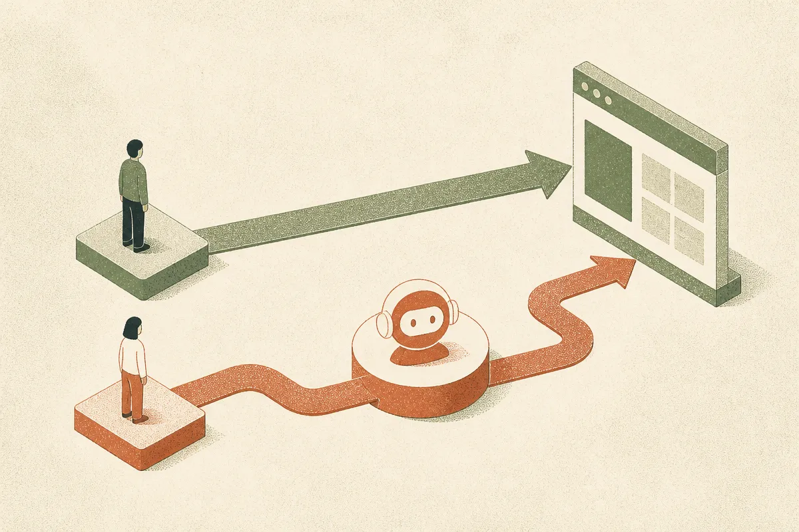

TL;DR: Google’s AI Mode makes paid search look more like assisted discovery than direct-response capture, so PPC teams need to test for incremental demand, not just cheaper last-click conversions.

## What changes when search moves up the funnel?

Greg Jarboe at Search Engine Journal framed the shift plainly in “Paid Search Is Moving Up The Funnel – Google Admits AI Mode Pays Less”: as Google’s AI Mode pushes users earlier into the buying journey, paid search budgets need protection, not autopilot.

That is the right lens.

Classic paid search was built around intent that had already hardened. A user typed “best payroll software for 50 employees” or “buy running shoes size 10,” and the ad system tried to intercept that demand near the point of action. AI Mode changes the shape of that moment. The user may ask a broader question, compare options inside an AI answer, refine the task, and only later click, search again, or convert.

That does not mean paid search stops working. It means the signal gets fuzzier.

If an AI answer satisfies early research, the ad click may arrive later, or not at all. If the user clicks while still exploring, that click may be less valuable than the old bottom-funnel click. Jarboe’s summary says Google admits AI Mode pays less. I would read that less as a confession of collapse and more as a warning about attribution. The same campaign may now be touching consideration, not just harvesting demand.

That breaks a lot of dashboards.

## What should PPC teams actually test?

The mistake is treating this as a brand debate. “AI search kills PPC” versus “nothing changes.” Both are too neat.

The operator question is narrower: are these AI Mode-adjacent clicks creating incremental customers, or just absorbing budget that used to convert closer to purchase?

Jarboe notes four account changes to test whether discovery pays. The specific lesson I’d pull from that framing is measurement before belief. Separate discovery-shaped traffic from conversion-shaped traffic where the platform lets you. Watch assisted conversions, branded follow-up searches, new-user share, lead quality, and time-to-close. A cheap lead that never closes is not cheap. An expensive click that creates a high-intent return visit may be undercounted.

Also, stop blending every query into one blended CPA target and pretending the average tells the story. It does not. AI-driven search experiences can mix research, comparison, and action in the same session. That makes campaign structure and negative controls more important, not less.

I run Lucky Domains, where search visibility and SEO work sit next to acquisition and website builds, and this is exactly where paid and organic teams need to stop living in separate spreadsheets: [SEO and search visibility](https://luckydomains.io/services.html#seo).

Organic results, AI citations, paid placements, review pages, landing pages, and brand searches are now parts of one discovery loop. If PPC is moving up-funnel, the landing page cannot be a hard-sell checkout page wearing a research-query costume. It needs to answer the comparison the user is actually making.

## The budget risk is quiet waste, not one big failure

The biggest risk is not that AI Mode suddenly destroys paid search performance in a clean, obvious way. The bigger risk is budget drift.

Discovery traffic often looks promising early. More impressions. New query shapes. Broader reach. Maybe lower direct conversion rates, but enough volume to keep the machine running. Then three months later, finance asks why spend rose and pipeline quality did not.

That is where teams need discipline. Hold out markets if you can. Compare cohorts. Track downstream revenue, not just form fills. Split landing pages by intent. Ask sales what changed in lead quality. Look for branded search lift after non-brand AI search exposure. None of this is glamorous. It is basic operating hygiene.

My take: AI Mode makes paid search more strategic and less mechanical. The old playbook was bid, match, convert, optimize. The new one is closer to participate, educate, qualify, retarget, prove incrementality.

A builder should treat AI-search PPC like a new channel segment, not a cosmetic update to Google Ads. Start with a small test budget, isolate broad research queries, send them to genuinely useful comparison pages, and measure whether those users come back with stronger intent. The catch most readers miss: if your site cannot teach, compare, and qualify better than the AI answer did, paying for earlier clicks just buys you earlier disappointment.
