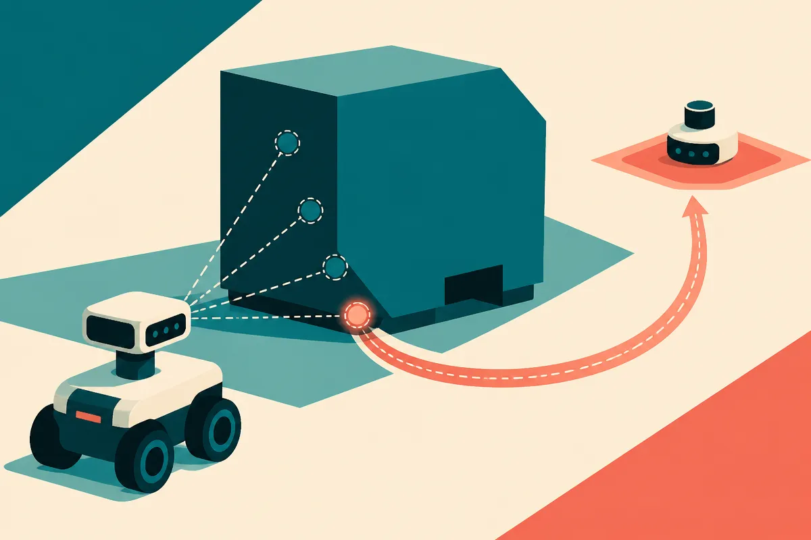

TL;DR: Grasp-TAGS is useful because it ranks possible grasps by downstream task success before contact, not by whether the grasp looks stable in isolation.

## What problem is Grasp-TAGS actually solving?

The primary source here is the arXiv paper titled “Grasp-TAGS: Task-Aware Grasp Selection via Critic Distillation for Prehensile Loco-Manipulation,” with supplementary qualitative results at https://rpm-lab-umn.github.io/Grasp-TAGS-web-page/.

The setup is loco-manipulation: a mobile manipulator has to move itself and a large object over a longer horizon. Think service robotics or warehouse automation, where the robot is not just picking up a mug. It is pushing, carrying, rotating, and repositioning something big enough that the initial contact choice changes the whole trajectory.

That matters because a “good grasp” is not always good for the job. A grasp can be geometrically stable and still set the robot up for a bad final orientation, a difficult path, or a failed rearrangement. The paper’s central claim is simple and practical: initial grasp selection should be task-aware.

Existing learning-based approaches often assume a fixed or predefined initial grasp. That is convenient for training. It is also a hidden constraint. If the downstream policy is strong but starts from the wrong contact point, the policy has to spend the rest of the task paying for that early decision.

Grasp-TAGS tries to move that judgment earlier.

## How does critic distillation help choose the grasp?

The method has two stages.

First, Grasp-TAGS trains a unified PPO-based reinforcement learning policy across multiple initial grasp configurations. The important bit is that the policy sees variation in how the object is initially grasped, instead of being trained around one default contact.

Second, it distills the learned critic into a lightweight grasp utility network. That smaller network ranks candidate grasps using only the candidate grasp configuration and goal information. At inference time, Grasp-TAGS picks the grasp with the highest predicted downstream utility before the robot makes contact.

That is a nice pattern. The expensive learning happens during training, where the critic learns which starting conditions tend to lead to successful task completion. Then the distilled utility model becomes a fast selector at runtime.

This is not “the robot reasons like a person.” It is narrower and more useful than that. The system learns a scoring function for an early decision that has downstream consequences. In applied robotics, that is often where the win is. Not magic autonomy. Better selection among options you already know how to generate.

## How big is the reported gain?

The paper reports an average success rate of 89.84% for Grasp-TAGS, compared with 79.87% for the best-performing single-grasp policies. That is a 9.97 percentage point improvement. It also reports lower final orientation errors across all evaluated objects.

That is meaningful because the comparison is not against a strawman random-only baseline. The paper says Grasp-TAGS beats both fixed single-grasp policies and random grasp selection. The best single-grasp policy already gets close to 80%, so the reported improvement is about squeezing more reliability out of the same downstream task by making the first contact decision smarter.

The caveat: the source material provided here does not give enough detail to judge generalization across hardware, object families, clutter, sensing noise, or real warehouse variability. So I would not read this as “large-object rearrangement is solved.” I would read it as evidence for a design principle: in long-horizon robotics, front-loaded action selection can be trained from downstream value, then distilled into a cheap runtime module.

That principle travels beyond this exact task. If an agent has to commit early, and that commitment shapes the rest of the episode, train on the full outcome. Then compress the judgment into a selector that runs before the commitment.

A practitioner building robot workflows should try this as a ranking layer, not as a replacement for the control policy. Generate several feasible grasps, score them against the actual goal, execute the top candidate, and track whether the downstream success rate improves. The catch most readers miss: the candidate set still matters. A great utility scorer cannot pick a grasp that your perception and planning stack never proposes.
