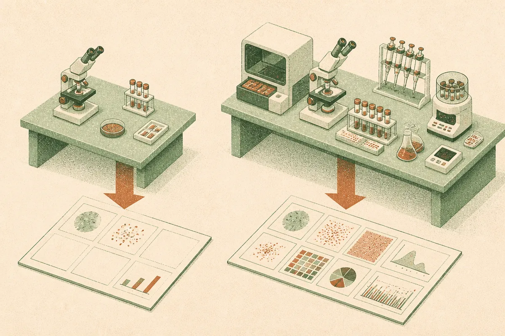

TL;DR: Radiology agents will not close the reporting gap by orchestration alone, because many clinically actionable findings still have no available tool for the right modality.

## What did the radiology agent actually test?

The primary source here is the arXiv paper titled “Can Agentic Systems Close the Gap in Radiology with Production AI Tools?” The paper asks a practical question: if you built an agent around today’s FDA-cleared radiology AI devices, how much of a structured radiology report could it actually recover?

That framing matters. A lot of medical AI discussion gets stuck between two imperfect paths. Narrow models can be good at one task, like detecting a specific finding on a specific scan type. Generalist models can cover more ground, but hallucination and measurement errors are not cute failure modes in medicine.

The paper tests a third path: an orchestrator that calls modular tools. Not one giant model doing everything. More like a dispatcher that decides which finding-specific tools to run, then assembles a structured report.

The key detail is that tool outputs were simulated from the reference report. That means this is not a live benchmark of commercial device accuracy. It intentionally removes tool error so the test can isolate two other bottlenecks: whether the right tool exists, and whether the orchestrator calls it.

That is a clean design choice. It also limits the claim. This does not prove an agent can produce safe clinical reports in production. It shows where the ceiling is when current tool coverage and planning are the constraints.

## Is the bigger problem missing tools or bad orchestration?

Both. But not equally.

With the cleared catalog and only the clinical indication as input, the orchestrator recovered under a third of clinically actionable findings. That is the headline number I would pay attention to. Not because it is a final product score, but because it shows how far “agent plus approved tools” is from comprehensive reporting when constrained to what exists today.

Recovery improved when the orchestrator had an unlimited catalog, where any finding class could be requested. It improved again when planning used the target report rather than just the clinical indication. That second condition is obviously easier than real life, since the target report is the answer key. But it is useful as an upper-bound test.

The miss analysis is the best part. Most missed findings came from classes where no cleared device offered that finding for the study’s modality. In plain English: the agent could not call a tool that did not exist for that scan type.

But orchestration was not off the hook. About a third of misses were cases where the class or tool was available and the orchestrator still did not call it. That is the agent problem. Planning, tool selection, and coverage discipline still matter.

One more result cuts against a lazy “just add tools” answer. Adding the most frequently missing tools closed most of the gap to the unlimited catalog on held-out reports. But when the paper swapped in a smaller orchestrator with the unlimited catalog, it gave up the whole gain. More tools do not help much if the planner cannot select them.

## What should AI builders take from this?

The useful pattern is not “agents are ready for radiology.” The useful pattern is how to evaluate agentic systems that depend on tools.

The paper separates tool availability from orchestration quality. That is exactly what many enterprise agent evaluations fail to do. If an agent misses the answer, teams often argue vaguely about “model quality.” This paper forces the miss into buckets: no tool exists, tool exists but was not called, tool was called but would need to perform correctly in a real deployment.

That structure travels well outside medicine. Customer support agents, compliance agents, data analysis agents, coding agents, and SEO workflow agents all face the same split. Sometimes the model plans badly. Sometimes the tool catalog is missing a required action. Sometimes the interface between the two is too loose.

I also like the paper’s implied product roadmap logic. Do not add every possible tool. Add the most frequently missing, highest-value tools first, then test on held-out tasks. If the curve moves, you found a real coverage gap. If it does not, your orchestrator may be the bottleneck.

For builders, the move is to instrument misses before expanding the stack. Build a simple taxonomy: unavailable tool, available but not selected, selected but failed, output not integrated. Then run the agent against real traces, not toy demos. The catch most readers miss is that agent performance is a joint product of catalog design and planner quality. A better model can waste a thin catalog. A rich catalog can be wasted by a weak planner.
